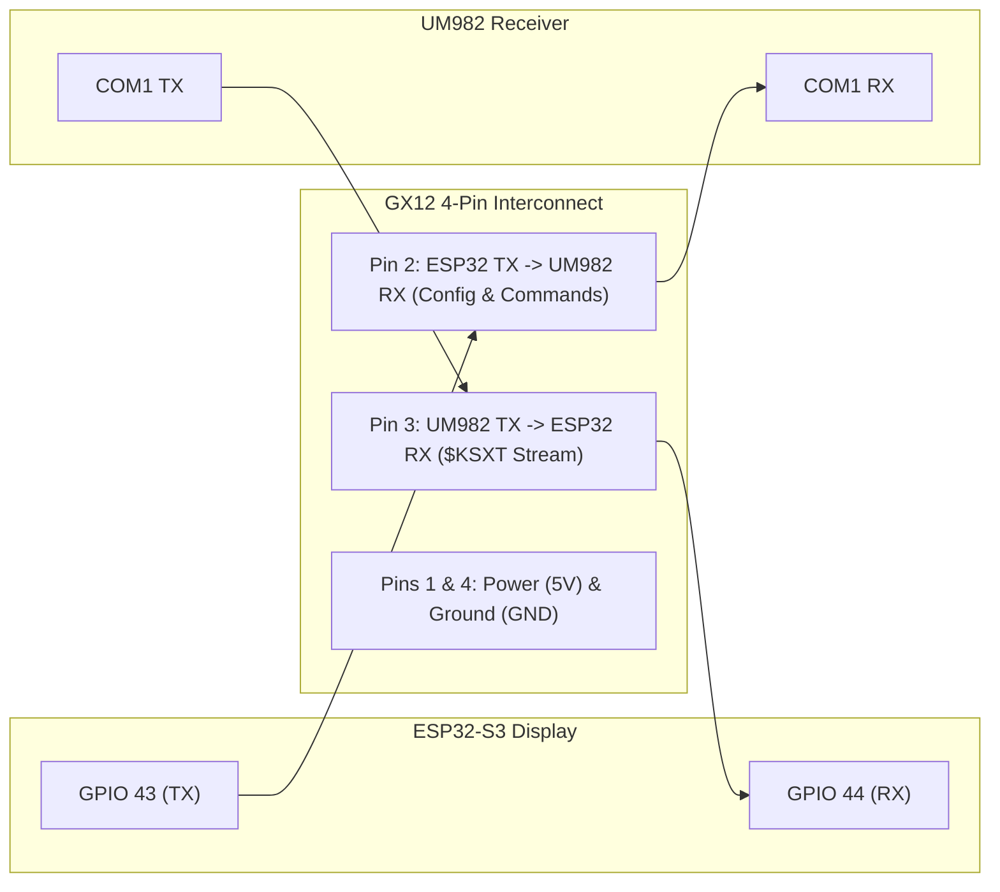

# GNSS Receiver Configuration & Antenna Setup

This document describes how to configure the Unicore UM982 dual-antenna RTK receiver and properly mount the antennas for the GNSS Compass.

---

## 1. Receiver Overview & Output Messages

The compass firmware parses messages from the UM982 receiver on its `COM1` port:
* **`$KSXT`** *(Standard)*: All-in-one message streaming heading, RTK differential quality, precise decimal latitude/longitude, and UTC time at 5 Hz (every 0.2 s). With `$KSXT`, no other message logs are needed.
* **`$GNGLL` & `$GNHDT` / `$GNTHS`** *(Legacy)*: Fully supported for backward compatibility with older receiver setups or generic NMEA receivers, but redundant when `$KSXT` is active.

All other messages should be disabled so the ESP32 serial buffer is not flooded.

### Heading Display Color States
The displayed antenna bearing (Row 3, left) dynamically color codes reception quality:
* ⚪ **Pure White (`0xFFFF`)**: **RTK Fixed (High Precision)** — Full differential carrier-phase ambiguity resolved (~0.1° accuracy). Also used during initial satellite acquisition (`---.-`) and for legacy `$GNHDT` valid tracking.
* 🟡 **Bright Yellow (`0xFFE0`)**: **RTK Float (Reduced Quality)** — Satellites acquired, but degraded sky view, obstructions, or floating baseline ambiguities. Heading may be noisy or slightly off.
* 🔴 **Bright Red (`0xF800`)**: **Lost / Stale** — Differential signal lost, empty heading sentence, or no update received for > 1.5 seconds. Protects the operator against frozen stale readings.

---

## 2. Receiver Wiring & Automated Configuration (Standard Build)

All builds should connect the 4-conductor cable terminated in GX12 4-pin aviation connectors as specified in the **[Bill of Materials (BOM)](BOM.md#3-gx12-interconnect-pinout-display--receiver)**. 

Connecting the **ESP32 TX line (GPIO 43) to the UM982 COM1 RX line (Pin 2)** enables complete, automated in-system receiver configuration. You do **not** need to install Unicore PC drivers, plug the receiver into USB-C, or ever take down the mast / open the enclosure to configure or update the module.



### 2.1 Automatic Detection
On boot or as soon as the receiver data stream is detected, the ESP32 automatically probes the TX line on GPIO 43:
* If the receiver acknowledges, the link status is set to **`AVAILABLE`**.
* The ESP32 is immediately ready to configure the receiver or query running parameters.

### 2.2 Automated In-System Setup (`gps config`)
Once the hardware is connected, you can configure the receiver in a single command from the compass serial interface — either plugged into a computer via the ESP32 USB-C port (`tio /dev/ttyACM0` or PuTTY) or wirelessly from your phone/tablet over Bluetooth Low Energy (BLE UART, e.g. using *Serial Bluetooth Terminal*):

```text
> gps config
```

The ESP32 executes and verifies the complete receiver configuration sequence:
1. `MODE ROVER UAV`: Configures moving-baseline / dual-antenna heading mode.
2. `CONFIG SIGNALGROUP 3 6`: Enables multi-frequency tracking across GPS, BDS, GLONASS, and Galileo.
3. `UNLOG COM1`: Wipes all factory default and legacy NMEA sentences in a single command.
4. `KSXT com1 0.2`: Activates the unified 5 Hz `$KSXT` stream on `COM1`.
5. `CONFIG HEADING FIXLENGTH`: Constrains heading calculation to a rigid fixed-length baseline (standard for boom-mounted antennas; does not require setting an explicit length).
6. `SAVECONFIG`: Commits configuration parameters to the receiver's non-volatile NOR Flash.
7. **Stream Verification:** Verifies that active `$KSXT` packets are streaming into the display at 5 Hz.

```text
> gps config
[GPS CONFIG] Initiating configuration pipeline (Standard 5 Hz $KSXT)...
[GPS CONFIG] Starting receiver configuration...
[GPS CONFIG] Settings saved. Verifying KSXT 5 Hz stream...
[GPS CONFIG] Complete! Receiver configured at 5 Hz KSXT.
```

> [!NOTE]
> **Built-In NOR Flash Protection:** To protect the receiver's NOR Flash from unnecessary write cycles or corrupted parameters, the ESP32 configuration pipeline validates each command response before committing changes. If any step fails or times out, the sequence safely aborts without sending `SAVECONFIG`.

### 2.3 Inspecting Running Parameters (`gps check` / `gps status`)
To verify what is running on the receiver at any time without writing to flash:

```text
> gps check
```
*(or `gps audit`)*

This queries `#VERSION`, operating `MODE`, active message logs via `UNILOGLIST COM1`, and baseline status via `HEADINGSTATUSA`, reporting model number, firmware build, and stream health. See [SERIAL.md](SERIAL.md#33-gnss-transmitter-discovery--configuration-commands-gps) for sample outputs.

---

## 3. Optional: Constraining the Physical Baseline Length

Because the GNSS Compass is designed with two antennas rigidly mounted on a fixed pole, **`CONFIG HEADING FIXLENGTH` is standard and applied automatically during setup**. 

With `CONFIG HEADING FIXLENGTH` enabled, the receiver knows the baseline distance is rigid and will dynamically compute and maintain the fixed baseline without drift. 

Optionally, you can also set the **physical baseline length and tolerance** (`CONFIG HEADING LENGTH <length_cm> <tolerance_cm>`) in the receiver to tighten the RTK search space even further:

### Benefits of Constraining Baseline Length
* **Substantially Faster RTK Lock:** Reduces initial carrier-phase ambiguity resolution time (Yellow $\to$ White) from ~30+ seconds down to **2–5 seconds** by restricting the mathematical search space from a large 3D volume to a thin spherical shell.
* **Immunity to False Integer Fixes:** Prevents false integer ambiguity solutions (momentary 90° or 180° heading errors) that can occur during hot antenna reconnects, severe multipath reflections from metal dishes/towers, or degraded satellite geometry.

### Baseline Parameters
* **`length_cm`**: Physical center-to-center distance between the two antenna phase centers in centimeters (e.g., `101.6` for a 40-inch / 1-meter boom with end mounts, or your measured distance between the SMA bulkhead connectors).
* **`tolerance_cm`**: Allowable tolerance margin in centimeters (typically `2.5` to `3.0`). Accommodates antenna phase-center variations, thermal expansion, and boom flex while remaining tight enough to reject false integer cycle slips (which differ by 10–20+ cm). A standard tape-measure measurement is plenty accurate.

---

### Method 1: Via the ESP32 Serial Interface (Preferred)

To apply the baseline length constraint in-system, run `gps config baseline` via the ESP32 serial interface (over USB-C or Bluetooth BLE):

```text
> gps config baseline <length_cm> [tolerance_cm]
```

*(Example for the standard 1-meter boom measuring 40 inches / 101.6 cm center-to-center with 2.5 cm tolerance):*
```text
> gps config baseline 101.6 2.5
```

```text
> gps config baseline 101.6 2.5
[GPS CONFIG] Initiating configuration pipeline (Baseline: 101.6 cm, Tol: 2.5 cm)...
[GPS CONFIG] Starting receiver configuration...
[GPS CONFIG] Settings saved. Verifying KSXT 5 Hz stream...
[GPS CONFIG] Complete! Receiver configured at 5 Hz KSXT.
```

The ESP32 sends `CONFIG HEADING FIXLENGTH` followed by `CONFIG HEADING LENGTH 101.6 2.5`, saves to flash, and verifies the stream.

---

### Method 2: Via Direct UM982 Configuration Tools (UPrecise or Terminal)

If you configure the receiver using direct UM982 tools (such as Unicore UPrecise or a serial terminal connected to the UM982 USB-C port), send:

```text
CONFIG HEADING LENGTH 101.6 2.5
SAVECONFIG
```
*(Replace `101.6` and `2.5` with your measured distance and tolerance in centimeters. Note that `CONFIG HEADING FIXLENGTH` is already set).*

---

## 4. Fallback: Manual Setup for Unwired / Legacy 3-Wire Builds

> [!NOTE]
> All new builds should wire the TX line (Pin 2 on the GX12 connector) as described in Section 2. This section is provided only for older legacy builds with 3-wire cabling, or in the event the TX wire was omitted.

If your build only has 3 wires connected (Power, Ground, and UM982 TX $\to$ ESP32 RX), the ESP32 operates in **Receive-Only Mode** (`[GPS] TX wire not detected`). Because the ESP32 cannot send commands to the receiver, you **must configure the UM982 manually via its onboard USB-C port** before mounting it on the mast:

| Item | Standard Build (4-Wire) | Legacy / Omitted TX Wire (3-Wire) |
| :--- | :--- | :--- |
| **Wiring** | 4 wires (Power, GND, RX, TX) | 3 wires (Power, GND, RX only) |
| **Receiver Setup** | **Automated in-system via ESP32** | Manual entry over USB-C data cable |
| **Tools Needed** | None (ESP32 USB or phone BLE) | Computer with UPrecise or terminal |
| **Baseline Setup** | `gps config baseline ...` via ESP32 | Manual commands in UPrecise / terminal |
| **Enclosure Disassembly** | Never needed | Required whenever changing settings |

### 4.1 Manual USB-C Connection Steps
1. Connect the UM982 module to your computer using a USB Type-C data cable.
2. Connect to the receiver using either **Unicore UPrecise** (GUI, recommended) or a **Serial Terminal Emulator**:

#### Tool A: Unicore UPrecise Software (Recommended GUI)
* Download and install **UPrecise** (Unicore's graphical evaluation software, available from Unicorecomm or ArduSimple).
* Connect to the UM982 USB serial port at `115200` baud.
* Open the **Receiver Command** console window at the bottom to send configuration commands.
* *Advantage:* UPrecise provides visual confirmation of commands (`<OK`), live satellite SNR bars, constellation skyplots, computed baseline distance, and real-time RTK status without terminal echo issues.

#### Tool B: Serial Terminal Emulator (`picocom`, PuTTY, Tera Term, `minicom`)
* Configure port settings:
  * **Baud rate:** `115200`
  * **Data bits:** `8`, **Parity:** `None`, **Stop bits:** `1` (`8N1`)
  * **Flow control:** None
* **Important — Enable Local Echo & CR+LF:** The UM982 firmware does **not** echo typed characters back to the terminal. To see what you are typing and ensure commands execute:
  * **Local Echo:** Set to **ON** (e.g., `picocom --echo -b 115200 /dev/ttyUSB0`, in PuTTY: *Terminal $\to$ Local echo: Force on*, in Tera Term: *Setup $\to$ Terminal $\to$ Local echo: ON*). Otherwise, your keystrokes are invisible.
  * **Line Endings:** Ensure the terminal transmits carriage return + line feed (**CR+LF** / `\r\n`) when pressing Enter.

---

### 4.2 Manual Configuration Commands
Once connected, send the following commands one by one to configure the operational mode, constellations, 5 Hz stream, and commit settings to flash:

```text
MODE ROVER UAV
CONFIG SIGNALGROUP 3 6
CONFIG HEADING FIXLENGTH
KSXT com1 0.2
SAVECONFIG
```

#### Explanation of Commands
* `MODE ROVER UAV`: Configures the receiver in moving-baseline / dual-antenna heading mode.
* `CONFIG SIGNALGROUP 3 6`: Selects multi-frequency constellations (GPS, BDS, GLONASS, Galileo).
* `CONFIG HEADING FIXLENGTH`: Informs the receiver that the two antennas are rigidly mounted on a fixed boom.
* `KSXT com1 0.2`: Outputs the unified `$KSXT` sentence on `COM1` every 0.2 seconds (5 Hz), providing dual-antenna heading, RTK quality, decimal coordinates, and UTC time in a single stream.
* `SAVECONFIG`: Saves the current configuration to receiver flash so it persists across power cycles.

*(Note: `GPGLL` is no longer needed because `$KSXT` provides position and time 5 times per second).*

### 4.3 Optional: Physical Baseline Length Constraint
If you wish to configure your antenna spacing and tolerance in the receiver:
```text
CONFIG HEADING LENGTH 101.6 2.5
SAVECONFIG
```

### 4.4 Modifying / Upgrading an Existing Receiver
If your UM982 was previously configured with legacy commands (`GPHDT com1 0.2` and/or `GPGLL com1 10`), connect via USB-C and run these commands to unlog (disable) the obsolete sentences, activate `$KSXT`, and save:

```text
UNLOG COM1 GPHDT
UNLOG COM1 GPGLL
KSXT com1 0.2
SAVECONFIG
```
* `UNLOG COM1 GPHDT`: Disables legacy `$GNHDT` heading output to prevent duplicate heading sentences.
* `UNLOG COM1 GPGLL`: Disables redundant 10-second `$GNGLL` position messages to eliminate unnecessary serial traffic.
* `KSXT com1 0.2`: Enables the unified 5 Hz stream for instantaneous time sync, position lock, and color-coded bearing status.
* `SAVECONFIG`: Commits the updated configuration to non-volatile flash memory.

---

## 5. Antenna Installation & Alignment

* **Mounting Hardware:** Complete parts, sourcing links, and fitment tips for the 1-meter carbon fiber boom, split tube clamps, crossover mast clamp, bulkhead adapters, and RF cables are detailed in **[BOM.md Section 2 (Mast, Mounting & Hardware)](BOM.md#2-mast-mounting--hardware)**.
* **Separation Baseline:** Mount the two tri-band antennas at least **3 feet (~1 meter)** apart (the 1m carbon fiber tube in the BOM provides this baseline). Longer baselines improve heading accuracy.
* **Orientation:** The baseline between the antennas must be mounted **perpendicular** to the microwave antenna heading direction.
* **180° Heading Correction:** On first power-up, if the displayed antenna heading is 180° backwards, simply swap the two antenna RF cables at the receiver (or physically swap antenna positions).

---

## 6. Next Steps: Firmware Setup & Installation

* **[Getting the Firmware](FIRMWARE.md):** Covers both downloading the pre-compiled release binary (recommended) and building from source code.
* **[Firmware Installation Guide](INSTALL.md):** Step-by-step flashing instructions using `esptool` for everyone once the firmware binary is ready.
* **[Serial Interface & CLI Guide](SERIAL.md):** Detailed command reference for receiver diagnostics (`gps status`, `gps check`, `gps probe`), antenna calibration (`cal`), and rover transit tracking.
