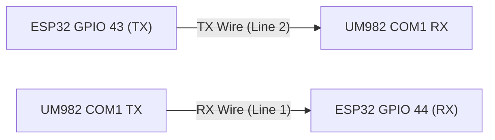

# ESP32 Serial Interface & CLI Guide

The GNSS Compass firmware features an interactive command-line interface (CLI) accessible concurrently over both the physical **USB-C serial port** and wireless **Bluetooth Low Energy (BLE UART)**. The CLI provides real-time GNSS receiver diagnostics, display self-test triggers, Rover Mode transit tracking, and antenna heading offset calibration stored in non-volatile storage (NVS).

---

## 1. Connection Options

### 1.1 Physical USB-C Connection

Connect the ESP32-S3 rotary display to your computer using a USB-C data cable.

| Parameter | Setting | Notes |
| :--- | :--- | :--- |
| **Port (Linux)** | `/dev/ttyACM0` (or `/dev/ttyACM1`) | Default USB CDC serial device |
| **Port (macOS)** | `/dev/cu.usbmodem*` | Native USB CDC port |
| **Port (Windows)** | `COMx` | Appears under Device Manager > Ports (COM & LPT) |
| **Baud Rate** | **115,200** | 8N1 (8 data bits, no parity, 1 stop bit) |
| **Flow Control** | None | Hardware and software flow control disabled |
| **Line Endings** | Any (`\r`, `\n`, or `\r\n`) | Firmware handles CR, LF, and CRLF transparently |

#### Terminal Emulator Recommendations (USB)
* **Linux / macOS:** `tio /dev/ttyACM0 -b 115200`, `picocom -b 115200 /dev/ttyACM0`, or `minicom -D /dev/ttyACM0 -b 115200`
* **Windows:** PuTTY, Tera Term, or Arduino Serial Monitor
* **Cross-Platform:** Visual Studio Code Serial Monitor extension

The CLI includes **local character echoing** and supports **backspace/DEL** editing directly in terminal emulators.

---

### 1.2 Wireless Bluetooth (BLE UART / Nordic NUS)

Because the Elecrow 2.1" display is often mounted on a mast, tripod, or vehicle dash with delicate rear cabling, the firmware provides a wireless Bluetooth interface using the industry-standard **Nordic UART Service (NUS)**.

> [!NOTE]
> The ESP32-S3 microcontroller utilizes **Bluetooth 5.0 Low Energy (BLE)**. BLE UART requires no pairing PIN, connects in under a second, and works natively across iOS, Android, and desktop browsers.

* **Advertised Device Name:** `GNSS-Compass-xxxxxx` (where `xxxxxx` is the last 6 lowercase hex digits of the Bluetooth MAC address, e.g. `GNSS-Compass-8a4f2b`).
* **Service UUID:** `6E400001-B5A3-F393-E0A9-E50E24DCCA9E`
* **RX Characteristic (Write to ESP32):** `6E400002-B5A3-F393-E0A9-E50E24DCCA9E`
* **TX Characteristic (Notify from ESP32):** `6E400003-B5A3-F393-E0A9-E50E24DCCA9E`

#### Android Mobile Connection
1. Install **[Serial Bluetooth Terminal](https://play.google.com/store/apps/details?id=de.kai_morich.serial_bluetooth_terminal)** by Kai Morich from Google Play.
2. Open sidebar -> **Devices** -> **Bluetooth LE** tab -> Scan -> Select `GNSS-Compass-xxxxxx`.
3. Tap Connect. The terminal connects immediately.
4. **Recommended Field Macro Buttons:** In the app, long-press the `M1`–`M6` macro buttons along the bottom to configure 1-tap commands:
   * **M1 (`status`):** `status\n` (Live GNSS receiver stream & lock diagnostics)
   * **M2 (`rover`):** `rover status\n` (16 km transit displacement & qualification)
   * **M3 (`cal snap`):** `cal snap\n` (1-touch antenna heading alignment snapshot)
   * **M4 (`history`):** `rover history\n` (Display visited contest grid roster)
   * **M5 (`undo`):** `rover undo\n` (Discard accidental stop and re-arm)
   * **M6 (`exit`):** `disconnect\n` (Cleanly release BLE radio link)

> [!TIP]
> In *Serial Bluetooth Terminal*, go to **Settings -> Bluetooth LE** and verify that **"Close GATT on disconnect"** is enabled, or simply type `disconnect` in the terminal before switching devices to release the Bluetooth link immediately.

#### iPhone / iPad Connection
1. Install **[BLE Terminal HM-10](https://apps.apple.com/us/app/ble-terminal-hm-10/id1398703795)** or **[Adafruit Bluefruit Connect](https://apps.apple.com/us/app/adafruit-bluefruit-connect/id830125974)** from the App Store.
2. Scan and tap `GNSS-Compass-xxxxxx`.
3. Select **UART** mode. Bidirectional terminal access is active.

#### Laptop / Desktop (Web Bluetooth — Zero Software Installation)
You can connect directly from **Google Chrome**, **Microsoft Edge**, or **Chromium** on macOS, Linux, Windows, or ChromeOS without installing any desktop software or drivers using the Web Bluetooth API:

1. Open the open-source **[HTML-BLEserial](https://github.com/ednieuw/HTML-BLEserial)** Web Bluetooth terminal by ednieuw:
   * Clone or download the repository from [GitHub](https://github.com/ednieuw/HTML-BLEserial).
   * Double-click `BLE_UART_Terminal.html` (or `BLE_UART_Terminal-darktheme.html`) to open it directly in Chrome or Edge (can be run locally from disk or hosted on GitHub Pages).
2. Click the **CONNECT** button in the webpage.
3. Select `GNSS-Compass-xxxxxx` from the browser device prompt and click **Pair**.
4. You now have full bidirectional CLI access (`status`, `rover`, `cal`, `test`, `help`) directly within your browser tab.

---

## 2. Boot Output

Upon power-up or reboot, the ESP32 outputs initial startup identification and a summary prompt:

```text
GNSS Compass v1.0.0
Commands: 'status' (GPS stream diagnosis), 'test' (visual demo), 'sim' (simulation)
```

---

## 3. Command Reference

All commands are case-insensitive and can be issued interactively or piped via script.

### 3.1 Help Menu (`help` or `?`)
Displays a summary of available serial commands.

```text
> help

=== GNSS Compass Serial Commands ===
  status (or gps)       - Live GNSS receiver stream & link diagnostic
  gps probe             - Test bidirectional TX connection to UM982
  gps config [baseline] - Run automated 5 Hz $KSXT receiver setup
  gps send <command>    - Send raw command to UM982 receiver
  gps check (or audit)  - Query receiver running parameters
  rover [status|start|stop|history|undo|max|clear] - Rover transit tracking
  test (or demo)        - Run visual display self-test demo
  cal [snap|zero|<val>] - View or configure antenna calibration
  sim [on|off|hdg|pos|grid|rover|status] - GPS simulation commands
  exit (or disconnect)  - Terminate wireless BLE connection cleanly
  restart (or reboot)   - Restart the ESP32 controller
  ble [diag on|off]     - BLE link status / toggle BLE RF diagnostics
  $<NMEA/KSXT sentence> - Inject raw GNSS sentence directly
  help (or ?)           - Show this help menu
====================================
```

---

### 3.2 GNSS Stream Diagnostics (`status`, `gps`, `diag`, `s`, `g`)
Inspects the live incoming UART stream from the Unicore UM982 GNSS receiver (`Serial2` / GPIO 44). Outputs bidirectional link status, TX discovery capability, configuration health, byte counters, packet reception rates, fix conditions, and a link health verdict.

#### Example: Normal / RTK Fixed Lock with Bidirectional Link
```text
> status

========================================
     GNSS Receiver Stream Diagnosis     
========================================
Link Status:    CONNECTED (Bidirectional TX/RX Active)
TX Capability:  AVAILABLE (UM982 command responses confirmed)
Config State:   OPTIMAL ($KSXT streaming at 5.0 Hz, legacy unlogged)
Physical Link:  CONNECTED (Hardware Serial Link Active)
Total Bytes:    48291 (last byte 12 ms ago)

Message Streams:
  - $GNGLL (Position):   0 pkts (never)
  - $KSXT  (Navigation): 280 pkts (last 0.2s ago)
  - $HDT   (Heading):    0 pkts (never)

Data Fix Status:
  - Coordinates:         37.77490, -122.41940 (Grid: CM87wa92)
  - Dual-Antenna Heading: RTK FIXED (Pure White - High Precision)

Overall Verdict:        [PASS] FULLY OPERATIONAL (RTK Fixed)
========================================
```

#### Diagnostic Verdicts & Troubleshooting
| Verdict | Cause | Suggested Action |
| :--- | :--- | :--- |
| **`[PASS] FULLY OPERATIONAL (RTK Fixed)`** | Normal high-precision dual-antenna RTK heading. | None — operational. |
| **`[PASS - WARN] OPERATIONAL (RTK Float)`** | Carrier phase ambiguity unresolved (obstructed sky view or multipath). | Check for local obstructions or RF reflections near antennas. |
| **`[WAIT] POSITION LOCKED, WAITING FOR HEADING BASELINE`** | Position fix acquired, waiting for dual-antenna baseline carrier lock. | Allow 10–30 seconds with clear view of the sky. |
| **`[FAIL] NO GPS DATA STREAM DETECTED`** | No bytes received across UART in > 3000 ms. | 1. Verify GX12 cable is plugged in.<br>2. Check 5V / 12V power to receiver enclosure.<br>3. Check RX pin (GPIO 44) wiring to UM982 TX. |
| **`[FAIL] FRAMING / BAUD RATE MISMATCH`** | Bytes received, but no valid NMEA/Unicore packets decoded. | Check receiver baud rate (must match 115,200 baud 8N1). |

---

### 3.3 GNSS Transmitter Discovery & Configuration Commands (`gps`)

When the ESP32 transmitter line (GPIO 43) is wired to the UM982 receiver's COM1 RX line (via a 4-pin GX12 connector or internal jumper), the compass can probe transmitter presence, configure the receiver in-system, and query runtime parameters without disassembling the receiver enclosure or plugging into a computer:



#### 1. Discover TX Wire (`gps probe`)
The compass automatically discovers TX capability as soon as receiver stream data is detected on boot or upon cable connection. You can also manually trigger a discovery probe at any time:

```text
> gps probe
[GPS PROBE] Transmitting 'version' discovery probe on GPIO 43...
[GPS RX] <OK
[GPS RX] #VERSIONA,91,GPS,FINE,2320,150123000,0,0,18,0;UM982,R4.10Build11252*9543ab12
```

If the TX line is disconnected (legacy 3-wire setups), the probe times out safely after 2 retries and marks the link as `Receive-Only Mode`. Transmission-dependent operations are cleanly gated without affecting compass display or heading calculation.

#### 2. Automated In-System Receiver Setup (`gps config`)
Executes the verified multi-step configuration sequence from [RECEIVER.md](RECEIVER.md):
1. `MODE ROVER UAV` (Moving baseline / dual-antenna mode)
2. `CONFIG SIGNALGROUP 3 6` (GPS + BDS + GLONASS + Galileo multi-frequency tracking)
3. `UNLOG COM1` (Wipes all legacy and factory default sentences in a single command)
4. `KSXT com1 0.2` (Enables unified navigation message at 5 Hz)
5. `SAVECONFIG` (Commits RAM parameters to receiver non-volatile NOR Flash)
6. Stream verification (Confirms live `$KSXT` stream is active)

```text
> gps config
[GPS CONFIG] Initiating configuration pipeline (Standard 5 Hz $KSXT)...
[GPS CONFIG] Starting receiver configuration...
[GPS CONFIG] Settings saved. Verifying KSXT 5 Hz stream...
[GPS CONFIG] Complete! Receiver configured at 5 Hz KSXT.
```

> [!CAUTION]
> **Flash Wear & Safety Abort Safeguard:** To protect the receiver's NOR Flash from unnecessary write cycles or corrupted parameters, if any step prior to `SAVECONFIG` fails or times out, the sequence **immediately aborts** without sending `SAVECONFIG`.

#### 3. Setup with Fixed Baseline Distance (`gps config baseline <cm> [tol_cm]`)
If your physical antenna spacing is known (e.g. 101.6 cm / 40 inches center-to-center with a default 2.5 cm tolerance), provide the baseline distance to lock the search constraint:

```text
> gps config baseline 101.6 2.5
[GPS CONFIG] Initiating configuration pipeline (Baseline: 101.6 cm, Tol: 2.5 cm)...
[GPS CONFIG] Starting receiver configuration...
[GPS CONFIG] Settings saved. Verifying KSXT 5 Hz stream...
[GPS CONFIG] Complete! Receiver configured at 5 Hz KSXT.
```

#### 4. Audit Running Receiver Parameters (`gps check` or `gps audit`)
Non-destructively queries the receiver's running settings (`VERSION`, `MODE`, `UNILOGLIST COM1`, and `HEADINGSTATUSA` for baseline constraint) to inspect firmware build, operating mode, active message logs, and configured baseline length/tolerance without writing to NOR Flash. If TX status has not yet been established at the time of query, `gps check` automatically initiates an in-flight probe on GPIO 43 and executes the query sequence as soon as the receiver acknowledges.

Intermediate `$command` echoes are suppressed during the audit, and incoming payloads are formatted into a clean status card:

```text
> gps check
[GPS AUDIT] Querying receiver parameters (VERSION, MODE, UNILOGLIST COM1, HEADINGSTATUSA)...

========================================
     GNSS Receiver Audit Report         
========================================
Hardware Model: UM982 (PN: HRPT00-S10C-P)
Serial Number:  2310415000012-LR23C1261413487
Firmware:       R4.10Build13495 (2024/04/02)
Operating Mode: ROVER UAV
COM1 Output:    KSXT COM1 0.2s (5 Hz)
Baseline Range: 101.6 cm (± 2.5 cm)  [CONSTRAINED]
Overall Config: [OK] Optimal for Dual-Antenna Compass
========================================
> 
```

#### 5. Send Raw Receiver Command (`gps send <cmd>`)
Power-user command allowing transmission of arbitrary Unicore ASCII commands directly to the receiver:

```text
> gps send uniloglist com1
[GPS TX] Sent: 'uniloglist com1'
[GPS RX] < KSXT COM1 0.200000
[GPS RX] <OK
```

---

### 3.4 Visual Display Self-Test (`test`, `demo`, `t`)
Triggers an automated visual demonstration on the round LCD screen. Runs sequentially through 9 test phases:

1. **Test 1: Same Grid Clamp** (ARRL 1.0 km minimum rule)
2. **Test 2: Under 1,000 km formatting** (~600 km geodetic distance)
3. **Test 3: Over 1,000 km formatting** (~2,500 km geodetic distance)
4. **Test 4: Extreme distance (> 10,000 km)** and recovery without ghost characters
5. **Test 5: Antenna Heading Quality Color States** (White / Yellow / Red)
6. **Test 6: Live GNSS Receiver Stream Diagnostic** (Direct hardware UART check)
7. **Test 7: Antenna Calibration Pill & Modal** (Offset fine-tuning & snap demo)
8. **Test 8: Rover Mode 4-State Qualification Matrix** (Transit, Qualified, Revisit, Lost)
9. **Test 9: Rover Location History & 1-Touch Undo Modal** (Discard progress demo)

After completion, the self-test prints a complete summary table with individual stage verdicts and an overall pass/fail status, then automatically restores live compass operation.

```text
> test

=== Starting Visual Display Self-Test Demo ===
[Test 1/9] Same Grid (ARRL 1.0 km rule)
[Test 2/9] Under 1,000 km formatting (~600 km)
[Test 3/9] Over 1,000 km formatting (~2,500 km)
[Test 4/9] Extreme distance (> 10,000 km) & Ghost Recovery
  -> Dropping back to 1.0 km (verifying no ghost characters)
[Test 5/9] Antenna Heading Quality Color States
  -> Bearing Color: Pure White (RTK Fixed)
  -> Bearing Color: Bright Yellow (RTK Float / Degraded)
  -> Bearing Color: Bright Red (Lost / Stale)
[Test 6/9] Live GNSS Receiver Stream Diagnostic
[Test 7/9] Antenna Calibration Pill & Modal Display Demo
  -> Testing Calibration Pill Display (Uncalibrated: OFF)
  -> Testing Calibration Pill Display (Calibrated: +4.2 deg)
  -> Demonstrating Calibration Modal Dialog
[Test 8/9] Rover Mode 4-State Qualification Matrix (Row 5 Card)
  -> State A: In Transit (< 16.0 km, Red on White)
  -> State B: Qualified New Grid (>= 16.0 km, Green on White)
  -> State C: Qualified Revisited Grid (>= 16.0 km, Blue on White)
  -> State D: GPS Lost / Stale (Amber status on White)
[Test 9/9] Rover Contest Location History & 1-Touch Undo Modal

==================================================
             Visual Self-Test Summary             
==================================================
  [1/9] Same Grid (ARRL 1.0 km rule)      : PASS
  [2/9] Under 1,000 km formatting         : PASS
  [3/9] Over 1,000 km formatting          : PASS
  [4/9] Extreme distance (> 10,000 km)    : PASS
  [5/9] Heading quality color states      : PASS
  [6/9] Live GNSS stream diagnostic       : PASS
  [7/9] Antenna calibration pill & modal  : PASS
  [8/9] Rover Mode 4-state matrix card    : PASS
  [9/9] Rover history log & undo modal    : PASS
--------------------------------------------------
Overall Verdict: ALL 9 TESTS PASSED [PASS]
==================================================
=== Visual Self-Test Complete (Live state restored) ===
```

---

### 3.5 Antenna Heading Calibration (`cal`)
Manages the non-volatile antenna alignment offset in degrees. The offset corrects for mechanical misalignment between the dual-antenna cross-boom and the microwave antenna feedline.

#### Display Current Calibration (`cal`, `cal status`, `cal show`)
```text
> cal

=== Antenna Calibration Status ===
  Stored Offset :  +3.5 deg
  Target Bearing:  48.2 deg
  Raw GNSS Hdg  :  44.7 deg
  Calibrated Hdg:  48.2 deg
==================================
```

#### Snap Calibration to Target (`cal snap`)
Aligns the compass heading to match the current target bearing (requires an active GNSS heading fix). Calculates $\text{offset} = \text{target} - \text{raw\_heading}$, normalizes to $[-180^\circ, +180^\circ]$, updates display, and saves to NVS.

```text
> cal snap
[CAL] Snapped! New offset: +3.5 deg
```
*If no GNSS heading fix is active, the command responds with:*
```text
[CAL ERROR] Cannot snap: No valid GNSS heading fix.
```

#### Reset Calibration to Zero (`cal zero`, `cal reset`, `cal 0`)
Clears any stored offset back to $0.0^\circ$ and updates NVS.

```text
> cal zero
[CAL] Offset reset to 0.0 deg (Cleared).
```

#### Set Specific Offset (`cal <value>` or `cal set <value>`)
Sets an exact manual offset in degrees. Angles are automatically normalized to $[-180^\circ, +180^\circ]$.

```text
> cal set +4.2
[CAL] Offset set to  +4.2 deg

> cal -12.5
[CAL] Offset set to -12.5 deg
```

---

### 3.6 GPS Data Simulation & Rover Test (`sim` and `$<sentence>`)

The simulation interface allows desktop verification of **Rover Mode**, transit displacement tracking (evaluating the **16 km legal rule** and grid boundary crossings), antenna needle motion, and RTK quality states without connecting the physical UM982 receiver or driving outside.

#### Simulation State Control
* `sim` or `sim status`: Displays simulation mode state, injected packet counts, simulated coordinates, heading, and rover alert status.
* `sim on`: Enables simulation mode and **suppresses physical receiver input on `Serial2`**, preventing real GNSS data from interfering with tests.
* `sim off`: Disables simulation mode and restores live communication with the UM982 receiver.

```text
> sim status

=== GPS Simulation Mode Status ===
  Simulation Active : YES (Hardware Serial2 suppressed)
  Sim Packets Recv  : 142
  Last Sim Packet   : 180 ms ago
  Current Heading   : 145.2 deg (Quality: FIXED)
  Current Position  :  38.35400, -119.45800 (Grid: CM87wa)
  Rover Mode Active : YES (<16k alert tracking)
  Rover Distance    :  14.8 km (Alert: ACTIVE (RED on WHITE))
==================================
```

#### Simulated Values & Quick Commands
* `sim hdg <deg> [fixed|float|lost]`: Updates simulated antenna heading and color quality.
  * Example: `sim hdg 145.2 fixed` (Pure white needle)
  * Example: `sim hdg 90.0 float` (Bright yellow needle)
  * Example: `sim hdg 270.0 lost` (Bright red needle)
* `sim pos <lat> <lon>`: Sets current geographic coordinates and calculates Maidenhead grid.
  * Example: `sim pos 38.354 -119.458`
* `sim grid <grid>`: Moves current position to the center of a Maidenhead grid.
  * Example: `sim grid CM87wa`
* `sim rover [origin_grid] <dist_km>`: Configures rover tracking from an origin grid and sets simulated vehicle distance.
  * Example: `sim rover CM87wa 14.5` (Row 5 highlights **RED on WHITE**, alert active: $< 16\text{ km}$)
  * Example: `sim rover CM87wa 16.5` (Alert clears, distance $\ge 16\text{ km}$)
* `sim time <hh:mm>`: Sets the simulated satellite UTC clock.
  * Example: `sim time 18:30`

#### Direct Sentence Injection (`$<sentence>`)
Any line sent across serial beginning with `$` is passed directly to the unified sentence parser, exactly as if received from the Unicore receiver:

```text
$KSXT,20261106202506.00,-122.12500000,37.02083333,2100.00,145.20,0.00,0.00,0.022,,1,3,28,28*1C
```

Injecting raw sentences automatically enables simulation mode (`simModeActive = true`).

---

### 3.7 Clean Wireless Disconnect (`disconnect`, `exit`, `quit`)
Terminates an active Bluetooth Low Energy session cleanly from the peripheral side:

```text
> disconnect
Disconnecting BLE connection...
```

This makes the ESP32 send a link-layer `LL_TERMINATE_IND`, closing any lingering background OS connection handle, and then restart BLE advertising so other phones, tablets, or browser sessions can connect without needing to toggle Bluetooth. The reply is delivered first: the link is closed once queued output has been sent (at most about 2 seconds later).

---

### 3.8 BLE Link Status & Diagnostics (`ble`)

```text
> ble
[BLE] Device: GNSS-Compass-71c581
[BLE] Connected: yes | Subscribed: yes | MTU: 512
[BLE] Advertising: no
[BLE] TX queue: 0 / 12288 bytes | Dropped: 0 bytes | Send retries: 0
[BLE] Diagnostics: off
```

* **Subscribed:** the client has enabled notifications. Output is only sent to a subscribed client.
* **TX queue:** BLE output is buffered (12 KB) and sent in the background, so long reports never stall the compass. If the queue ever fills, further output is dropped until it drains, and the client sees `[BLE] N bytes of output dropped (send queue full)`. *Dropped* is the running total.
* **Send retries:** how often the Bluetooth stack was momentarily out of buffers and a packet had to be retried. It is harmless unless it keeps climbing quickly.
* `ble diag on|off`: prints RSSI every 3 s, main-loop stall reports, TX power, MTU, connection-parameter and congestion changes on the **USB** serial port. Connects, disconnects (with reason code) and advertising failures are always printed there.

---

### 3.9 System Restart (`restart` or `reboot`)
Restarts the ESP32-S3 microcontroller via software reset:

```text
> restart
[SYSTEM] Restarting ESP32 controller...
```

Accepts both `restart` and `reboot`. Over physical USB CDC or wireless BLE, the confirmation message is dispatched before triggering software reset via `esp_restart()`.

---

## 4. Host Simulator Script (`tools/gps_sim.py`)

A comprehensive scenario-based simulation script is available in `tools/gps_sim.py`. It communicates directly with the ESP32 over `/dev/ttyACM0` (or auto-detected port).

### 4.1 Running Pre-Canned Scenarios

```bash
# 1. Rover transit journey (drives from CM87wa across 16 km boundary at 65 km/h)
./tools/gps_sim.py rover --origin CM87wa --speed 65 --distance 25

# 2. Mountain canyon switchback / backtrack scenario (handles distance decreases)
./tools/gps_sim.py backtrack --origin CM87wa

# 3. 360-degree antenna rotator sweep (validates needle fluidity and 0/360 wrap)
./tools/gps_sim.py sweep --speed 6.0

# 4. RTK quality degradation & watchdog timeout cycle
./tools/gps_sim.py rtk

# 5. Interactive terminal drive controller (WASD keyboard control)
./tools/gps_sim.py drive --origin CM87wa

# 6. Dry run (prints generated NMEA/$KSXT sentences to stdout without serial port)
./tools/gps_sim.py rover --dry-run
```

### 4.2 Custom Parameter & Sentence Injection (`inject`)

The `inject` subcommand provides one-shot or sustained injection of custom coordinates, headings, simulated rover distances, UTC timestamps, and raw sentences.

| Argument | Description | Example |
| :--- | :--- | :--- |
| `--grid GRID` | Center on Maidenhead grid (4, 6, or 8 chars) | `--grid CM87wa` |
| `--lat LAT`, `--lon LON` | Set exact decimal geographic coordinates | `--lat 38.3540 --lon -119.4580` |
| `--hdg HDG` | Antenna heading in degrees (0–360) | `--hdg 145.2` |
| `--quality, -q` | RTK quality: `fixed` (white), `float` (yellow), `lost` (red) | `-q fixed` |
| `--duration, -d SEC` | Hold duration in seconds to continuously stream packet (prevents 1.5s staleness timeout) | `-d 10.0` |
| `--time, -t TIME` | Set simulated UTC clock display (`HH:MM` or `HH:MM:SS`) | `-t 21:45` |
| `--rover-origin GRID` | Origin grid for rover distance testing | `--rover-origin CM87wa` |
| `--rover-dist KM` | Simulated rover displacement distance from origin in km | `--rover-dist 14.5` |
| `--repeat, -r N` | Number of packets to send (default: 1) | `-r 5` |
| `--rate HZ` | Streaming rate in Hz for `--duration` or `--repeat` (default: 5.0) | `--rate 5.0` |
| `--altitude ALT` | Altitude in meters (default: 2100.0) | `--altitude 1850.0` |
| `--sats SATS` | Number of tracked satellites (default: 28) | `--sats 32` |
| `--raw RAW` | Direct injection of an arbitrary raw NMEA or `$KSXT` sentence | `--raw '$GNGLL,...'` |

#### Injection Examples

```bash
# 1. Quick coordinate and heading injection (Pure white fixed needle)
./tools/gps_sim.py inject --grid CM87wa --hdg 145.2 --quality fixed

# 2. Hold heading and position on screen for 10 seconds (prevents 1.5s watchdog timeout)
./tools/gps_sim.py inject --grid CM87wb --hdg 90.0 --quality fixed --duration 10

# 3. Simulate rover displacement relative to an origin (evaluates 16 km alert threshold)
./tools/gps_sim.py inject --rover-origin CM87wa --rover-dist 14.5 --hdg 45.0 --duration 15

# 4. Set specific UTC time on the clock display (Row 6)
./tools/gps_sim.py inject --grid CM87wa --time 23:45

# 5. Test degraded RTK reception (Bright yellow float needle)
./tools/gps_sim.py inject --grid CM87wa --hdg 210.0 --quality float --duration 8

# 6. Inject an arbitrary raw NMEA or $KSXT sentence directly
./tools/gps_sim.py inject --raw '$GNGLL,3821.24,N,11927.48,W,183000.00,A*23'
```

---

## 5. Scripting & Automation Examples

### Bash / Shell Quick Query
You can query the device directly from a Linux/macOS shell:

```bash
# Query live status
echo "status" > /dev/ttyACM0 && head -n 20 /dev/ttyACM0

# Zero out calibration
echo "cal zero" > /dev/ttyACM0
```

### Python Script Example
```python
import serial
import time

ser = serial.Serial('/dev/ttyACM0', 115200, timeout=2)
time.sleep(1)  # Allow CDC connection to stabilize

# Send status command
ser.write(b"status\n")

# Read response until prompt or timeout
while True:
    line = ser.readline().decode('utf-8', errors='ignore')
    if not line:
        break
    print(line, end='')

ser.close()
```
