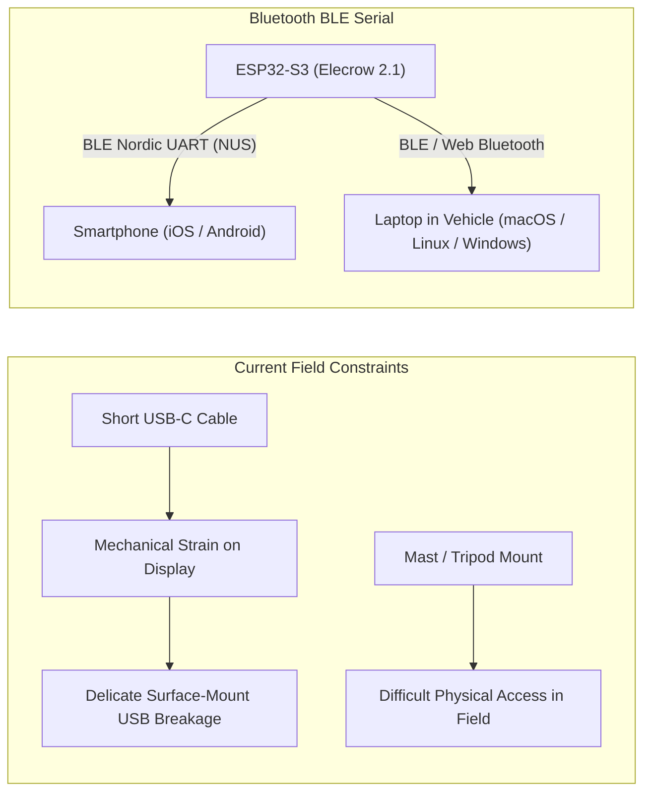
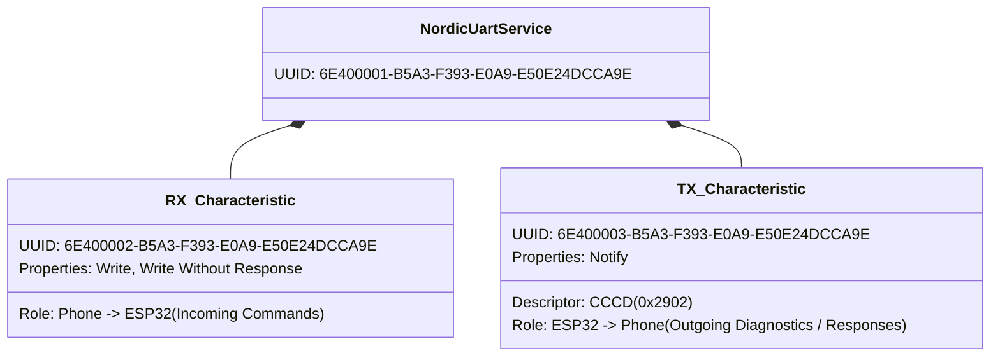
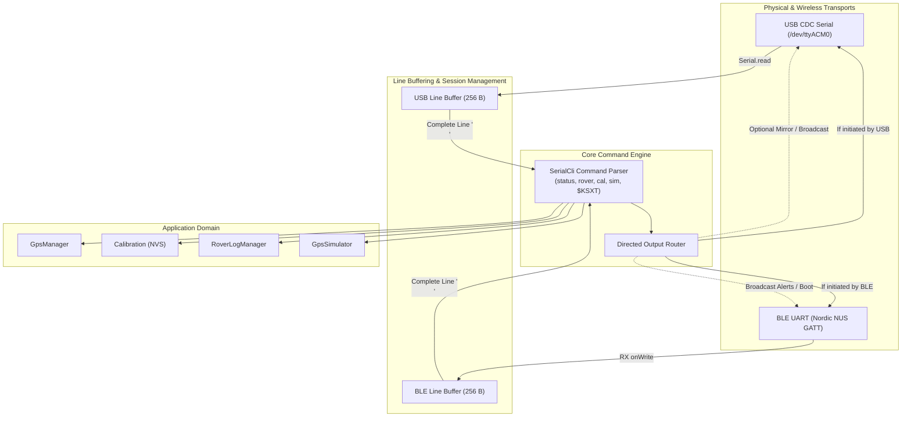

# Bluetooth Serial Interface (BLE UART) — Technical Design

* **Feature:** Wireless Command-Line Interface (CLI) & Diagnostics over Bluetooth Low Energy
* **Status:** Proposed / Ready for Review
* **Target Hardware:** ESP32-S3 (16 MB Flash, 8 MB OPI PSRAM), Elecrow 2.1" Round Touch Display (480×480)
* **Architecture Base:** Modular C++ Architecture (`src/protocol/serial_cli.h`, `src/system/app_controller.h`)
* **Associated Docs:** [Serial CLI Guide](../../SERIAL.md), [BOM](../../BOM.md), [Firmware Modularization](../firmware-modularization/DESIGN.md)

---

## 1. Executive Summary & Field Motivation

The GNSS Compass features an interactive Serial Command-Line Interface (CLI) used for GNSS receiver diagnostics (`status`), antenna heading calibration (`cal snap`, `cal +2.5`), rover transit tracking (`rover status`, `rover history`, `rover undo`), and simulation testing (`sim`).

Currently, this CLI is accessed exclusively via the physical USB-C port on the rear of the Elecrow 2.1" display. In laboratory and bench testing, this is straightforward. However, in real-world field operations (e.g. amateur VHF/UHF/microwave roving, portable summit deployments, and vehicle-mounted installations), physical USB connectivity presents severe operational drawbacks:



1. **Connector Vulnerability:** The Elecrow CrowPanel 2.1" rotary display has a compact surface-mount USB-C connector on its rear PCB. Frequent plugging/unplugging in windy, vibrating, or outdoor field environments introduces mechanical leverage that can fatigue the solder joints or snap the connector.
2. **Mounting Inaccessibility:** When clamped to a mast cross-arm or vehicle dashboard, reaching behind the display with a USB-C cable while operating is awkward and hazards snagging RF cables.
3. **Field Device Portability:** Operators need to inspect receiver health and calibrate antenna baseline offsets directly from a smartphone (iPhone or Android) or a laptop resting in the vehicle cab, without tethering physical wires.

This design introduces a **wireless Bluetooth Low Energy (BLE) serial interface** running alongside the existing USB CDC interface, providing identical CLI access without cables.

---

## 2. Hardware Architecture & Radio Constraints (ESP32-S3)

### 2.1 Microcontroller Capabilities

The Elecrow 2.1" Rotary Display is powered by an **Espressif ESP32-S3-WROOM-1** module (N16R8: 16 MB Flash, 8 MB Octal PSRAM).

> [!IMPORTANT]
> **No Bluetooth Classic on ESP32-S3:**
> Unlike the legacy original ESP32 (which included dual-mode Bluetooth Classic BR/EDR and BLE), the **ESP32-S3 silicon includes only Wi-Fi (802.11 b/g/n) and Bluetooth 5.0 Low Energy (BLE)**.
> Bluetooth Classic Serial Port Profile (SPP / `BluetoothSerial.h`) is **physically unsupported** by ESP32-S3 hardware.

### 2.2 Why BLE Nordic UART Service (NUS) is the Optimal Choice

While Classic SPP is unavailable on the ESP32-S3, implementing **BLE UART via the Nordic UART Service (NUS)** is actually superior for field operations:

| Criterion | Bluetooth Classic SPP | BLE Nordic UART Service (NUS) | Impact on GNSS Compass |
| :--- | :--- | :--- | :--- |
| **ESP32-S3 Hardware Support** | **Not Supported** | **Fully Supported** (Bluetooth 5.0 LE) | Matches existing hardware BOM. |
| **Apple iOS (iPhone / iPad)** | Blocked (Requires Apple MFi hardware crypto chip) | **Native, Out-of-the-Box** | Allows iPhone/iPad operators to connect without jailbreaks or MFi dongles. |
| **Android Compatibility** | Supported | **Fully Supported** | Works with standard Android serial terminal apps. |
| **Laptop / Desktop** | Virtual COM port | **Web Bluetooth & Bleak** | Direct browser terminal connection without driver installation. |
| **Power Consumption** | 30–50 mA (continuous RF carrier) | 8–15 mA (interval advertising / low duty cycle) | Lower thermal load inside 3D enclosure. |
| **Pairing Friction** | Requires OS PIN pairing dialog | **Instant 1-Tap Connect** | Instant field connectivity without pairing rituals. |

---

## 3. Protocol & GATT Profile Specification

The firmware will implement the **Nordic UART Service (NUS)** GATT profile, the universal de-facto standard across the mobile and embedded industry for transparent serial communication over BLE.



### 3.1 GATT UUID Definitions

* **Service UUID:** `6E400001-B5A3-F393-E0A9-E50E24DCCA9E`
* **RX Characteristic (Write / Write Without Response):** `6E400002-B5A3-F393-E0A9-E50E24DCCA9E`
  * Client (Phone/PC) writes ASCII command bytes into this characteristic.
* **TX Characteristic (Notify):** `6E400003-B5A3-F393-E0A9-E50E24DCCA9E`
  * ESP32 pushes ASCII diagnostic responses, command output, and banners back to the client via BLE notifications.
* **Client Characteristic Configuration Descriptor (CCCD):** `00002902-0000-1000-8000-00805F9B34FB` (`0x2902`)
  * Client enables notifications by writing `0x0001`.

### 3.2 BLE Advertising & Device Identification

* **Complete Local Name:** `GNSS-Compass-xxxxxx` (where `xxxxxx` is the last 6 characters of the ESP32 MAC address in lowercase hex, e.g., `GNSS-Compass-8a4f2b`).
  * Avoids naming collisions when multiple roving stations or operators are grouped at a contest summit.
* **Advertising Flags:** `ESP_BLE_ADV_FLAG_GEN_DISC | ESP_BLE_ADV_FLAG_BREDR_NOT_SPT` (General Discoverable, BR/EDR Not Supported).
* **Service Solicitation / UUID:** Includes the NUS 128-bit UUID in advertising data so terminal apps can filter specifically for UART-capable devices.
* **Advertising Interval:** 100 ms (balanced for sub-second connection discovery with minimal radio power).

### 3.3 MTU Negotiation & High-Throughput Chunking

The standard default BLE MTU is 23 bytes (allowing 20 payload bytes). Command outputs like `status` (600+ bytes) or `rover history` (1,000+ bytes) require efficient transmission:

1. **Automatic MTU Request:** Upon connection establishment, the firmware requests an MTU increase up to **512 bytes** (or 247 bytes, standard for modern iOS/Android/PC stacks).
2. **Dynamic Packet Chunking:**
   * An outgoing transmit ring buffer stores response lines.
   * Chunks are sized up to `min(negotiated_mtu - 3, 240)` bytes.
   * Chunks are delivered via `notify()` sequentially, with cooperative yielding to prevent BLE queue exhaustion.

---

## 4. Software Architecture: Dual-Transport CLI

To preserve USB CDC functionality while introducing BLE UART, the architecture cleanly decouples the transport layer from the command execution engine.



### 4.1 Transport Abstraction & Multi-Session Safety

If an operator has a USB cable plugged into a PC while simultaneously connecting with a smartphone over BLE, naive sharing of a single input character buffer would interleave keystrokes and corrupt commands.

To prevent this:
1. **Independent Input Buffers:**
   * `UsbTransport` maintains its own `usbBuffer_[256]` and character accumulator.
   * `BleTransport` maintains its own `bleBuffer_[256]` and packet accumulator.
2. **Source Tagging on Dispatch:**
   * When a newline (`\r` or `\n`) completes a line, `SerialCli::executeCommand(cmd, source)` receives an origin tag: `CLI_SOURCE_USB` or `CLI_SOURCE_BLE`.
3. **Targeted Response Routing:**
   * Interactive responses (e.g., help menus, status dumps, calibration confirmations) are directed back to the specific client that initiated the query.
   * System broadcast events (e.g. boot banners, visual self-test phase markers) are dispatched to all active connections.

### 4.2 Component Design: `BleSerialManager`

A new class `BleSerialManager` in `src/protocol/ble_serial_manager.h` encapsulates all BLE hardware interactions:

```cpp
class BleSerialManager {
public:
    BleSerialManager();

    void begin(const char *deviceName = nullptr);
    void update();

    // Connection state
    bool isConnected() const;
    uint16_t getMtu() const;

    // Stream write operations
    void write(const uint8_t *data, size_t length);
    void print(const char *str);
    void println(const char *str = "");

    // Inbound command callback hook
    typedef void (*BleLineReceivedCallback)(const char *line, void *context);
    void setLineReceivedCallback(BleLineReceivedCallback cb, void *context);

    // Connection event listeners (for UI icon updates)
    typedef void (*BleConnectionCallback)(bool connected, void *context);
    void setConnectionCallback(BleConnectionCallback cb, void *context);
};
```

---

## 5. User Interface (UI) Integration

To provide the operator with immediate feedback without cluttering the 480×480 circular compass display, the UI includes a minimal Bluetooth connection status indicator:

```text
       ┌────────────────────────┐
       │     14:23 UTC   [B]    │   <- [B]: Bluetooth Indicator (Row 0 / Status Area)
       │                        │
       │       CM87wa22         │   <- Row 1: My Grid
       │        032°            │   <- Row 2: Live Antenna Heading
       │      FN31pr99          │   <- Row 3: Target Grid
       │    045°   3892 km      │   <- Row 4: Bearing & Distance
       └────────────────────────┘
```

### 5.1 Status States

| State | Visual Representation | Meaning |
| :--- | :--- | :--- |
| **Disabled / Off** | Hidden | Bluetooth stack not initialized. |
| **Advertising (Disconnected)** | Dim Blue / Outline Bluetooth Glyph | Ready for incoming wireless connection from phone or laptop. |
| **Connected** | Solid Vibrant Cyan / Blue Glyph | Active wireless terminal connection established. |

---

## 6. Client Connection Guide & Workflows

### 6.1 Android Phone / Tablet: "Serial Bluetooth Terminal"

* **App:** [Serial Bluetooth Terminal](https://play.google.com/store/apps/details?id=de.kai_morich.serial_bluetooth_terminal) by Kai Morich (Free, standard amateur radio utility).
* **Setup:**
  1. Open app -> Sidebar -> **Devices** -> **Bluetooth LE** tab.
  2. Select `GNSS-Compass-XXXX`.
  3. Connection is instantaneous (no OS PIN prompt required).
* **Custom Field Macros:** The app allows configuring custom buttons across the bottom:
  * `M1`: `status\n` (Live GNSS stream diagnostics)
  * `M2`: `rover status\n` (16 km displacement check)
  * `M3`: `cal snap\n` (1-touch antenna alignment snapshot)
  * `M4`: `rover history\n` (Visited contest grids roster)
  * `M5`: `rover undo\n` (Discard false stop)

### 6.2 iPhone / iPad: "BLE Terminal" / "Adafruit Bluefruit"

* **App:** [BLE Terminal HM-10](https://apps.apple.com/us/app/ble-terminal-hm-10/id1398703795) or [Adafruit Bluefruit Connect](https://apps.apple.com/us/app/adafruit-bluefruit-connect/id830125974) (Free).
* **Setup:**
  1. Launch app -> Scan -> Select `GNSS-Compass-XXXX`.
  2. Select **UART** mode.
  3. Full bidirectional terminal appears immediately.

### 6.3 Laptops (Chrome / Edge Web Bluetooth — Zero Install)

Because modern Chromium browsers support the **Web Bluetooth API**, operators on macOS, Windows, Linux, and ChromeOS can access the serial CLI without installing any drivers or terminal programs:

* Connect via an open-source single-file HTML/JS Web Bluetooth Terminal (hosted on GitHub Pages or run locally).
* Click **"Connect"** -> Browser presents device picker -> Click `GNSS-Compass-XXXX` -> Interactive terminal connects in the tab.

---

## 7. Resource & Timing Analysis

* **Flash Footprint:** ESP32 BLE stack consumes $\sim 350\text{ KB}$ of Flash. With the Elecrow display's 16 MB Flash partition, this accounts for $< 3\%$ of available application storage.
* **RAM Footprint:** Controller and GATT heap allocations consume $\sim 45\text{ KB}$ of internal RAM. The ESP32-S3 has 512 KB internal SRAM and 8 MB external PSRAM, leaving abundant margin for UI rendering buffers.
* **Core Assignment & FreeRTOS Tasks:**
  * FreeRTOS handles the Espressif BT controller task on **Core 0**.
  * The main Arduino application and LVGL / display rendering operate on **Core 1**.
  * Bluetooth radio operations do not introduce frame drops or jitter to the circular UI animation.

---

## 8. Verification & Test Plan

1. **Host-Side Mock Transport Unit Tests:**
   * Unit test `SerialCli` dual-transport routing using simulated streams in `tests/test_calculations.cpp`.
   * Verify that command inputs on one transport do not corrupt buffers on the other.
   * Verify directed output routing (BLE command produces BLE response).
2. **GATT Characteristic Ingest & Chunking Verification:**
   * Verify that commands split across multiple BLE packets (e.g. fast typing or paste) reassemble correctly up to 256 bytes.
   * Verify that long outputs (`rover history` with 50 stops, `status` report) chunk smoothly without dropping packets or crashing the BLE stack.
3. **Field Stress & Reconnection Testing:**
   * Verify graceful recovery when a phone moves out of RF range and returns.
   * Verify advertising resumes immediately upon client disconnection.
   * Verify that simultaneous physical USB serial and wireless BLE connections operate seamlessly in parallel.

---

## 9. Implementation Next Steps

1. Review and refine this technical design.
2. Implement transport abstraction in `src/protocol/serial_cli.h` / `src/protocol/serial_cli.cpp`.
3. Implement `src/protocol/ble_serial_manager.h` and `.cpp` using standard ESP32 BLE / NUS GATT.
4. Add Bluetooth connection state hook to `AppController` and UI status glyph to `DisplayUi`.
5. Update `tests/` with dual-transport regression unit tests.
6. Update `SERIAL.md` and `INSTALL.md` with mobile app configuration instructions.

