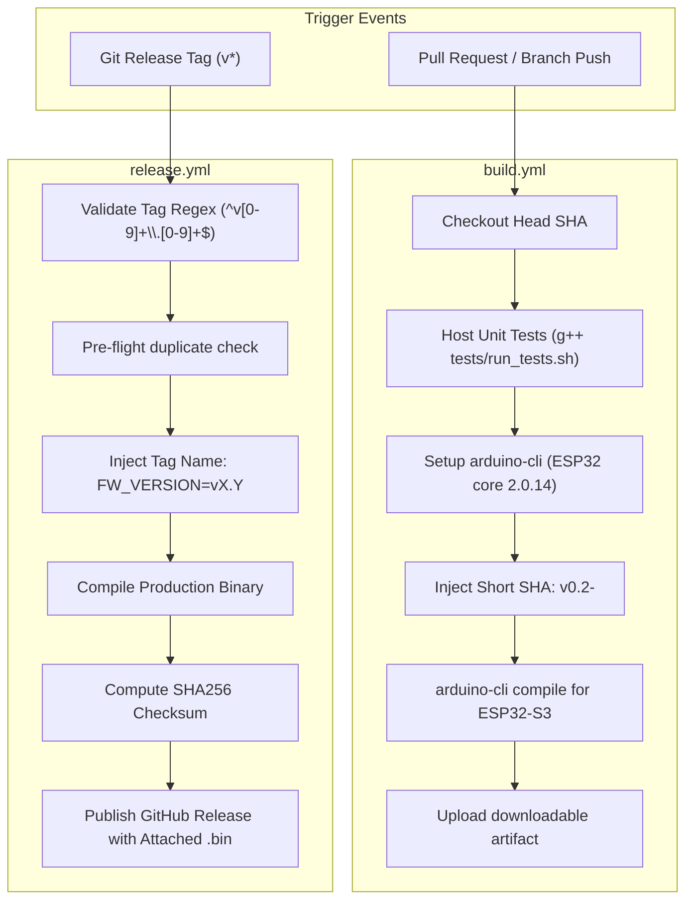

# Automated CI Firmware Build, Version Injection, & Release Pipeline — Design Specification

* **Feature:** Headless GitHub Actions Compilation, Dynamic Git Version Injection, & Release Distribution
* **Status:** Implemented (v0.2-dev)
* **Target Hardware:** ESP32-S3 (16 MB Flash, 8 MB OPI PSRAM), Arduino CLI Toolchain

---

## 1. Problem Statement & Motivation

Embedded IoT and firmware projects frequently suffer from reproducibility and version tracking issues:
1. **"Works on My Machine" Syndrome:** Discrepancies in locally installed Arduino core versions, ESP-IDF patches, and third-party display library revisions can introduce subtle rendering bugs or memory crashes.
2. **Untracked Binary Binaries in Field Use:** When an operator is holding an assembled compass on a mountain summit, there must be zero ambiguity about which exact commit or release binary is flashed.
3. **Friction in Field Updates:** Non-developer ham radio operators should not be forced to install the heavy Arduino IDE, configure board manager URLs, or select complex PSRAM and partition flags just to flash the latest release.

---

## 2. CI/CD Pipeline Architecture

The project splits automated build automation into two decoupled GitHub Actions workflows:



---

## 3. Dynamic Semantic Version Injection

The firmware displays the active software version on the circular display footer ($Y = 444$, size 2) and logs it to USB Serial during boot.

### Compile-Time Macro Injection
In `gps_compass.ino`, a local fallback version is defined for offline desktop development:
```cpp
#ifndef FW_VERSION
#define FW_VERSION "v0.3-dev"
#endif
```

During CI execution, GitHub Actions extracts the exact commit SHA or tag name and overrides the macro using `arduino-cli` build properties:

```bash
# Branch / PR Builds
SHORT_SHA=$(git rev-parse --short "$HEAD_SHA")
arduino-cli compile --fqbn esp32:esp32:esp32s3:CDCOnBoot=default,PSRAM=opi \
  --build-property "build.extra_flags=-DFW_VERSION=\"v0.2-${SHORT_SHA}\"" \
  gps_compass.ino
```

```bash
# Official Tagged Releases (e.g. tag v0.2)
arduino-cli compile --fqbn esp32:esp32:esp32s3:CDCOnBoot=default,PSRAM=opi \
  --build-property "build.extra_flags=-DFW_VERSION=\"${GITHUB_REF_NAME}\"" \
  gps_compass.ino
```

This guarantees that every deployed device displays its exact git provenance directly on screen.

---

## 4. Hardware Target Board Configuration

The ESP32-S3 round display module requires specific hardware options that are codified in the build parameters:

| Parameter | Configuration Value | Reason |
| :--- | :--- | :--- |
| **FQBN** | `esp32:esp32:esp32s3` | Targets dual-core Xtensa LX7 ESP32-S3 |
| **USB CDC On Boot** | `CDCOnBoot=default` | Enables USB CDC serial monitor and diagnostics |
| **PSRAM Type** | `PSRAM=opi` | Configures 8 MB Octal-SPI PSRAM for framebuffers |
| **Flash Mode** | `FlashMode=qio` | High-speed Quad I/O flash |
| **Flash Size** | `FlashSize=16M` | Allocates 16 MB onboard flash for code, NVS, and OTA |

---

## 5. Automated Release Distribution & Verification

For production releases, the `release.yml` workflow:
1. Enforces strict tag naming: `^v[0-9]+\.[0-9]+$` (e.g. `v0.2`, rejecting malformed tags).
2. Generates a standalone binary: `gps_compass.ino.esp32s3.bin`.
3. Computes cryptographic integrity checksums:
   ```bash
   sha256sum gps_compass.ino.esp32s3.bin > gps_compass.ino.esp32s3.bin.sha256
   ```
4. Publishes both files to GitHub Releases, allowing operators to flash devices using browser-based WebSerial flashing tools or the repository's `simple_build.sh` script.

