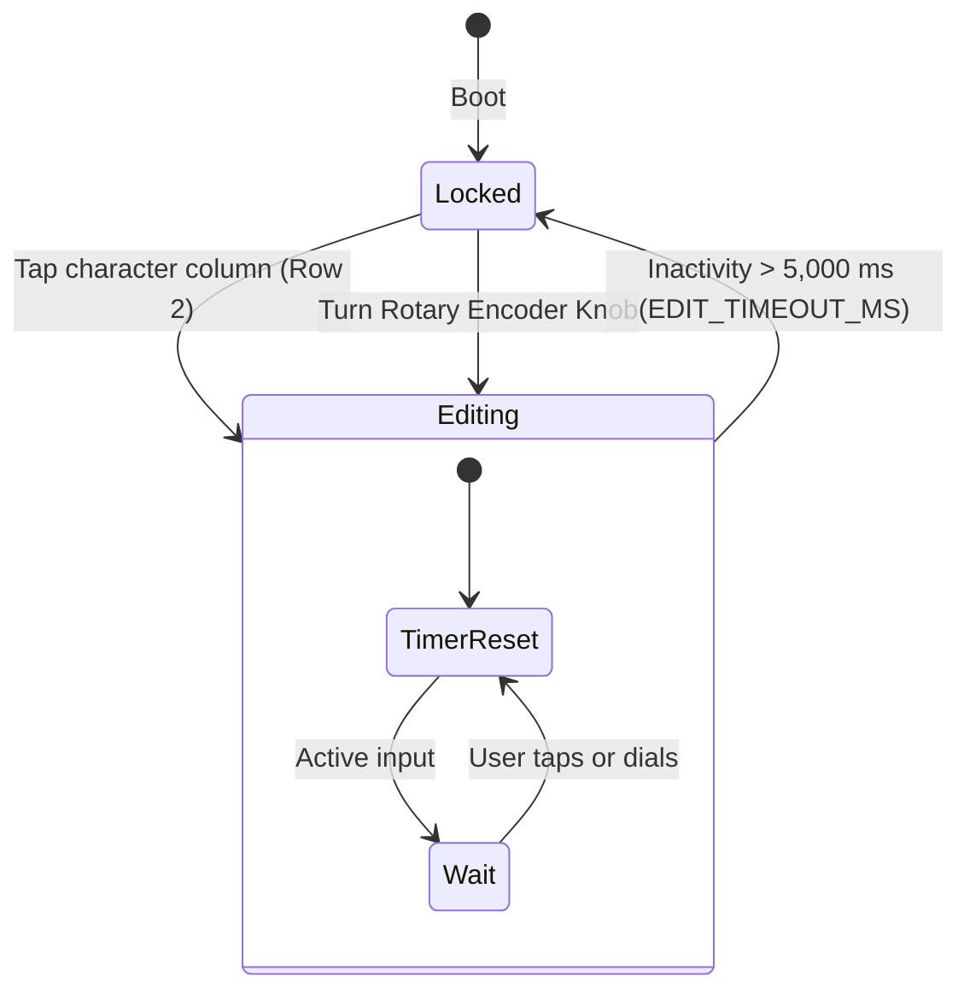

# 480x480 Circular Display Touch Interface & Grid Editor — Design Specification

* **Feature:** Circular Layout Geometry, 6-Row Budget, Touch Maidenhead Editor, & Inactivity Auto-Lock
* **Status:** Implemented (v0.2-dev)
* **Target Hardware:** Elecrow 480x480 Round RGB Display (ST7701S RGB Interface), CST8XX Capacitive Touch Controller (I2C 0x15, GPIO 38 SDA, GPIO 39 SCL), Rotary Encoder (GPIO 42 CLK, GPIO 4 DT)

---

## 1. Problem Statement & Motivation

Circular displays provide an intuitive, compass-rose form factor for antenna pointing systems. However, round TFT displays introduce distinct UI layout and interaction constraints:
1. **Corner Clipping:** On a 480x480 circular panel, any UI element placed in standard rectangular corners ($X, Y < 70\text{ px}$ or $> 410\text{ px}$) falls outside the display circle and is mechanically occluded by the enclosure bezel.
2. **Field Touch Ergonomics:** Operators wearing gloves in wind or cold must reliably select characters on a touchscreen without fat-fingering adjacent elements.
3. **Accidental Touch Prevention:** Once an antenna target is locked, inadvertent touches from carrying the compass or brushing against cables must not corrupt the target grid during operation.

---

## 2. Circular Layout Geometry & 6-Row Coordinate Budget

All visual rows are positioned along the vertical axis with horizontal widths constrained by chord lengths across the circle:

```text
               .---. (Y = 0)
            .-'     '-.
          .'   Row 1   '.     Y=35:  Local Grid & UTC Time (LOC_SZ = 4)
         /               \
        |      Row 2      |   Y=95:  Target Grid Editor (REMSIZE = 8)
        |                 |
        |      Row 3      |   Y=223: Heading | Cal Pill | Target (BEARSZ = 6)
        |                 |
        |      Row 4      |   Y=352: Reverse Bearing & Dist (REVBEAR_SZ = 4)
         \     Row 5     /    Y=408: ARRL Contest Distance (ARRL_SZ = 3)
          '.   Row 6   .'     Y=444: Firmware Version Footer (VER_SZ = 2)
            '-.     .-'
               '---' (Y = 480)
```

### Row Coordinate Specifications

| Row | Content | Font Size | Y Position | Horizontal Span | Purpose |
| :--- | :--- | :--- | :--- | :--- | :--- |
| **Row 1** | Local Grid & UTC Time | Size 4 | $Y = 35$ | $144 \le X \le 336$ | Current GPS position (`mygrid`) and UTC clock |
| **Row 2** | Target Maidenhead Grid | Size 8 | $Y = 95$ | $80 \le X \le 368$ | 6-char interactive target locator |
| **Row 3** | Bearings & Cal Pill | Size 6 | $Y = 223$ | $20 \le X \le 460$ | Current heading, calibration pill, target bearing |
| **Row 4** | Reverse Bearing & Dist | Size 4 | $Y = 352$ | $90 \le X \le 390$ | Back-azimuth and line-of-sight distance |
| **Row 5** | ARRL Contest Distance | Size 3 | $Y = 408$ | $123 \le X \le 357$ | ARRL 10 GHz scored distance (1 km clamp) |
| **Row 6** | Version Footer | Size 2 | $Y = 444$ | Centered | Firmware version & self-test tap trigger |

---

## 3. Maidenhead Touch Editor & Input Arbitration

Target grid entry allows operators to quickly tune to any Maidenhead locator using touch taps or a rotary knob.

### Character Constraints
Maidenhead locators require specific character domains per column:
* **Columns 0 & 1 (Field):** Letters `'A'` through `'R'`
* **Columns 2 & 3 (Square):** Digits `'0'` through `'9'`
* **Columns 4 & 5 (Subsquare):** Letters `'A'` through `'X'`

Character increment/decrement macros guarantee rollover within legal bounds:
```cpp
#define INCA(x) (((x+1)>'Z')?'A':(x+1))
#define DECA(x) (((x-1)<'A')?'Z':(x-1))
#define INCN(x) (((x+1)>'9')?'0':(x+1))
#define DECN(x) (((x-1)<'0')?'9':(x-1))
#define INCG(x) (x=(x>='0' && x<='9')?INCN(x):INCA(x))
#define DECG(x) (x=(x>='0' && x<='9')?DECN(x):DECA(x))
```

### Touch Hit-Target Padding & Column Clamping
To prevent missed taps, the touch hit box encompasses the full character height plus generous vertical margins ($Y \in [70, 235]$) and clamps horizontal coordinates:

```cpp
// Tap on target grid (Row 2)
if (TOUCH_X_MIN <= p.x && p.x <= TOUCH_X_MAX && TOUCH_Y_MIN <= p.y && p.y <= TOUCH_Y_MAX) {
  int touched_char = (p.x - REMSTARTX) / CHAR_W(REMSIZE);
  if (touched_char < 0) touched_char = 0;
  if (touched_char > 5) touched_char = 5;
  remotec = touched_char;
  isEditing = true;
  lastEditActivity = millis();
  printrem();
}
```

---

## 4. Inactivity Auto-Lock Architecture

To prevent accidental target grid changes while handling the mast, an automatic inactivity timeout locks the editor.



### Timing Implementation
```cpp
#define EDIT_TIMEOUT_MS 5000

if (isEditing && (millis() - lastEditActivity > EDIT_TIMEOUT_MS)) {
  isEditing = false;
  printrem();  // Erases active edit caret underscore
}
```

When locked, the active underscore caret is erased, and subsequent accidental screen touches outside hit targets produce no changes until intentionally tapped again.

