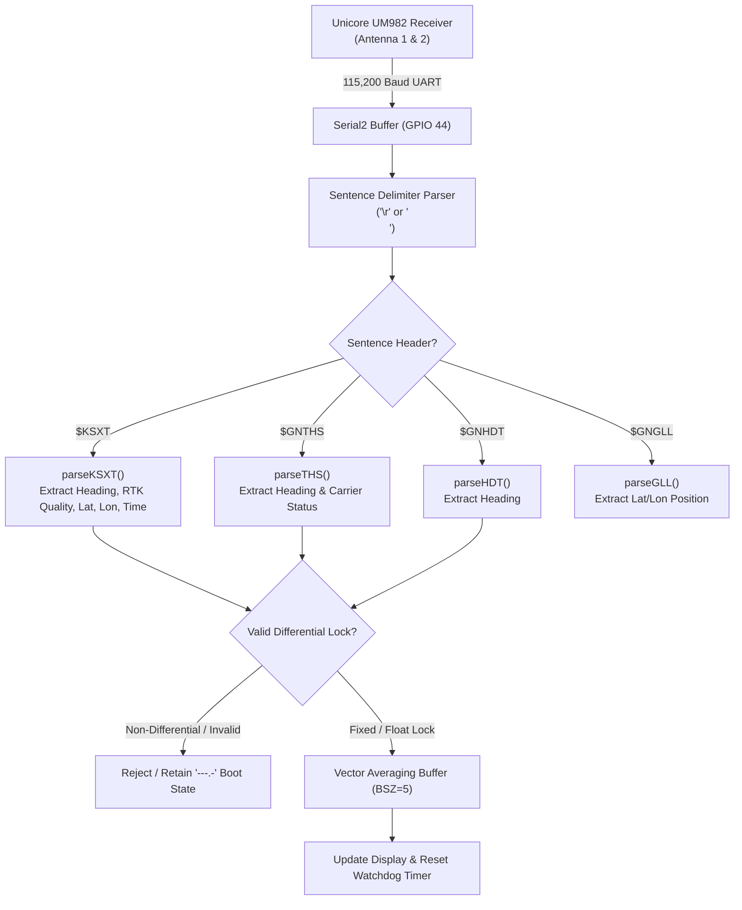
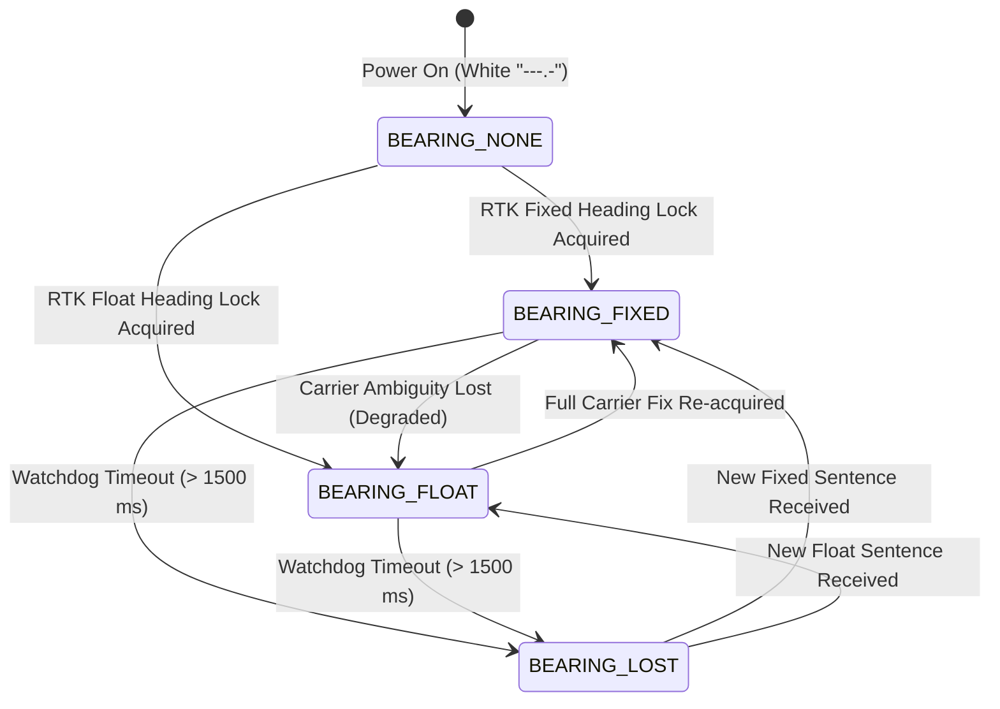

# Dual-Antenna GNSS Heading Pipeline & Watchdog — Design Specification

* **Feature:** Dual-Antenna RTK Carrier-Phase Heading Acquisition, Vector Smoothing, & Stream Watchdog
* **Status:** Implemented (v0.2-dev)
* **Target Hardware:** Unicore UM982 Dual-Antenna RTK GNSS Receiver, ESP32-S3 Hardware Serial (`Serial2`, GPIO 44 RX, GPIO 43 TX)

---

## 1. Problem Statement & Motivation

Traditional magnetic compasses (fluxgates, magnetometers) are notoriously unreliable in microwave amateur radio stations due to proximity to metal antenna masts, dish counterweights, rotator motors, and strong RF fields generated during transmission.

Dual-antenna GNSS heading resolves these challenges by measuring the carrier-phase baseline vector between two fixed antennas mounted on a common boom. However, raw dual-antenna GNSS data introduces three specific engineering challenges:
1. **Multi-Protocol Stream Parsing:** Receivers like the Unicore UM982 output proprietary composite sentences (`$KSXT`) that combine attitude, position, and RTK quality into a single high-rate packet, while third-party receivers output standard NMEA-0183 (`$GNTHS`, `$GNHDT`, `$GNGLL`). The system must parse both seamlessly.
2. **Angular Wrap-Around at North:** Standard scalar arithmetic averages (e.g., $(359^\circ + 1^\circ) / 2 = 180^\circ$) produce catastrophic $180^\circ$ inversion errors when heading fluctuates across true North ($0^\circ / 360^\circ$).
3. **Silent Signal Dropouts:** In portable environments, moving cables, tree canopy, or antenna mast tilt can cause the receiver to drop carrier lock or stop streaming packets. Without an active watchdog, the display would freeze on stale data, misleading the operator.

---

## 2. High-Speed Multi-Protocol Architecture

The receiver streams asynchronous ASCII data into ESP32-S3 `Serial2` at **115,200 baud** (8N1).



### Unicore `$KSXT` vs Standard NMEA Fallback

The firmware prioritizes the high-rate Unicore `$KSXT` sentence:
```text
$KSXT,20261024031520.00,119.458231,38.354120,1850.4,180.25,1.25,12.5,0.02,2,3*47
```
* **Token 5:** True Heading ($180.25^\circ$)
* **Token 6:** Pitch
* **Token 9:** Heading Quality Flag ($2 = \text{Float}$, $3 = \text{Fixed}$)
* **Token 10:** Position Status Flag

When `$KSXT` is active, a single sentence updates heading, position, and time synchronously. If standard NMEA sentences are received instead, the parser falls back to `$GNTHS` (True Heading and Status) and `$GNHDT` (True Heading).

---

## 3. Circular Mean Vector Smoothing

To dampen high-frequency mechanical vibration from wind buffeting the antenna boom while avoiding phase-wrap singularities, heading is smoothed using **2D circular vector averaging**.

### Mathematical Formulation
For a window of $N = 5$ heading samples ($\theta_1, \theta_2, \dots, \theta_N$):

$$S = \sum_{i=1}^N \sin(\theta_i), \quad C = \sum_{i=1}^N \cos(\theta_i)$$

$$\bar{\theta} = \operatorname{atan2}(S, C) \pmod{360^\circ}$$

```cpp
#define BSZ 5
float sinbuff[BSZ], cosbuff[BSZ];
float sinavg = 0.0f, cosavg = 0.0f;
int sin_i = 0;

void updateHeadingBuffer(float heading_deg) {
  float r = toRad(heading_deg);
  sinavg -= sinbuff[sin_i];
  cosavg -= cosbuff[sin_i];
  sinbuff[sin_i] = sin(r);
  cosbuff[sin_i] = cos(r);
  sinavg += sinbuff[sin_i];
  cosavg += cosbuff[sin_i];
  sin_i = (sin_i + 1) % BSZ;
}

double calcCurrentBearing(float s_avg, float c_avg, float cal_offset) {
  double b = toDeg(atan2(s_avg, c_avg));
  if (b < 0.0) b += 360.0;
  return applyBearingOffset(b, cal_offset);
}
```

This guarantees continuous, smooth averaging across North ($359^\circ \leftrightarrow 1^\circ$) with zero discontinuity.

---

## 4. Staleness Watchdog & Bearing Quality State Machine

To ensure high operational integrity in the field, the heading pipeline implements an active staleness watchdog and a 4-state visual quality model.



### Bearing Quality Color Coding

| State | Quality Level | Color | Screen Visual | Meaning |
| :--- | :--- | :--- | :--- | :--- |
| **`BEARING_NONE`** | Boot / Unlocked | **Pure White** | `---.-` | Initial power on. Carrier baseline search in progress. |
| **`BEARING_FIXED`** | RTK Fixed | **Pure White** | `180.2` | Sub-degree dual-antenna carrier-phase integer lock. |
| **`BEARING_FLOAT`** | RTK Float | **Rich Golden Yellow** (`0xFEA0`) | `180.2` | Reduced accuracy. Sunlight-optimized gold tint avoids bleaching to white. |
| **`BEARING_LOST`** | Watchdog Expired | **Bright Red** | `180.2` | **Data Stale ($>1.5\text{ s}$).** Signal blocked or cable severed. |

### Watchdog Implementation
In the main execution loop:

```cpp
#define HEADING_TIMEOUT_MS 1500

if (hasHeading && (currentBearingQuality != BEARING_LOST)) {
  if (millis() - lastHeadingUpdate > HEADING_TIMEOUT_MS) {
    currentBearingQuality = BEARING_LOST;
    drawCurrentBearing();  // Redraws bearing in Bright Red (RED, BLACK)
  }
}
```

