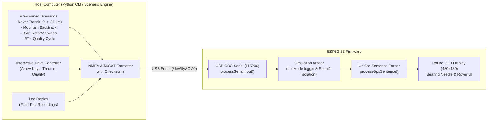

# GPS Data Simulation & Rover Transit Test Framework — Technical Design

* **Feature:** Host-Driven GPS Simulation, Scenario Engine, Dynamic Rover Transit Validation, and Serial Sentence Injection
* **Status:** Implemented / Active
* **Target Hardware:** ESP32-S3 Display Module, Unicore UM982 GNSS Receiver (Serial2), Host PC (USB CDC Serial1)
* **Associated Feature:** [Rover Mode & Transit Tracking](../rover-transit/DESIGN.md)

---

## 1. Problem Statement & Motivation

During development of the **Rover Mode** and transit tracking features (monitoring straight-line displacement against the **ARRL 16 km legal rule**, 6-character Maidenhead grid boundary crossings, and mountain backtrack switchbacks), testing on physical hardware presents unique challenges:

1. **Outdoor Drive Requirement:** Verifying that the display highlights when crossing the 16 km boundary, updates the distance cleanly, and transitions through legality states (Illegal $\to$ Warn $\to$ Qualified) requires driving a vehicle across tens of kilometers with active satellite locks.
2. **Edge-Case Reproduction:** Real-world testing cannot easily reproduce rapid edge cases such as sudden multipath degradation (Fixed $\to$ Float), baseline loss in deep canyons, switchbacks where straight-line distance temporarily decreases, or exact boundary crossings across Maidenhead subsquares.
3. **Desk Development Loop:** Developers need immediate, repeatable, automated visual and functional verification on the benchtop while refining the display UI, layout, and geodetics algorithms.

---

## 2. Architecture & Design Decisions

### 2.1 Host-Driven vs. On-Device Simulation



* **Host-Driven Execution:** Placing the physics simulation, route waypoints, speed dynamics, and scenario state machine in a host-side Python tool (`tools/gps_sim.py`) avoids burning limited ESP32 flash and RAM with test vectors.
* **Unified Firmware Pipeline:** The ESP32 parses simulated sentences through the exact same processing pipeline (`processGpsSentence()`) as live data from the Unicore UM982 receiver. This guarantees that test results reflect real operational behavior.
* **Mutual Exclusion & Hardware Isolation:** When simulation mode is activated (`sim on` or automated sentence injection), the firmware ignores incoming bytes on `Serial2` (UM982) to eliminate collisions between benchtop hardware and simulated scenarios.

---

## 3. Communication Protocol & Serial Interface

The firmware accepts simulation commands over the primary USB CDC serial port (`115200` baud) in two formats:

### 3.1 Direct NMEA / `$KSXT` Sentence Injection

Any serial line beginning with `$` is treated as a GNSS sentence and passed directly to the parser pipeline:

```text
$KSXT,20261106183000.00,-119.45800000,38.35400000,2100.0,145.20,0.0,0.0,0.0,,1,3,46,28*27
```

* **Automatic Sim Engagement:** Injecting a raw sentence automatically activates simulation mode (`simMode = true`) and notifies the operator.
* **Full Field Extraction:** Supports heading, quality (Fixed, Float, Lost), UTC time, latitude, and longitude.

### 3.2 Human-Friendly `sim` CLI Commands

For manual testing in a serial terminal without running Python scripts:

| Command | Arguments | Description | Example |
| :--- | :--- | :--- | :--- |
| `sim` / `sim status` | None | Displays simulation mode status and statistics | `sim` |
| `sim on` | None | Manually forces simulation mode ON (isolating Serial2) | `sim on` |
| `sim off` | None | Disables simulation mode; restores live UM982 stream | `sim off` |
| `sim hdg <deg> [q]` | `<deg>` heading, optional `[fixed\|float\|lost]` | Simulates antenna heading and bearing quality | `sim hdg 145.2 fixed` |
| `sim pos <lat> <lon>` | `<lat>` latitude, `<lon>` longitude | Simulates geographic decimal coordinates | `sim pos 38.354 -119.458` |
| `sim grid <grid>` | `<grid>` (4, 6, or 8 characters) | Jumps position to center of Maidenhead grid | `sim grid CM87wa` |
| `sim rover <origin> <dist>` | `<origin_grid>`, `<dist_km>` | Configures rover mode with an origin and simulated offset | `sim rover CM87wa 14.5` |
| `sim time <hh:mm>` | `<hh:mm>` | Simulates UTC time clock | `sim time 18:30` |

---

## 4. Test Scenarios Supported by `tools/gps_sim.py`

### Scenario 1: Rover Transit (Straight-Line Journey)
* **Goal:** Verify distance progression, 16 km boundary crossing, grid transition, and UI alert styling.
* **Sequence:**
  1. Starts at origin grid `CM87wa22` ($0\text{ km}$).
  2. Drives northeast at $60\text{ km/h}$.
  3. $0 \to 10\text{ km}$: Displays distance in same grid (State A: Illegal, red alert).
  4. Crosses boundary into `CM87wb` at $\sim 11\text{ km}$ (State B: Warn, new grid but $< 16\text{ km}$).
  5. Crosses $16.0\text{ km}$ threshold at $\sim 16.1\text{ km}$ (State D: Qualified, green banner).
  6. Continues to $25\text{ km}$.

### Scenario 2: Mountain Backtrack & Switchbacks
* **Goal:** Verify that the UI gracefully handles canyon switchbacks and temporary distance decreases without erroneous state triggers.
* **Sequence:**
  1. Departs origin, climbs to $14.2\text{ km}$.
  2. Road wraps around a mountain canyon; straight-line displacement drops to $11.5\text{ km}$.
  3. Road breaks out onto a ridge; displacement climbs past $16.0\text{ km}$ to $22.0\text{ km}$.

### Scenario 3: 360° Rotator Continuous Sweep
* **Goal:** Verify bearing needle visual fluidity, trigonometric smoothing, and $0^\circ \leftrightarrow 360^\circ$ wrap-around.
* **Sequence:** Sweeps heading continuously from $0^\circ \to 360^\circ$ at configurable speeds ($3^\circ/\text{sec}$ to $30^\circ/\text{sec}$) at $5\text{ Hz}$ update rate.

### Scenario 4: RTK Quality Cycle & Watchdog
* **Goal:** Verify display transitions between white (Fixed), yellow (Float), red (Lost), and the $1500\text{ ms}$ staleness watchdog timeout.
* **Sequence:** Fixed ($10\text{s}$) $\to$ Float multipath ($5\text{s}$) $\to$ Lost ($3\text{s}$) $\to$ Stream silence ($5\text{s}$, triggering watchdog red) $\to$ Re-acquisition ($5\text{s}$, returning to Fixed).

### Scenario 5: Interactive Terminal "Drive Simulator"
* **Goal:** Real-time keyboard-steered rover testing with a live ASCII dashboard.
* **Controls:**
  * `[W] / [S]`: Accelerate / Decelerate (speed in km/h)
  * `[A] / [D]`: Steer heading left / right
  * `[1] / [2] / [3]`: Switch RTK Fixed / Float / Lost
  * `[Space]`: Emergency stop
  * `[Q]`: Quit simulation

---

## 5. Verification & Safety

1. **Physical Safety:** Simulation mode operates strictly in volatile memory. Power cycling the ESP32 or issuing `sim off` completely restores live hardware serial communication.
2. **Automated Unit Testing:** Pure mathematical transformations and sentence generation routines are integrated with the host test harness (`tests/run_tests.sh`).

