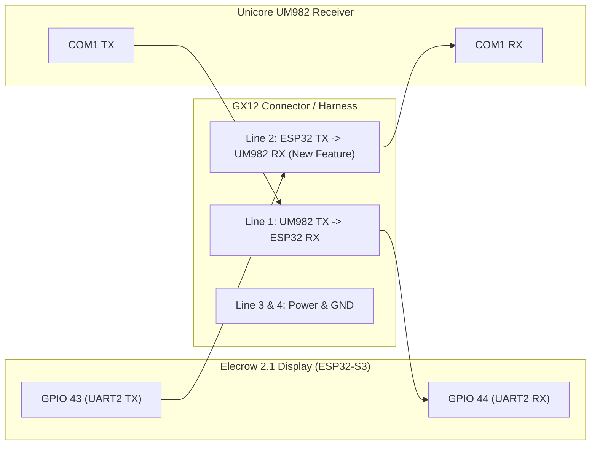
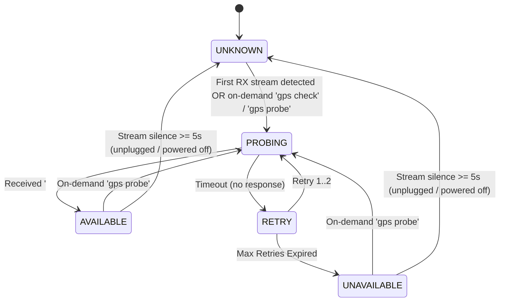
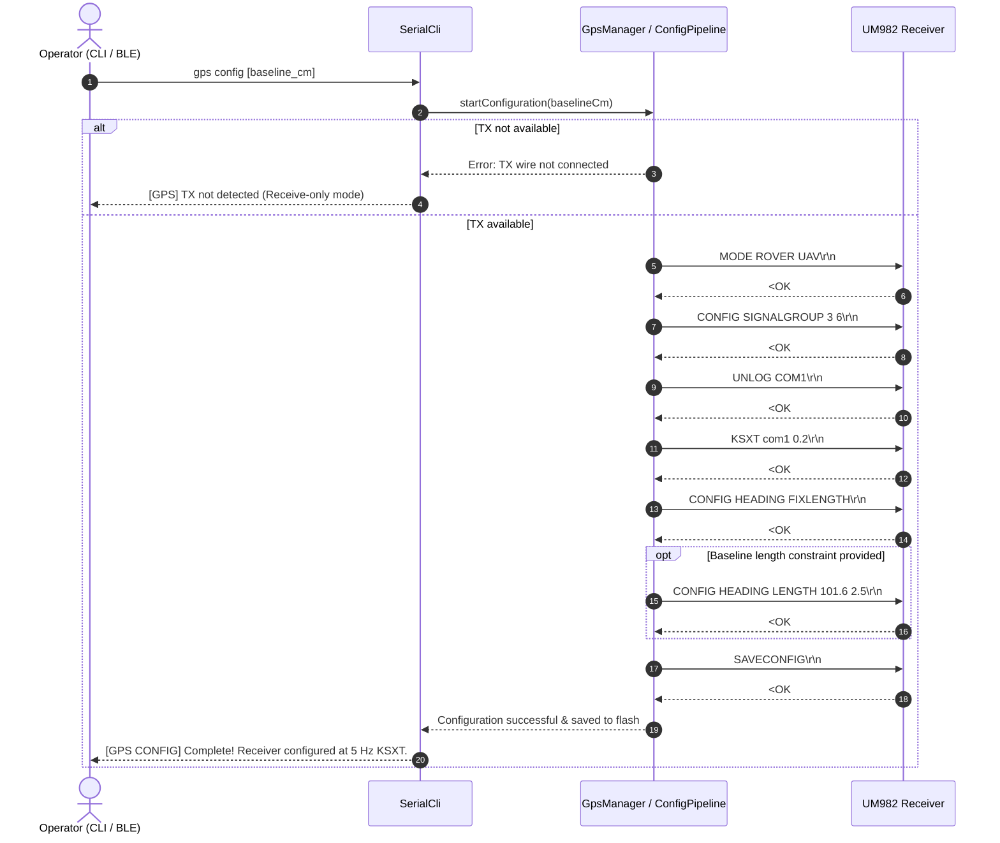

# GNSS Receiver Bidirectional Communication & Automated Configuration — Technical Design

* **Feature:** Automated TX Discovery Probe & In-System UM982 Configuration Pipeline
* **Status:** Proposed / Ready for Review
* **Target Hardware:** ESP32-S3 (Elecrow 2.1" Display), Unicore UM982 Dual-Antenna RTK Receiver
* **Serial Interface:** Hardware UART (Serial2: RX=GPIO 44, TX=GPIO 43, 115200 8N1)
* **Associated Docs:** [RECEIVER.md](../../RECEIVER.md), [SERIAL.md](../../SERIAL.md), [BOM.md](../../BOM.md)

---

## 1. Executive Summary & Hardware Motivation

### 1.1 The Hardware Transition: Receive-Only vs. Bidirectional Serial
Historically, early GNSS Compass builds utilized a 3-pin GX12 connector providing DC power (+5V or +12V), Ground (GND), and a single unidirectional data line: **UM982 TX $\to$ ESP32 RX (GPIO 44)**. In this configuration:
* The ESP32 passively received NMEA and `$KSXT` sentences.
* The UM982 receiver had to be pre-configured manually via its USB-C port using Unicore UPrecise or a desktop terminal prior to field installation (as outlined in [RECEIVER.md](../../RECEIVER.md)).
* Any configuration drift, reset, or antenna baseline adjustment required taking down the mast, disassembling the receiver enclosure, and plugging in a computer.

By running a wire from **ESP32 TX (GPIO 43) $\to$ UM982 RX (COM1 RX)** (via a 4-pin GX12 connector or internal jumper), the ESP32 gains the ability to send commands directly to the UM982 in the field:



### 1.2 Dual-Feature Scope
1. **Feature 1 — TX Presence & Discovery Flag (`isSendAvailable()`):**
   Automatically or on-demand discover whether the TX wire is physically connected and the receiver is responding. If TX is absent (legacy 3-wire setups), the system safely flags send as unavailable and filters out transmission-dependent operations without breaking normal compass operation.
2. **Feature 2 — In-System Receiver Configuration Pipeline:**
   Provide an automated, verified configuration pipeline implementing the full setup specified in [RECEIVER.md](../../RECEIVER.md) (`MODE ROVER UAV`, `CONFIG SIGNALGROUP 3 6`, `KSXT com1 0.2`, `SAVECONFIG`, optional fixed baseline distance constraint, and unlogging legacy messages).

---

## 2. Receiver Flash Wear Analysis & Limited Write Safeguards

### 2.1 Does the UM982 Receiver Have Limited Flash Writes?
**Yes.** 
* The Unicore UM982 receiver (NebulasIV SoC) uses onboard non-volatile **NOR Flash** memory to persist configuration parameters across power cycles.
* Like all NOR flash devices, typical endurance is between **10,000 and 100,000 Program/Erase (P/E) cycles**.
* In Unicore architecture:
  * Runtime commands (such as `MODE`, `CONFIG`, and `KSXT`) take effect **immediately in volatile memory (RAM)**.
  * The **`SAVECONFIG`** command flushes the active RAM configuration to NOR flash memory blocks.

### 2.2 Risk of Unchecked Boot-Time Writes
If the firmware were designed to execute `SAVECONFIG` unconditionally on every boot:
* In mobile roving operations, field testing, or vehicle installations subject to battery changes and ignition cycles (e.g. 10–20 power cycles/day), the NOR flash could accumulate thousands of redundant write cycles.
* Flash block wear or partial write corruption could permanently brick or corrupt the receiver's persistent configuration.

### 2.3 Flash Protection Strategy & Intelligent Boot Flow
1. **Never write on every boot:** Configuration commands and `SAVECONFIG` must **never** run blindly during routine startup.
2. **Configuration Persistence:** Once saved to flash once, the UM982 retains its configuration across power cycles indefinitely.
3. **Passive Stream Inspection:** The firmware monitors incoming packets (`ksxtPacketCount_`, `gllPacketCount_`, `hdtPacketCount_`).
   - If `$KSXT` is active and streaming at 5 Hz, the receiver is **OPTIMAL**. Zero writes to flash.
   - If legacy sentences (`$GPHDT` + `$GNGLL`) are streaming, the receiver is **LEGACY COMPATIBLE**. It continues to navigate normally without modifying receiver flash; the user is simply notified in `status` that an upgrade to `$KSXT` is available.
   - If factory default NMEA is streaming (zero heading data) and TX is confirmed: The receiver is **UNCONFIGURED** and cannot function as a compass.
4. **Automatic 1-Time Setup with Visual Feedback (Unconfigured Receivers Only):**
   - When an unconfigured receiver is detected and `isSendAvailable() == true`, the ESP32 automatically configures it *once* to 5 Hz `$KSXT` and saves to flash.
   - The Elecrow screen shows a non-blocking transient status: `"CONFIGURING GPS..."` (cyan) followed by `"GPS CONFIGURED"` (green for 2 seconds), then transitions into the normal compass display.
   - Detailed progress is mirrored over USB CDC and BLE UART.
   - On all future boots, `$KSXT` is already saved in receiver flash, so auto-config never runs again.
5. **Active Non-Destructive Query & Configuration Audit:** When TX is available, the ESP32 can audit the receiver's running parameters against [RECEIVER.md](../../RECEIVER.md) without writing flash:
   - `VERSION`: Inspects product model, firmware build, serial number, and build date.
   - `MODE`: Verifies operating mode is `MODE ROVER UAV`.
   - `UNILOGLIST COM1`: Checks active output logs. Verifies `$KSXT` is logged at 0.2s and confirms no extraneous sentences (`GPGGA`, `GPHDT`, `GPGLL`, `GPRMC`) are active.
   - `LOG COM1 HEADINGSTATUSA ONCE`: Inspects baseline configuration (`#HEADINGSTATUSA`), returning the configured baseline length (cm) and error tolerance (cm).
   *(Note: `CONFIG SIGNALGROUP` and `CONFIG HEADING` are write-only configuration commands requiring arguments on Unicore receivers; bare queries return a grammar error).*
6. **Clean Slate with `UNLOG COM1`:** Rather than attempting to guess and unlog individual legacy sentences, Unicore supports `UNLOG COM1`, which wipes all active message streams on `COM1` in a single command before enabling `KSXT com1 0.2`.

---

## 3. Feature 1: TX Presence Discovery & State Machine

### 3.1 Probe Mechanism
To test whether the TX wire is connected from ESP32 GPIO 43 to UM982 COM1 RX:
* ESP32 transmits a harmless, non-destructive ASCII probe command:
  ```text
  version\r\n
  ```
* **Automatic Discovery on Stream Ingest:** When the receiver data stream is first detected from `UNKNOWN` state (or after stream recovery following $\ge 5$ s silence), the ESP32 automatically transmits a discovery probe. Probing is skipped when running under synthetic simulation.
* **On-Demand Discovery:** Running `gps check` (or `gps audit`) while TX state is `UNKNOWN` automatically initiates an in-flight probe on GPIO 43, queueing the parameter audit queries to run immediately once receiver acknowledgment is confirmed.
* **If TX wire is connected:** UM982 receives the command and replies on COM1 TX with:
  ```text
  $command,version,response: OK*<checksum>
  #VERSIONA,...
  ```
  or standard acknowledgment `<OK`.
* **If TX wire is NOT connected:** The command never reaches the UM982. The receiver continues streaming whatever it was streaming before; no command response or acknowledgment is received.

### 3.2 TX Discovery State Machine



### 3.3 State Representation & API

```cpp
enum class GpsTxState : uint8_t {
    Unknown,      // Initial state prior to probe
    Probing,      // Probe command in flight, waiting for response
    Available,    // TX confirmed: UM982 responded to command
    Unavailable   // TX missing: Timed out without response (Receive-only mode)
};
```

* `bool isSendAvailable() const`: Returns `true` if `txState_ == GpsTxState::Available`.
* `GpsTxState getTxState() const`: Returns current state enum.
* `void probeTx(unsigned long nowMs = 0)`: Initiates discovery probe.

### 3.4 Feature Filtering & User Feedback
When `!isSendAvailable()`, transmission-dependent actions are cleanly gated:

| Feature / Command | Behavior When TX Available | Behavior When TX Unavailable |
| :--- | :--- | :--- |
| `status` (CLI / BLE) | `Link: BIDIRECTIONAL (TX & RX Confirmed)` | `Link: RECEIVE ONLY (RX Active, TX Not Detected)` |
| `gps config` | Executes step-by-step receiver configuration | Rejects with clear instruction: `[GPS] TX wire not detected. Connect GPIO 43 to UM982 RX to configure.` |
| `gps send <cmd>` | Transmits raw command to UM982 | Rejects: `[GPS] Cannot send: TX wire not connected.` |
| Baseline length tuning | Applies `CONFIG HEADING LENGTH` to receiver | Gated with error message |

---

## 4. Feature 2: In-System Receiver Configuration Pipeline

### 4.1 Configuration Command Sequence (per RECEIVER.md)
The pipeline sends the verified command sequence one step at a time, checking for receipt acknowledgment (`<OK` or response):

| Step | Command | Purpose |
| :---: | :--- | :--- |
| **1** | `MODE ROVER UAV` | Configure moving baseline / dual-antenna heading mode |
| **2** | `CONFIG SIGNALGROUP 3 6` | Enable multi-frequency constellations (GPS, BDS, GLO, GAL) |
| **3** | `UNLOG COM1` | Clear all active message streams on COM1 (wipes any legacy/unwanted logs) |
| **4** | `KSXT com1 0.2` | Output unified `$KSXT` navigation sentence at 5 Hz (0.2s) |
| **5** | `CONFIG HEADING FIXLENGTH` | Constrain heading to rigid fixed baseline (standard for boom-mounted antennas) |
| **6** | *(Optional)* `CONFIG HEADING LENGTH <cm> <tol>` | Set physical antenna spacing and tolerance (e.g. `101.6 2.5`) |
| **7** | `SAVECONFIG` | Commit RAM parameters to non-volatile NOR Flash |

> [!TIP]
> Using **`UNLOG COM1`** before **`KSXT com1 0.2`** is much more robust than individually unlogging legacy sentences (`UNLOG COM1 GPHDT`, `UNLOG COM1 GPGLL`). It guarantees that factory defaults (`GPGGA`, `GPRMC`, `GPGSV`) or any other user-enabled sentences are completely cleared in one shot, leaving COM1 with exclusively the clean `$KSXT` 5 Hz stream.

### 4.2 Configuration Pipeline State Machine



### 4.3 Active Configuration Audit & Query (`gps check` / `gps audit`)
Before altering configuration or writing flash, the operator or system can query the receiver's current state:

| Query Command | Expected / Optimal Response | Discrepancy Detected |
| :--- | :--- | :--- |
| `MODE` | `#MODE...;MODE ROVER UAV` | Receiver in `BASE` or `SURVEY` mode (cannot compute dual-antenna moving baseline heading). |
| `UNILOGLIST COM1` | Only `< KSXT COM1 0.2` active | Port flooded with `GPGGA`, `GPHDT`, `GPGLL`, or missing `KSXT`. |
| `CONFIG SIGNALGROUP` | `CONFIG SIGNALGROUP 3 6` | Running single-constellation or missing Galileo/BDS multi-frequency tracking. |
| `CONFIG HEADING` | `CONFIG HEADING FIXLENGTH` + length | Operating in unconstrained baseline mode (slower fix time). |

By checking these parameters non-destructively:
* The system avoids re-running `SAVECONFIG` if the receiver already matches [RECEIVER.md](../../RECEIVER.md).
* The CLI `status` or `gps check` command displays an itemized report of any discrepancies before the user decides to run `gps config`.

### 4.4 Error Handling & Abort Safeguard
* **Timeout Protection:** Each command has a 1000ms acknowledgment window.
* **Non-Volatile Protection:** If any step prior to `SAVECONFIG` fails or times out, the sequence **immediately aborts** without sending `SAVECONFIG`. This guarantees corrupted or partial configurations are never committed to receiver flash.
* **Non-Blocking Execution:** The configuration state machine runs inside `GpsManager::update(nowMs)` using non-blocking timestamps; it never stalls the FreeRTOS display render loop or rotary encoder polling.

---

## 5. Serial CLI & BLE Command Interface

The following subcommands will be added to the unified `SerialCli` parser (accessible over USB CDC and BLE UART):

### 5.1 Command Syntax
* `status` (or `gps`): Enhanced to show TX presence, link mode, and configuration status:
  ```text
  Link Status:    CONNECTED (Bidirectional TX/RX Active)
  TX Capability:  AVAILABLE (UM982 command responses confirmed)
  Config State:   OPTIMAL ($KSXT streaming at 5.0 Hz, legacy unlogged)
  ```
* `gps probe`: Manually triggers a TX discovery probe cycle.
* `gps check` (or `gps audit`): Queries `VERSION`, `MODE`, `UNILOGLIST COM1`, and `HEADINGSTATUSA` (baseline length & tolerance) to report hardware/firmware details and runtime configuration without modifying flash.
* `gps config`: Runs the standard [RECEIVER.md](../../RECEIVER.md) configuration pipeline (`MODE ROVER UAV` -> `CONFIG SIGNALGROUP 3 6` -> `UNLOG COM1` -> `KSXT com1 0.2` -> `SAVECONFIG`).
* `gps config baseline <length_cm> [tol_cm]`: Runs configuration including physical antenna separation constraint (default tolerance 2.5 cm).
* `gps send <raw_command>`: Power-user command allowing transmission of arbitrary Unicore commands (e.g. `gps send uniloglist`, `gps send version`, `gps send config`).

---

## 6. Implementation Plan & Phases

### Phase 1: Core TX Discovery & Response Parser (Feature 1)
1. **Extend `GpsManager`**:
   - Add `GpsTxState` enum and `txState_` tracking.
   - Add probe timeout / retry management (`lastProbeTime_`, `probeRetries_`).
   - Add response parser in sentence/byte ingest for `<OK`, `$command`, `#VERSIONA`.
   - Implement `probeTx(nowMs)`, `isSendAvailable()`, and `getTxState()`.
2. **Unit Tests**:
   - Test TX probe state transitions (initial $\to$ probing $\to$ available on `<OK` / `#VERSION`).
   - Test timeout transition to `Unavailable`.
   - Test manual re-probe.

### Phase 2: Configuration Pipeline Engine (Feature 2)
1. **Implement `GpsConfigPipeline`**:
   - Sequential command state machine (`MODE` $\to$ `SIGNALGROUP` $\to$ `KSXT` $\to$ `UNLOG` $\to$ optional baseline $\to$ `SAVECONFIG`).
   - Acknowledgment verification and failure abort before `SAVECONFIG`.
   - Stream health verification (verifying `$KSXT` arrives following configuration).
2. **Unit Tests**:
   - Test full successful configuration step-by-step sequence.
   - Test abort on command rejection (verifying `SAVECONFIG` is never sent if a step fails).
   - Test baseline constraint formatting (`CONFIG HEADING LENGTH 101.6 2.5`).

### Phase 3: CLI / BLE Commands & Status Reporting
1. **Integrate into `SerialCli`**:
   - Add `gps probe`, `gps config`, `gps send` command handlers.
   - Enhance `printGpsStatus()` to report bidirectional link status and configuration health.
   - Gate send features when `!isSendAvailable()`.
2. **Unit Tests**:
   - Test CLI command routing over USB and BLE.
   - Test error feedback when TX is unavailable.
3. **Documentation**:
   - Update [SERIAL.md](../../SERIAL.md) with new commands and diagnostic outputs.
   - Update [RECEIVER.md](../../RECEIVER.md) noting the automated in-system configuration option.

