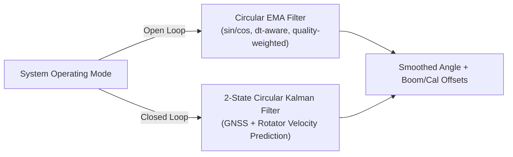

# Configurable Heading Averaging & Pluggable Filter — Technical Design

* **Feature:** 3-Level Heading Smoothing & Pluggable Filter Architecture (CLI & NVS)
* **Status:** Implemented (Phase 1: Pluggable `CircularEmaFilter` + CLI/NVS; Phase 2: Closed-Loop Kalman deferred)
* **Target Hardware:** ESP32-S3, Unicore UM982 Dual-Antenna RTK Receiver (`$KSXT` @ 5 Hz)
* **Architecture Base:** `IAngleFilter` / `CircularEmaFilter` (`src/geo/angle_filter.h`), `BearingFilter` (`src/geo/bearing_filter.h`), `GpsManager` (`src/gnss/gps_manager.h`), `SerialCli` (`src/protocol/serial_cli.h`), `NvsConfig` (`src/system/nvs_store.h`)
* **Associated Docs:** [Dual-Antenna GNSS Heading Pipeline](../gnss-heading-pipeline/DESIGN.md), [Serial CLI Guide](../../../SERIAL.md), [Feature Ideas](../../../FEATURE_IDEAS.md)

---

## 1. Motivation & Design Philosophy

`BearingFilter` currently smooths dual-antenna GNSS headings using a hardcoded 5-sample circular moving-window average (`WINDOW_SIZE = 5`). While simple, two requirements motivate an architectural upgrade:

1. **Operator-Tunable Damping:** Different field conditions (rapid hand-slewing vs. high-wind summit masts vs. steady `cal snap`) benefit from adjustable smoothing. Rather than exposing raw sample counts or adding touch UI clutter, we expose **3 discrete levels** (`low`, `med`, `high`) via the **Serial / BLE CLI** and **NVS**.
2. **Upcoming Closed-Loop Rotator & Elevation Features:** Future features in [FEATURE_IDEAS.md](../../../FEATURE_IDEAS.md) introduce closed-loop rotator PID control, an optional elevation sensor, and continuous Sun/Moon tracking.
   * **Open Loop** needs zero overshoot and operator-tunable damping (**Circular EMA**).
   * **Closed Loop** needs low phase lag between 5 Hz `$KSXT` updates so filter delay does not erode PID phase margin—best served by a **Kalman Filter** fused with rotator velocity/drive commands.

Rather than building a single monolithic Kalman class with an ad-hoc fallback, this design introduces a **pluggable angular filter interface** that **auto-selects** its strategy based on the system's operating mode, starting with **Circular Exponential Moving Average (EMA)** for Open Loop.

### 1.1 Why Host-Side Filtering (Rather Than UM982 Smoothing)

Following standard autopilot practice (e.g., ArduPilot EK3 and PX4 EKF2), smoothing is performed on the **ESP32 host controller** rather than inside the UM982 receiver:

* **Geometric Constraints Already Enabled:** The existing `gps config` pipeline already configures receiver-side baseline constraints (`MODE ROVER UAV`, `CONFIG HEADING FIXLENGTH`, `CONFIG HEADING LENGTH`).
* **Preserves Raw 5 Hz Output & Closed-Loop Phase Margin:** Keeping the UM982 streaming unsmoothed 5 Hz `$KSXT` allows `low` ($\tau = 0.0\text{ s}$) to expose raw receiver output on demand and prevents hidden receiver lag from degrading future Closed-Loop Kalman + PID phase margin.

---

## 2. Pluggable Filter Architecture

### 2.1 Strategy Selection

* **Open Loop (Phase 1 — Current):** Automatically uses the **Circular EMA** filter, parameterized by the user's 3-level setting (`low` / `med` / `high`).
* **Closed Loop (Phase 2 — Future Rotator PID):** Automatically switches to a **Kalman Filter** that consumes rotator velocity/drive commands during the 200 ms intervals between `$KSXT` packets. The 3-level setting can map to measurement noise $R$ aggressiveness.

### 2.2 Future-Proofed Filter Inputs

To avoid refactoring `GpsManager` or the filter contract when rotator control, elevation sensing, and Sun/Moon tracking arrive, the filter interface accepts these inputs from day one:

| Input | Purpose |
| :--- | :--- |
| **`headingDeg`** (`float`) | Raw measured angle ($0^\circ\text{–}360^\circ$). |
| **`quality`** (`BearingQuality`) | `Fixed` vs. `Float` — allows quality-weighted smoothing (trust `Fixed` more than `Float`, critical for narrow-beam Sun/Moon pointing). |
| **`nowMs`** (`unsigned long`) | Sample timestamp for $\Delta t$-invariant time constants ($\alpha = 1 - e^{-\Delta t / \tau}$), handling dropped packets or non-5 Hz receiver rates. |
| **`predict(velDegPerSec, dtSec, driveActive)`** | Optional motion-prediction hook for Closed Loop. No-op in Circular EMA; advances state in Kalman only when `driveActive` is true (prevents windup on mechanical stall/end-stop). |

Separating the generic circular filter from the `+270°` dual-antenna boom offset also allows direct reuse for the **Elevation** axis when Feature #5 is implemented.

---

## 3. Open-Loop Implementation: Circular EMA & 3 Levels

### 3.1 Circular Exponential Moving Average (EMA)

Instead of a fixed-size ring buffer, the Open-Loop filter maintains two state variables $(S, C)$ in `double` precision:

$$\Delta t = \frac{\text{nowMs} - \text{lastUpdateMs}}{1000.0}, \qquad \alpha = 1 - e^{-\Delta t / \tau}$$

$$S_k = (1 - \alpha) S_{k-1} + \alpha \sin(\theta_k), \qquad C_k = (1 - \alpha) C_{k-1} + \alpha \cos(\theta_k)$$

$$\bar{\theta}_k = \mathrm{atan2}(S_k, C_k) \pmod{360^\circ}$$

* **Zero Wrap-Around Singularity:** Filtering in $(\sin\theta, \cos\theta)$ space handles $359^\circ \leftrightarrow 1^\circ$ seamlessly.
* **Lower Phase Lag:** Exponential weighting responds faster to genuine antenna turns than an equal-weight boxcar window of equivalent noise reduction.
* **Quality Weighting (Optional):** When `quality == BEARING_FLOAT`, $\tau$ can be scaled up slightly (e.g. $1.5\times$) to damp Float carrier-phase jitter without slowing down `BEARING_FIXED` tracking. An optional innovation/outlier gate can also down-weight single-sample multipath jumps during `BEARING_FLOAT`.
* **Seeding & Runtime Level Changes:** `seed(headingDeg)` sets $S = \sin\theta, C = \cos\theta$ directly. Changing levels at runtime simply updates $\tau$ while preserving $(S, C)$, producing a smooth transition with zero `---.-` flicker.

### 3.2 Three Averaging Levels

| Level | CLI Token | Time Constant ($\tau$) | Effective $\alpha$ (@ 5 Hz, $\Delta t = 0.2\text{ s}$) | ~90° Settle Time | Intended Use Case |
| :--- | :--- | :---: | :---: | :---: | :--- |
| **Low** | `low` | `0.0 s` | `1.00` (raw) | `0.2 s` (instant) | Rapid antenna slewing, rotator testing, zero-lag tracking. |
| **Medium** *(Default)* | `med` / `medium` | `0.8 s` | `~0.22` | `~5 s` | General portable/rover operation (steady readout with moderate lag). |
| **High** | `high` | `1.8 s` | `~0.11` | `~10–11 s` | High-wind mast flex damping, noisy Float solutions, Sun/Moon pointing, steady `cal snap`. |

> [!NOTE]
> Preserving `Medium` as the default ensures existing users experience comparable smoothing out of the box with slightly crisper turn response.

---

## 4. NVS Persistence & CLI Interface (USB & BLE UART)

* **NVS Storage (`NvsConfig`):** Namespace `"compass"`, key `"avg_level"` (`uint16_t` / `uint8_t`, `0 = Low`, `1 = Medium`, `2 = High`, default `1`). Loaded at boot in `AppController::begin()`.
* **CLI-Only Control:** No touch UI or modal changes are included.

| Command | Behavior |
| :--- | :--- |
| `cal avg` | Print active averaging level, filter mode (e.g. `Circular EMA`), and time constant $\tau$. |
| `cal avg low` | Set averaging to `Low` ($\tau = 0\text{ s}$, raw), save to NVS, and confirm. |
| `cal avg med` *(or `medium`)* | Set averaging to `Medium` ($\tau = 0.8\text{ s}$), save to NVS, and confirm. |
| `cal avg high` | Set averaging to `High` ($\tau = 1.8\text{ s}$), save to NVS, and confirm. |

`status` and `cal help` / `help` should also display the active averaging level and document `cal avg [low|med|high]`.

---

## 5. Operational & Performance Impact

* **CPU & RAM:** $O(1)$ per sample, only two `double` state variables + timestamp (actually uses **less** RAM than the current 5-slot `sinBuffer`/`cosBuffer` ring buffer).
* **Watchdog Independence:** `HEADING_TIMEOUT_MS` (1500 ms) in `GpsManager::checkStaleness()` triggers on packet arrival, independent of filter $\tau$.
* **Calibration (`cal snap`) Note:** In `High` mode ($\tau = 1.8\text{ s}$), allow ~10 seconds after a large slew (~90°) before running `cal snap` so the exponential tail settles (~5 s in `Medium`).

---

## 6. Verification Plan

1. **Host Unit Tests (`tests/test_calculations.cpp`):**
   * Verify `Low`, `Medium`, and `High` time constants, `359° / 1°` wrap-around, and $\Delta t$ invariance (e.g., 5 Hz vs. 1 Hz packet intervals).
   * Verify `Fixed` vs. `Float` quality weighting and `predict()` no-op behavior in Open-Loop EMA.
   * Verify runtime level switching preserves heading continuity without `---.-` flicker.
   * Verify `SerialCli` parsing of `cal avg [low|med|medium|high]` and NVS persistence round-trip.
2. **On-Device Verification:**
   * Compile via `./build/simple_build.sh` and verify `cal avg` over USB and BLE UART.
