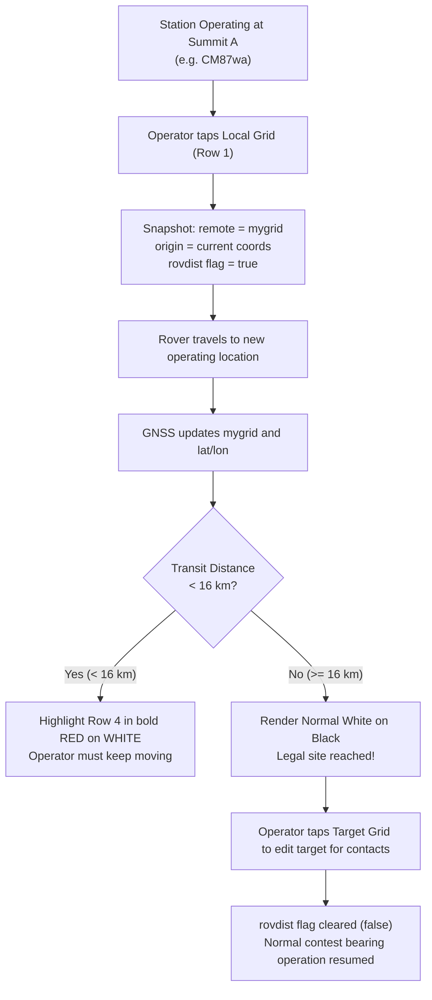

# Rover Station Proximity Alert & 1-Tap Transit Tracking — Design Specification

* **Feature:** Rover Transit Check & One-Tap Origin Grid Copy
* **Status:** Implemented (v0.2-dev / PR #2)
* **Target Hardware:** ESP32-S3, 480x480 Round Touch Display (ST7701 + CST8XX)

---

## 1. Problem Statement & Motivation

In microwave amateur radio contests—most notably the **ARRL 10 GHz and Up Contest**—operators frequently compete in the "Rover" category. Rovers travel between mountain tops, coastal bluffs, and grid boundaries during the contest weekend to make microwave contacts with fixed stations and other rovers.

### The ARRL 16 km Rover Rule
Contest rules require that a rover station move at least **16 kilometers (9.94 miles)** from its previous operating location before making contacts that count for additional points:
> *"A rover must move at least 16 km (9.94 miles) between operating sites to qualify as a new location."*

In the field, when packing up gear and driving down winding mountain roads to the next summit or pullout, rovers must track their straight-line transit distance from the last operating location to ensure they have met the 16 km requirement before deploying masts, pointing dishes, and initiating contacts.

Doing this manually requires:
* Remembering the 6-character Maidenhead locator of the previous summit.
* Manually tapping through all 6 characters into a calculator or compass device while operating a vehicle or setting up camp.
* Risking disqualification or lost QSO points if the new site is only 15.5 km away.

---

## 2. System Architecture & Workflow

The Rover Transit subsystem automates this tracking with a two-part workflow:
1. **One-Tap Origin Snapshot:** Before tearing down at the current summit, the operator taps the local grid display on screen. This captures the exact current location as the reference origin.
2. **Dynamic In-Transit Distance Alert:** As the rover moves, the compass continuously calculates the great-circle distance back to the origin and renders a high-visibility visual warning if the distance is under 16 km.



---

## 3. User Interface & Touch Interaction

### Row 1: One-Tap Origin Grid Snapshot
Row 1 ($Y = 35$, Height $\approx 40\text{ px}$) displays the current Maidenhead grid locator derived from live GPS coordinates (`LOC_SZ = 4`).

* **Touch Hit Zone:** $100 \le X \le 340$, $0 \le Y \le 75$.
* **Action:**
  1. Copies current 6-character `mygrid` into the target `remote` buffer.
  2. Copies `mylatitude` / `mylongitude` into reference target coordinates `remlatitude` / `remlongitude`.
  3. Sets the rover tracking state flag `rovdist = true`.
  4. Triggers immediate recalculation and redraw (`printrem()`, `updateBearings()`).

```cpp
// Tap on local grid (Row 1): copy local grid to target for rover distance check
else if (100 <= p.x && p.x <= 340 && 0 <= p.y && p.y <= 75) {
  for (int ii = 0; ii < 6; ii++) {
    remote[ii] = mygrid[ii];
  }
  remlatitude = mylatitude;
  remlongitude = mylongitude;
  rovdist = true;
  printrem();
  updateBearings();
}
```

---

### Row 4: High-Visibility Proximity Alert Rendering
Row 4 ($Y = 352\text{ px}$, Size 4) displays the reverse bearing and distance in kilometers:

$$\text{Format: } \texttt{"\%5.1f \%4i k"}$$

* **Normal State ($\text{Distance} \ge 16\text{ km}$ or $\texttt{rovdist} == \text{false}$):**
  * Foreground: White (`0xFFFF`)
  * Background: Black (`0x0000`)
* **Proximity Alert State ($\text{Distance} < 16\text{ km}$ and $\texttt{rovdist} == \text{true}$):**
  * Foreground: **Bright Red** (`0xF800`)
  * Background: **Solid White** (`0xFFFF`)

```cpp
char buf[20];
int rdist = (int)floor(distance / 1000.0);
sprintf(&buf[0], "%5.1f %4i k  ", revbearing, rdist);

if ((rdist < 16) && rovdist) {
  gfx->setTextColor(RED, WHITE);
} else {
  gfx->setTextColor(WHITE, BLACK);
}
gfx->setTextSize(REVBEAR_SZ);
gfx->setCursor(REVBEAR_X, REVBEAR_Y);
gfx->print(buf);
```

The inverted red-on-white block creates high visual contrast that is immediately noticeable in daylight even from the driver's seat or outside the vehicle.

---

## 4. State Lifecycle & Auto-Reset

To prevent false alarms when the operator subsequently works target stations that happen to be within 16 km, rover origin tracking (`rovdist` / `isRoverAlertActive`) disarms whenever the operator intentionally interacts with the target grid:

* **Origin Snapshot Protection:** Tapping the local grid (Row 1) automatically disarms edit mode (`isEditing = false`). The cursor (`^`) is hidden, protecting the origin grid from accidental bezel turns and road vibration bumps while driving. Turning the rotary bezel while in transit will not mutate characters or drop out of rover mode.
* **Target Grid Character Tap:** When the rover arrives at a destination and the operator taps a character on Row 2, edit mode is re-armed (`isEditing = true`) and rover transit mode is cleanly disarmed, returning the compass to standard target station tracking.

