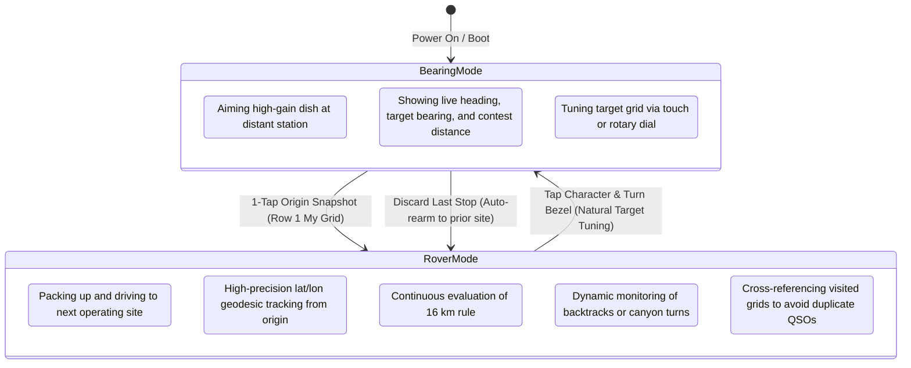
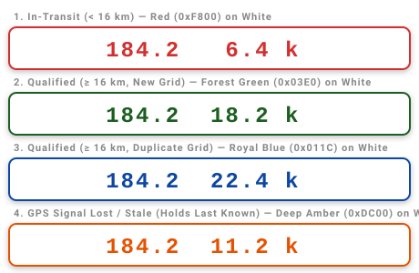
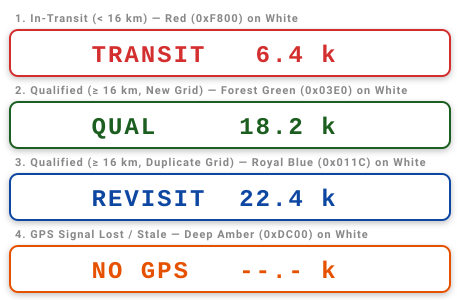

# Rover Mode, Transit Tracking, Location History & Modular Geodesics — Technical Design

* **Feature:** Dual Operational Modes (Bearing vs. Rover), Dynamic 16 km Displacement Tracking, Visited Grid History & Duplicate Contact Avoidance, and Modular Geodesic Integration
* **Status:** Proposed / Ready for Review
* **Target Hardware:** ESP32-S3 (16 MB Flash, 8 MB OPI PSRAM), 480×480 Round Touch Display (ST7701S RGB + CST8XX I2C Touch), Rotary Encoder with Push-Button (CLK, DT, SW)
* **Architecture Base:** Implemented Modular C++ Architecture (`src/geo/`, `src/ui/`, `src/gnss/`, `src/protocol/`)
* **Supersedes:** Earlier v0.2 single-alert design

---

## 1. Executive Summary & Operational Philosophy

In amateur microwave weak-signal contesting (e.g., the **ARRL 10 GHz and Up Contest** and **ARRL VHF/UHF Contests**), roving stations operate in two fundamentally distinct states:



1. **Bearing Mode (Stationary Operation):**
   The station is stationary at an operating location. The operator rotates the mast to aim high-gain antennas/dishes at distant targets, monitoring live antenna heading, target azimuth, and target distance.
2. **Rover Mode (In-Transit Relocation):**
   The station has torn down equipment and is driving along roads or highways to the next operating site. Bearing to distant targets is irrelevant; the critical tasks are:
   - Tracking exact straight-line displacement from the last operating location against the **ARRL 16 km legal rule**.
   - Dynamic awareness of backtracking (e.g., switchbacks, missed turns, dead-ends).
   - Logging visited operating locations and grids across the contest weekend to **prevent duplicate contacts**.

---

## 2. Rover Mode: User Experience & Transit Tracking

### 2.1 Entering Rover Mode: One-Tap Origin Snapshot
Rover Mode is triggered deliberately when packing up from an operating location:

```text
[Row 1 Tap] -> My Grid "CM87wa22" (Tap hit zone: X: 100-340, Y: 0-75)
```

1. **Snapshot Coordinates (`GeoPoint`):** Captures current live GPS decimal coordinates as `GeoPoint originPoint_` to full double precision (derived directly from `$GNGLL` / `$KSXT` via `GpsManager`). It **never snaps to grid center**, preventing up to $\sim 2.5\text{ km}$ of artificial quantization error.
2. **Snapshot Grid (`GridSquare`):** Copies current `myGrid_` into the origin reference buffer `originGrid_`.
3. **Bezel / Knob Lockout:** Automatically disarms edit mode (`gridEditor_.setEditing(false)`) and hides the editing cursor (`^`). This guarantees that road vibration bumps or accidental turns of the rotary bezel during transit cannot mutate the origin grid or drop out of Rover Mode.
4. **Timestamp:** Records UNIX/GPS epoch departure timestamp.
5. **Mode Engagement:** Firmware transitions `AppController` into `operationalMode = MODE_ROVER`.

---

### 2.2 Continuous Dynamic Tracking & The 16 km Rule

In contest roving, the legal site qualification criterion is strictly **straight-line displacement**:

$$\text{Legal Requirement: Straight-Line Displacement } \Delta D \ge 16.0\text{ km}$$

#### Grid Geometry vs. The 16 km Rule
A 6-character Maidenhead subsquare (e.g., `CM87wa`) spans $5' \text{ longitude} \times 2.5' \text{ latitude}$ ($\approx 7.3\text{ km} \times 4.63\text{ km}$ at mid-latitudes, with a maximum diagonal of $\approx 8.6\text{ km}$). Because the entire span of a 6-character grid is under $9\text{ km}$, **any valid move of $\ge 16.0\text{ km}$ has already traversed into a new grid square by mathematical definition**.

#### Purpose of Visited Grid Tracking: Avoiding Duplicate Contacts
While grid traversal occurs naturally when moving $\ge 16\text{ km}$, tracking visited grids serves a critical contest purpose: **avoiding duplicate contacts**. 
- In microwave contesting, an operator may legally return to a previously activated grid square later in the contest weekend (e.g., driving a loop course).
- However, contest rules prohibit claiming QSO points with the same station on the same band from the same grid square twice.
- Therefore, the system tracks visited grids to alert the operator upon arrival if a grid was activated earlier in the weekend, advising them to check their band log for prior contacts.

#### Continuous Displacement Resolution (`src/geo/geo_math.h`)
Calculates the exact **WGS-84 geodesic distance** between `originPoint_` and the live GPS antenna coordinates `currentPoint_`:

$$\Delta D = \text{distanceWGS84}(\text{originPoint}, \text{currentPoint})$$

**Mandatory 0.1 km Decimal Precision (`%5.1f k`):**
Displacement is continuously rendered with tenths-of-a-kilometer decimal precision (e.g., ` 6.4 k`, ` 18.2 k`, ` 22.4 k`). At typical driving speeds (e.g., 50 km/h), integer kilometers take over 70 seconds to increment, giving the driver the false impression that tracking is frozen. Tenths of a kilometer increment every ~7 seconds, providing immediate visual feedback that the vehicle is in motion and distance is actively accumulating.

#### Dynamic Qualification Matrix (4 States)

| State | Displacement $\Delta D$ | Grid History Context | Visual Indication | Operating Legality |
| :--- | :--- | :--- | :--- | :--- |
| **A: In-Transit Under 16k** | $< 16.0\text{ km}$ | Any grid | **Red text on White** (`0xF800` on `0xFFFF`) | **ILLEGAL** (Keep driving; under 16 km) |
| **B: Qualified New Location** | $\ge 16.0\text{ km}$ | New grid (unvisited) | **Forest Green on White** (`0x03E0` on `0xFFFF`) | **QUALIFIED** (Legal site; all bands open) |
| **C: Qualified Revisited Grid** | $\ge 16.0\text{ km}$ | Visited earlier in log | **Royal Blue on White** (`0x011C` on `0xFFFF`) | **QUALIFIED** (Legal site; check band log for duplicate QSOs) |
| **D: GPS Signal Lost / Stale** | Any / Stale | Stale GPS fix (> 3s) | **Deep Amber on White** (`0xDC00` on `0xFFFF`) | **WAIT GPS** (Signal lost in tunnel/trees; hold last known) |

---

### 2.3 Left Slot Exploration: Back-Azimuth vs. Textual State Label

In stationary Bearing Mode, Row 5 renders reverse bearing on the left and target distance on the right: `"%5.1f %4i k  "`.

In Rover Mode, the left-hand slot currently continues to display the back-azimuth pointing back to the departure site (e.g. ` 184.2   6.4 k `).

> [!NOTE]
> **Open Design Question:** During road transit, does a driver actually benefit from seeing the back-azimuth to their previous site, or would this space be more valuable displaying an explicit textual status label?
> * **Option A (Back-Azimuth):** ` 184.2   6.4 k ` / ` 184.2  18.2 k ` / ` 184.2  22.4 k `
> * **Option B (Status Word):** `TRANSIT  6.4 k ` / `QUALIFIED 18.2 k` / `REVISIT 22.4 k ` / `NO GPS  --.- k `
>
> Option B provides instant clarity for drivers, eliminating any ambiguity between states (especially between New Grid and Revisited Grid) without relying solely on color recognition.

---

### 2.4 Visual Preview: On-Screen Color Examples (Row 5)

Below are exact visual simulations of the 4 states rendered on the solid white background card:

#### Option A: Back-Azimuth + Continuous Decimal Distance



---

#### Option B: Textual Status Label + Continuous Decimal Distance



---

### 2.5 Dynamic Backtrack & Hysteresis Handling

Mountain transit rarely occurs in a straight line. An operator driving through canyons or climbing mountain roads may:
1. Reach $16.2\text{ km}$ straight-line displacement on a ridge.
2. Turn down a switchback or side road looking for a safe pullout, causing straight-line distance to drop back to $15.7\text{ km}$.
3. Accidentally clip back into the prior grid boundary.

**Design Rule: Instantaneous, Hysteresis-Free Reversibility**
- The system **never "latches"** qualification.
- If $\Delta D$ drops from $16.1\text{ km} \to 15.9\text{ km}$, the state drops immediately from **Qualified (Green)** back to **Under-16k (Red/Amber)**.
- The operator always knows their exact legal status at the moment they come to a stop.

---

### 2.6 Ending Rover Mode & Natural Targeting Transition

Ending Rover Mode signifies that the vehicle has parked, antennas will be aimed, and the operator is ready to work distant stations.

#### Zero-Overhead Natural Interaction
Rather than requiring a modal popup or dedicated push-button press that interrupts the operator's workflow, the exit transition is completely natural:
1. **Step 1 (Tap Character):** The operator taps a character in Row 2 (Target Grid) to select it, arming editing (`isEditing = true`) and displaying the yellow cursor (`^`).
2. **Step 2 (Turn Bezel):** The operator turns the rotary encoder knob to begin rolling the character to tune their first target station.
3. **Commit Transition:** On the very first encoder tick that changes a character while editing is armed:
   - The completed transit stop is automatically appended to the **Rover Location History Log** (NVS).
   - Rover Mode cleanly disarms (`isRoverAlertActive = false`).
   - The system is now in standard **Bearing Mode** (Row 5 displays normal target bearing and contest distance).

#### Two-Step Accidental Touch Protection
This design provides built-in 2-step protection against accidental transitions while driving over rough terrain:
- An accidental touchscreen bump (from a loose cable, coat, or road vibration) might select a character, but **touch alone does not exit Rover Mode**.
- It requires the combination of a touch selection **followed by a deliberate physical rotation of the rotary bezel**.
- If the screen was touched accidentally and the bezel is not turned, the standard 5-second inactivity auto-lock fires (`EDIT_TIME_OUT_MS`), automatically disarming edit mode (`isEditing = false`), hiding the cursor, and keeping Rover Mode active without user intervention.
- Finally, if the operator intentionally tunes a target and later realizes the site is unviable, the **"Discard Last Entry"** feature provides a complete safety net, reverting the log and automatically re-arming Rover Mode relative to the prior legitimate site.

---

## 3. Multi-Stop Rover Location History & Contest Log

As rovers travel between multiple operating locations across a contest weekend, the device maintains a persistent chronological history of operating locations.

```text
[Stop 1: CM87wa (Site 1)] ──(24.2 km)──> [Stop 2: CM87wb (Site 2)] ──(38.5 km)──> [Stop 3: CM88ec (Site 3)]
```

### 3.1 Data Model (`RoverStop`)

```cpp
#define MAX_ROVER_STOPS 20  // Defaults to 20 stops; easily scalable to 50 or 100+

struct RoverStop {
    uint32_t timestamp;        // GPS epoch timestamp (seconds)
    double   latitude;         // Decimal latitude of operating site
    double   longitude;        // Decimal longitude of operating site
    char     grid[9];          // 8-character Maidenhead locator (e.g. "CM87wa22")
    float    displacement_km;  // Verified straight-line km from immediate prior stop
    bool     qualified_16km;   // Whether the move met the 16 km requirement
};
```

Stored in ESP32 Non-Volatile Storage (`Preferences.h`) under namespace `"rover_log"`:
- Storage footprint: $20 \times 32\text{ bytes} \approx 640\text{ bytes}$ (negligible in the 16 MB NOR flash partition).

---

### 3.2 "Undo / Discard Last Entry" & Automatic Rover Re-Arm

In real field operations, rovers occasionally encounter unviable operating locations:
- The gate to a road, turnout, or hilltop is locked.
- Dense fog, freezing rain, or high winds prevent raising antennas.
- Extreme RF noise, trees, or terrain obstructions block microwave line-of-sight.

If the operator had already clicked the knob to end rover transit at that location, that unviable site would be recorded as the latest stop. If they then pack up and move to an alternative site, the displacement would incorrectly calculate relative to the *unviable* stop rather than the *previous legitimate operating site*.

**The "Discard Last Stop" Action & Automatic State Transition:**
- The operator opens the History menu and selects **"Discard Last Stop"** (via serial CLI `rover undo` or on-screen history menu).
- The unviable stop is removed from the NVS log.
- The active origin reference immediately **falls back to the previous legitimate stop's coordinates and grid**.
- **Automatic Re-Entry into Rover Mode:** The system automatically re-arms **Rover Mode** with respect to that restored prior stop! As the rover resumes driving toward an alternative location, continuous displacement $\Delta D$ instantly recalculates relative to the original valid site without requiring the operator to manually re-snapshot or configure anything.

---

### 3.3 Historical Grid Duplication Warning

While ARRL microwave contest rules do not require being 16 km away from *all* past locations (only the *immediate prior* location), operating from a grid square already activated earlier in the weekend has specific scoring constraints (e.g., stations cannot work the same contact on the same band from the same grid twice).

**Visual Presentation:**
When the rover arrives at a site with $\ge 16.0\text{ km}$ displacement, but the current grid matches an earlier stop in the contest log:
- **Card Color:** Qualified **Vibrant Green** (confirming legal 16 km displacement was achieved).
- **Advisory Badge:** Overlaid with an informational warning text:
  ```text
  [ QUALIFIED - NOTE: CM87wa ACTIVATED AT 14:22Z ]
  ```

---

## 4. Modular Geodesics & Domain Model Integration

The modular geodesic and coordinate engine was formally adopted in PR #10 under [`src/geo/`](../../src/geo/):

```text
src/geo/
├── geo_point.h        # Struct GeoPoint (lat, lon)
├── grid_square.h      # Class GridSquare (4, 6, 8-char Maidenhead)
├── geo_math.h         # calculateWgs84, isRoverTransitInsideAlert, calculateReverseBearing
├── maidenhead.h       # gridToGeoPoint, geoPointToGrid
└── bearing_filter.h   # Vector circular mean smoothing
```

### 4.1 Integration with Existing Geodesic Functions

Rover Mode directly consumes the existing, unit-tested functions in `src/geo/geo_math.h` and `src/geo/maidenhead.h`:

1. **Rover Transit Displacement (`calculateWgs84` & `isRoverTransitInsideAlert`):**
   - Evaluated directly between `originPoint_` and `currentPoint_` (`GeoPoint`).
   - Uses WGS-84 ellipsoidal model in true meters.
   - Evaluates `isRoverTransitInsideAlert(currentPoint_, originPoint_, 16.0)` to drive the qualification state.
2. **Stationary Target Distance (Bearing Mode):**
   - Evaluates either `calculateArrlContestDistance(myGrid_, targetGrid_)` (Grid-to-Grid spherical Earth, 0 km same-grid) or `calculateWgs84(currentPoint_, targetCenter)` depending on distance display mode.
   - Grid centers are converted via `gridToGeoPoint()`.

---

## 5. Screen Layout & Visual Design (480×480 Circular Display)

### 5.1 Bearing Mode vs. Rover Mode UI Budget

```text
           --- BEARING MODE (Stationary) ---                          --- ROVER MODE (In-Transit) ---
                      (Y = 0)                                                   (Y = 0)
                   .-----------.                                             .-----------.
                .-'   Row 1     '-.                                       .-'   Row 1     '-.
              .'   My Grid:       '.  Y=35                              .'   My Grid:       '.  Y=35
             /     CM87wa22         \                                  /     CM87wb44         \
            |        Row 2           | Y=95                           |        Row 2           | Y=95
            |   Target: CM97be       |                                |  Origin: CM87wa        |
            |        Row 3           | Y=223                          |        Row 3           | Y=223
            |  Hdg: 142  Tgt: 142    |                                |  TRANSIT STATUS BANNER |
            |        Row 4           | Y=300                          |        Row 4           | Y=300
             \   UTC: 18:42:15 Z    /                                  \   DISPLACEMENT: 17.4k /
              '.     Row 5        .'   Y=370                            '.     Row 5        .'   Y=370
                '-.  Rev: 322  42k -'                                     '-. GRID: TRAVERSED -'
                     (Y = 480)                                                 (Y = 480)
```

### 5.2 Rover Mode Visual Status States

#### Row 3: Status Card & Row 4: Displacement Meter

1. **State 1: In-Transit Under 16 km (Red on White Warning)**
   - Row 3 Banner: `[ TRANSIT: UNDER 16 KM ]` (Red background, White text)
   - Row 4 Displacement: `DIST:  6.4 km` (Bold Red, Size 6)
   - Row 5 Grid Status: `GRID: SAME (CM87wa)` (Red text)

2. **State 2: Grid Boundary Crossed, but Under 16 km (Amber Alert)**
   - Row 3 Banner: `[ NEW GRID / UNDER 16 KM ]` (Amber background, Black text)
   - Row 4 Displacement: `DIST: 12.8 km` (Amber, Size 6)
   - Row 5 Grid Status: `GRID: NEW (CM87wb)` (Cyan text)

3. **State 3: Fully Qualified New Location (Green Qualified Banner)**
   - Row 3 Banner: `[ LEGAL SITE QUALIFIED ]` (Vibrant Green, Black text)
   - Row 4 Displacement: `DIST: 18.2 km` (Pure White, Size 6)
   - Row 5 Grid Status: `GRID: NEW (CM87wb)` (Green text)

---

## 6. Serial CLI & Simulation Framework Integration

Integrating with [`src/protocol/serial_cli.h`](../../src/protocol/serial_cli.h) and [`tools/gps_sim.py`](../../tools/gps_sim.py):

### 6.1 CLI Commands for Rover Operations

| Command | Action | Output / Behavior |
| :--- | :--- | :--- |
| `rover` / `rover status` | Displays active rover transit status | Origin coords, live displacement, grid boundary status, and qualification state |
| `rover start` | Emulates Row 1 tap | Captures current location as origin and arms Rover Mode |
| `rover stop` | Confirms transit completion | Commits location to history and returns to Bearing Mode |
| `rover log` | Prints contest history | Table of all visited summits, timestamps, coordinates, and displacements |
| `rover undo` | Discards last stop | Discards most recent entry, restores origin baseline, and auto-rearms Rover Mode |
| `rover clear` | Clears history | Resets contest log (with confirmation) |

### 6.2 Simulation Verification with `gps_sim.py`
The simulation framework in `tools/gps_sim.py` directly validates Rover Mode:
- `python3 tools/gps_sim.py rover`: Feeds a live vehicle track driving from `CM87wa` past 16 km into `CM87wb`, testing all UI state transitions in real time.
- `python3 tools/gps_sim.py canyon`: Drives the canyon backtrack scenario, asserting that the firmware drops out of Qualified state when distance drops under 16 km.

---

## 7. Verification & Automated Test Strategy

1. **Native C++ Unit Tests (`tests/test_calculations.cpp`):**
   - Direct linking against `src/geo/geo_math.cpp` and `src/geo/maidenhead.cpp` (no `sed` scraping required).
   - Dual-condition qualification truth table (States A, B, C, D, E).
   - Dynamic backtrack assertions.
   - History log stack operations (`RoverLogManager`: append stop, undo fallback, clear all).
2. **Interactive Simulation Harness:**
   - Execute `tools/gps_sim.py` automated test runner asserting serial status output across transit milestones.
3. **CI Pipeline:**
   - Automated native unit testing and headless `arduino-cli` build verification on every pull request.
