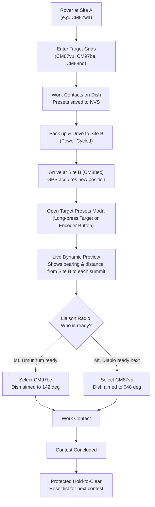
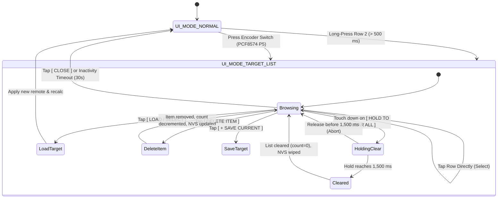

# Target Grid Presets & Mountain-Top History Manager — Design Specification

* **Feature:** Non-Volatile Target Maidenhead Grid History, Rover Preset Manager, & Live Azimuth/Distance Preview
* **Status:** Proposed (v0.4-dev)
* **Target Hardware:** ESP32-S3 (16 MB Flash, 8 MB OPI PSRAM), 480x480 Round Touch Display (ST7701 + CST8XX), Rotary Encoder, PCF8574 I2C Expander

---

## 1. Problem Statement & Motivation

In amateur radio VHF/UHF and microwave weak-signal operations (specifically the **ARRL 10 GHz and Up Contest**, **ARRL June/September VHF Contests**, and **Summits on the Air / SOTA**), rovers operate from portable field locations (hilltops, turnouts, and mountain passes), aiming high-gain dishes and yagis at distant mountain-top stations.

### Operational Context & The Rover Problem
1. **Fixed Targets vs. Moving Rover:** While the rover moves from one operating grid/summit to the next, the distant mountain-top stations (e.g., Mt. Diablo, Mt. Umunhum, Loma Prieta, Mt. Saint Helena) remain geographically fixed.
2. **Asynchronous Readiness:** Mountain-top stations are not ready in a predetermined or sequential order. Station readiness depends on weather, equipment setup, microwave band coordination over a 2-meter liaison frequency, and local operating queues:
   > *"Mt. Umunhum is on 10368.100 MHz now! Work him first! Mt. Diablo is still tuning their feed horn and will be ready in 15 minutes."*
3. **Setup Friction in the Field:** Under high sun glare, freezing wind, or night operations with gloves, manually dialing a 6-character Maidenhead locator (e.g., `C-M-8-7-v-u`) on a touchscreen for every target transition is slow, error-prone, and frustrating.
4. **Relocation Lifecycle:** When the rover completes contacts at Location A, they pack up the vehicle and drive 20+ km to Location B. When they arrive at Location B and power the compass back on:
   - The distant mountain tops have not moved.
   - The operator needs instant recall of previously dialed summits without re-entering them.
   - The operator needs to see live azimuths and distances from the *new* location to each target before aiming the mast.
   - Once a contest weekend ends or the rover enters an entirely new operating division, the operator needs a clean, safe method to clear the preset list.

---

## 2. System Architecture & Rover Workflow

The Target Grid Preset & History Manager introduces an on-device preset cache backed by ESP32 Non-Volatile Storage (NVS) and a high-readability modal dialog designed specifically for 480x480 round displays.



---

## 3. Storage Architecture: ESP32 NVS (`Preferences.h`)

### Non-Volatile Data Scheme & Memory Sizing
The target list is stored in a dedicated NVS namespace (`"targets"`) using a fixed-capacity, structured array. This guarantees that targets survive power cycles, vehicle transit shutdowns, and firmware updates.

#### Memory & Flash Budget Analysis
There is **no restrictive hardware memory limit** on the ESP32-S3:
* **Hardware Specs:** ESP32-S3 features 16 MB NOR Flash, 8 MB OPI PSRAM, and 512 KB internal SRAM.
* **Struct Footprint with Summit Names:** Each preset contains a 6-character Maidenhead locator, an optional 9-character human-readable summit/callsign label (e.g. `"DIABLO"`, `"UMUNHUM"`, `"BEACON"`), and a timestamp:
  ```cpp
  #define MAX_TARGET_PRESETS 20
  #define MAX_LABEL_LEN 10

  struct TargetPreset {
    char grid[7];              // "CM87vu" (6 chars + null)
    char label[MAX_LABEL_LEN]; // "DIABLO" (up to 9 chars + null)
    uint32_t lastUsedTime;     // Unix timestamp or sequence counter
  };

  struct TargetPresetList {
    uint8_t count;
    TargetPreset items[MAX_TARGET_PRESETS];
    uint16_t checksum;
  };
  ```
* **Total Storage Size:** For **20 presets with labels**, the entire `TargetPresetList` occupies only **423 bytes**:
  $$\text{Size} = 1\text{ byte (count)} + (20 \times 21\text{ bytes}) + 2\text{ bytes (checksum)} = 423\text{ bytes}$$
* **NVS Partition Fit:** Standard ESP-IDF NVS flash pages are 4,096 bytes, and individual NVS blobs comfortably hold up to 4,000 bytes. At 423 bytes, the 20-preset roster consumes $\approx 10\%$ of a single NVS page and negligible RAM ($< 0.1\%$).
* **Contest Realism:** Expanding to **20 named presets** provides complete coverage for a multi-day rover weekend spanning 15–20 regional mountain summits, microwave beacons, and frequent contest contacts across multiple grid squares.

### Flash Wear Mitigation & Write Gating
NOR flash wear leveling is handled automatically by ESP-IDF NVS. To further minimize flash writes:
* Presets are committed to NVS **only** when modified:
  1. An explicit `[ SAVE CURRENT ]` action occurs.
  2. The target editor auto-locks on a new unique grid.
  3. An entry is deleted or the entire list is cleared.
* Writes are bypassed if the current active target already matches an existing preset.

```cpp
void saveTargetPresetsToNVS(const TargetPresetList& list) {
  Preferences prefs;
  prefs.begin("targets", false);
  prefs.putBytes("preset_blob", &list, sizeof(TargetPresetList));
  prefs.end();
}

bool loadTargetPresetsFromNVS(TargetPresetList& list) {
  Preferences prefs;
  prefs.begin("targets", true);
  size_t len = prefs.getBytes("preset_blob", &list, sizeof(TargetPresetList));
  prefs.end();
  
  if (len != sizeof(TargetPresetList) || list.count > MAX_TARGET_PRESETS) {
    list.count = 0; // Initialize empty on first boot or corruption
    return false;
  }
  return true;
}
```

---

## 4. UI Layout & Circular Display Specifications (480x480)

The target list interface uses a dedicated modal view (`UI_MODE_TARGET_LIST`), visually consistent with the Antenna Calibration modal (`UI_MODE_CALIBRATING`).

### Circular Geometry & Chord Constraints
On a 480x480 circular panel, the modal card is centered with an inset width of 380 px ($X \in [50, 430]$) and height of 350 px ($Y \in [65, 415]$), preventing bezel clipping at all four corners.

```text
               .---. (Y = 0)
            .-'     '-.
          .'   Row 1   '.     Y=35: Live Local Grid (mygrid) & UTC
         / +---------------+ \
        |  | TARGET PRESETS|  | Y=75: Modal Header with count (X/20)
        |  +---------------+  |
        |  |1.CM87vu DIABLO 048°|#| Y=125: Item 1 (Active) [Scroll Track]
        |  |2.CM97be UMUNHUM142°|#| Y=175: Item 2          [Thumb #    ]
        |  |3.CM88no ST_HELN338°| | Y=225: Item 3          [Track      ]
        |  +---------------+  |
        |  |[LOAD] [DEL] [+SAVE]| Y=272: Load Selected / Delete Item / Save Current
        |  | [HOLD TO CLEAR ALL]| Y=324: 1.5s Hold-to-Clear Safety Bar (Wipe All)
         \ +---------------+ /  Y=376: Cancel / Back Button
          '.   Row 6   .'
            '-.     .-'
               '---' (Y = 480)
```

### Visual Row & Component Budget

| Component | Coordinates | Visual Styling | Function / Interaction |
| :--- | :--- | :--- | :--- |
| **Modal Background** | $X \in [45, 435]$, $Y \in [65, 415]$ | Dark Slate (`0x10A2`), 12px rounded corner | Modal background container |
| **Header Bar** | $X \in [60, 420]$, $Y \in [75, 105]$ | Yellow (`0xFFE0`), Font Size 2 | `"SAVED TARGET GRIDS (3/20)"` |
| **List Entry 1** | $X \in [60, 408]$, $Y \in [115, 160]$ | Cyan border if selected, Font Size 3 | Visible item 1 (Grid locator, live azimuth & distance) |
| **List Entry 2** | $X \in [60, 408]$, $Y \in [165, 210]$ | Gray border, Font Size 3 | Visible item 2 |
| **List Entry 3** | $X \in [60, 408]$, $Y \in [215, 260]$ | Gray border, Font Size 3 | Visible item 3 |
| **Scroll Indicator** | $X \in [414, 422]$, $Y \in [115, 260]$ | Gray track, White thumb bar | Proportional scroll position indicator (0 to 19) |
| **[ LOAD / SELECT ]** | $X \in [55, 170]$, $Y \in [270, 314]$ | Emerald Green (`0x0540`), Font Size 2 | Tap activates highlighted preset as active `remote` |
| **[ DELETE ITEM ]** | $X \in [180, 290]$, $Y \in [270, 314]$ | Crimson Red (`0x9800`), Font Size 2 | Tap removes only the selected preset item |
| **[ + SAVE CURRENT ]** | $X \in [300, 425]$, $Y \in [270, 314]$ | Cobalt Blue (`0x2945`), Font Size 2 | Tap bookmarks current active target into list |
| **[ HOLD TO CLEAR ALL ]** | $X \in [55, 425]$, $Y \in [324, 368]$ | Dark Red (`0x5000`), Yellow fill bar | 1.5-second hold wipes entire list from NVS |
| **[ CLOSE ]** | $X \in [150, 330]$, $Y \in [376, 408]$ | Dark Gray (`0x3186`), Font Size 2 | Tap dismisses modal without changes |

---

## 5. Live Geodetic Preview Feature

A critical operational capability for rovers is that the preset manager does not merely show static 6-character strings (`CM87vu`).

Instead, as the modal renders each preset, it dynamically calculates:
1. **Target Azimuth:** Great-circle true bearing from live GPS position (`mygrid`) to the preset subsquare center.
2. **Line-of-Sight Distance:** Great-circle distance in kilometers.

```cpp
void drawPresetRow(int index, const TargetPreset& preset, bool isSelected, int yPos) {
  double tgtLat, tgtLon;
  calcLatLon(preset.grid, &tgtLat, &tgtLon);
  
  double distMeters, fwdAzimuth, revAzimuth;
  calculateWGS84(mylatitude, mylongitude, tgtLat, tgtLon, &distMeters, &fwdAzimuth, &revAzimuth);
  
  int distKm = (int)round(distMeters / 1000.0);
  
  // Format: "1. CM87vu DIABLO  048° 42k" (Font Size 2, 12px per char, 28 chars = 336px)
  char lineBuf[36];
  if (preset.label[0] != '\0') {
    snprintf(lineBuf, sizeof(lineBuf), "%d. %s %-8.8s %05.1f\xf7 %3dk", 
             index + 1, preset.grid, preset.label, fwdAzimuth, distKm);
  } else {
    snprintf(lineBuf, sizeof(lineBuf), "%d. %s          %05.1f\xf7 %3dk", 
             index + 1, preset.grid, fwdAzimuth, distKm);
  }
  
  // Highlight active row with contrasting bounding box
  if (isSelected) {
    gfx->fillRoundRect(60, yPos, 348, 44, 6, 0x03E0); // Forest green highlight
    gfx->setTextColor(WHITE, 0x03E0);
  } else {
    gfx->fillRoundRect(60, yPos, 348, 44, 6, 0x18E3); // Subdued slate
    gfx->setTextColor(0xDEFB, 0x18E3);
  }
  
  gfx->setTextSize(2);
  gfx->setCursor(68, yPos + 14);
  gfx->print(lineBuf);
}
```

This gives the rover instant situational awareness: when arriving at a new summit, the operator can see the bearings, distances, and summit names to all worked mountains simultaneously on one screen.

---

### How Summit / Target Names are Assigned

Because typing text with gloves on a small round screen can be tedious, names are entered through three complementary mechanisms:

#### 1. USB Serial CLI Provisioning & Batch File Streaming (Primary Pre-Contest Method)
Before heading into the field, operators can connect the compass to a laptop or phone via USB-C serial (`/dev/ttyACM0` at `115200` baud) and configure their weekend target list in seconds.

##### Interactive Serial Commands
```text
=== Target Preset Serial Commands ===
target add <GRID> [LABEL]   - Add or update a target (e.g., "target add CM87vu DIABLO")
target del <INDEX|GRID>     - Remove a specific target by 1-based index or grid
target list                 - Print all saved targets with index, grid, label, and NVS slot
target clear                - Wipe all target presets
```

##### Batch Provisioning via Script / Config File Streaming
Rather than requiring complex file transfer protocols (like XMODEM/YMODEM) or flashing raw filesystem partition images (LittleFS/SPIFFS), the serial interface acts as a **stream loader**:

1. **Create a Contest Config File (`contest_targets.txt`):**
   ```text
   # ----------------------------------------------------
   # ARRL 10 GHz Contest - NorCal Rover Summit Roster
   # ----------------------------------------------------
   target clear
   target add CM87vu DIABLO
   target add CM97be UMUNHUM
   target add CM97bb LOMA_P
   target add CM88no ST_HELN
   target add CM87uv TAMALPAIS
   target add DM04ms FRAZIER
   target add DM13dr SADDLEBK
   target list
   ```

2. **Pushing the File to the ESP32:**
   * **Via Minicom:** Press `Ctrl+A`, then `S` (*Send file*), select `ascii`, and choose `contest_targets.txt`.
   * **Via SecureCRT:** Go to **Transfer → Send ASCII...** and select `contest_targets.txt` (or simply copy the text and right-click paste into the terminal window).
   * **Via Linux Shell (1-line pipe):**
     ```bash
     stty -F /dev/ttyACM0 115200 raw -echo
     cat contest_targets.txt > /dev/ttyACM0
     ```
   * **Via Python Script:**
     ```python
     import serial, time
     with serial.Serial("/dev/ttyACM0", 115200, timeout=1) as ser:
         with open("contest_targets.txt") as f:
             for line in f:
                 if line.strip() and not line.startswith("#"):
                     ser.write((line.strip() + "\r\n").encode())
                     time.sleep(0.05)
     ```

3. **Device Execution & Confirmation:**
   As lines stream across USB CDC, `processSerialInput()` parses each command, validates the Maidenhead format, and writes the `TargetPresetList` struct into NVS flash with atomic wear leveling. The device confirms:
   ```text
   [TARGET] Cleared all presets.
   [TARGET] Added #1: CM87vu (DIABLO)
   [TARGET] Added #2: CM97be (UMUNHUM)
   [TARGET] Added #3: CM97bb (LOMA_P)
   [TARGET] Added #4: CM88no (ST_HELN)
   [TARGET] Added #5: CM87uv (TAMALPAIS)
   [TARGET] Added #6: DM04ms (FRAZIER)
   [TARGET] Added #7: DM13dr (SADDLEBK)
   === Saved Target Presets (7/20) ===
     #1: CM87vu - DIABLO
     #2: CM97be - UMUNHUM
     #3: CM97bb - LOMA_P
     #4: CM88no - ST_HELN
     #5: CM87uv - TAMALPAIS
     #6: DM04ms - FRAZIER
     #7: DM13dr - SADDLEBK
   ===================================
   ```
   All targets are now permanently committed to flash. The operator can unplug the USB cable, drive to any operating site, and find all summits waiting in the on-screen preset picker.

##### Why Serial Streaming is Chosen Over Flash Filesystem Images (LittleFS)
* **Zero Partitioning Overhead:** No need to carve out a 1.5 MB flash partition or reflash partition tables.
* **Direct NVS Integration:** Reuses the existing robust ESP-IDF `Preferences` wear-leveling log structure.
* **Human-Editable in Any Editor:** Files can be edited in Notepad, Vim, or exported from contest logging spreadsheets without build toolchains (`mklittlefs` / `esptool`).
* **Interactive Verification:** Immediate CLI feedback confirms whether each grid was valid or full before packing for the field.

#### 2. Pre-Loaded Regional Summit Table (Zero-Effort Field Auto-Detection)
In major contest regions (e.g., Northern California, Southern California, Pacific Northwest), rovers repeatedly work the same classic microwave peaks. A small lookup table in firmware flash (`PROGMEM`) automatically maps known 6-character subsquares to default summit names:
```cpp
struct KnownSummit {
  const char* grid;
  const char* name;
};

const KnownSummit REGIONAL_SUMMITS[] PROGMEM = {
  {"CM87vu", "DIABLO"},
  {"CM97be", "UMUNHUM"},
  {"CM97bb", "LOMA P"},
  {"CM88no", "ST HELN"},
  {"CM87uv", "TAMALPAIS"},
  {"DM04ms", "FRAZIER"},
  {"DM13dr", "SADDLEBK"}
};
```
When an operator dials in a grid on the touchscreen (e.g. `CM87vu`) and taps **`[ + SAVE CURRENT ]`**, the firmware automatically looks up the grid. If it matches a known regional summit and no custom label exists, it automatically assigns `"DIABLO"`!

#### 3. Touch Screen Fallback
If a grid is dialed on-screen that does not exist in the regional lookup table, the label field remains blank (`""`), and the UI displays the 6-character Maidenhead locator prominently:
```text
4. CM98aa          124.5°  64k
```

---

## 6. Input Arbitration & Dual Controls (Touch + Rotary Knob)

Both capacitive touch and the rotary encoder are fully supported to accommodate operators wearing gloves or working in direct sunlight:



### 1. Opening the Modal
* **Touch:** Long-press anywhere on the Target Grid (Row 2, $Y \in [70, 235]$) for $\ge 500\text{ ms}$. (A short tap $< 500\text{ ms}$ retains existing character edit behavior).
* **Rotary Switch:** Press the encoder push-button (`pcf8574.pinMode(P5)`).

### 2. Navigating Presets
* **Rotary Encoder:** Turning the knob increments/decrements the selected index ($0$ to $\text{count} - 1$) with audible clicks and responsive visual highlight scrolling.
* **Direct Touch:** Tapping any visible row immediately sets it as the selected index.

### 3. Loading a Target
* Tapping `[ LOAD / SELECT ]` (or clicking the encoder switch while an item is highlighted):
  1. Copies `preset.grid` into active `remote`.
  2. Updates `remlatitude` and `remlongitude`.
  3. Resets `rovdist = false` (exits rover origin tracking).
  4. Recalculates bearings and distances via `updateBearings()`.
  5. Exits modal back to `UI_MODE_NORMAL`.

### 4. Deleting an Individual Item (Accidental Entry Removal)
If an operator accidentally bookmarks a typo (e.g., `CM87aa` instead of `CM87wa`) or no longer needs a specific summit in their roster:
* Highlight the target using the rotary knob or direct row tap.
* Tap the red **`[ DELETE ITEM ]`** button.
* **Action:**
  1. Removes that specific entry at `selectedPresetIndex`.
  2. Shifts all subsequent items down by one position:
     ```cpp
     for (int i = index; i < targetPresets.count - 1; i++) {
       targetPresets.items[i] = targetPresets.items[i + 1];
     }
     targetPresets.count--;
     ```
  3. Clamps `selectedPresetIndex` within $[0, \text{count} - 1]$.
  4. Commits the updated 20-item list to NVS immediately.
  5. Redraws the list in place without closing the modal.

### 5. Adding / Bookmarking Current Target
* Tapping `[ + SAVE CURRENT ]`:
  1. Validates that `remote` is a complete 6-character Maidenhead locator.
  2. Checks for duplicates: if already present, moves the entry to the top (MRU promotion).
  3. If new and list is full ($20/20$), evicts the oldest unselected entry (FIFO/LRU).
  4. Commits to NVS and redraws modal with updated count.

### 6. Safe Reset / Hold-to-Clear All Architecture (Full List Wipe)
When starting a new contest weekend or roving into a completely different division:
* The **`[ HOLD TO CLEAR ALL ]`** button wipes the entire roster.
* **Accidental Tap Protection:** Requires a continuous **1,500 ms long-press** with an animated yellow progress bar filling from left to right across the button.
* If the finger drifts off or is released before 1,500 ms, the wipe is aborted with no changes.
* Once the 1,500 ms hold completes:
  1. `targetPresets.count = 0;`
  2. Commits the empty list struct to NVS.
  3. The display redraws showing `"SAVED TARGET GRIDS (0/20)"` with an `"Empty List"` placeholder.

---

## 7. Firmware Data Structures & Functions

### New Enums & Global Variables
```cpp
enum UiMode {
  UI_MODE_NORMAL = 0,
  UI_MODE_CALIBRATING = 1,
  UI_MODE_TARGET_LIST = 2
};

TargetPresetList targetPresets;
int selectedPresetIndex = 0;   // 0 to count-1 (up to 19)
int presetScrollOffset = 0;    // Top visible item index (0 to count-3)
bool holdingClearBtn = false;
unsigned long clearBtnHoldStartTime = 0;
#define CLEAR_HOLD_MS 1500
#define PRESET_MODAL_TIMEOUT_MS 30000
unsigned long presetModalOpenedMillis = 0;
```

### Core API Functions
* `void initTargetPresets()`: Loads preset blob from NVS at boot.
* `void addTargetPreset(const char* grid)`: Adds or promotes grid with deduplication (up to 20 items).
* `void removeTargetPreset(int index)`: Deletes individual preset.
* `void clearAllTargetPresets()`: Resets list and writes clean state to NVS.
* `void drawTargetListModal()`: Full canvas rendering of presets, scroll track, buttons, and live bearings.
* `void handleTargetListTouch(CST_TS_Point p, bool isDown, unsigned long duration)`: Touch arbitration for modal.
* `void handleTargetListEncoder(int direction)`: Rotary scrolling through preset items with automatic viewport adjustment.

---

## 8. Verification & Test Plan

### Automated Host Unit Tests (`tests/test_target_history.cpp`)
1. **Deduplication Verification:** Adding `CM87vu` twice results in `count == 1` with the entry promoted to index 0.
2. **Capacity & Overflow Handling:** Adding 21 unique grids into a 20-slot list evicts the oldest entry and preserves the 20 most recent.
3. **Individual Item Deletion & Shift:** Deleting an entry from the middle of a list (e.g., removing item at index 2 of 5) correctly shifts subsequent items up, sets `count = 4`, and updates NVS.
4. **Format & Bounds Checking:** Rejection of non-Maidenhead or malformed strings.
5. **Hold-to-Clear Timing Logic:** Asserts that hold durations $< 1,500\text{ ms}$ reject clearing, while $\ge 1,500\text{ ms}$ commit an empty list.
6. **NVS Blob Serialization:** Byte-for-byte fidelity of 423-byte list serialization and deserialization.

### On-Device Hardware & Visual Self-Test
* Extend `runVisualSelfTest()` to include an interactive demo of the Target Presets modal with simulated mountain tops (e.g., Mt. Diablo, Mt. Umunhum, Mt. Tamalpais), demonstrating knob navigation and selection.

---

## 9. Future Extensibility

* **Azimuth Quick-Sort:** Option to sort presets dynamically by relative clockwise bearing from current mast heading.
* **Elevation Tilt Calculation:** Storing target elevation (meters ASL) to calculate dish vertical tilt angle in addition to true azimuth.
* **WebBluetooth / Mobile Companion:** Import and export preset rosters directly from contest logging software via BLE.

