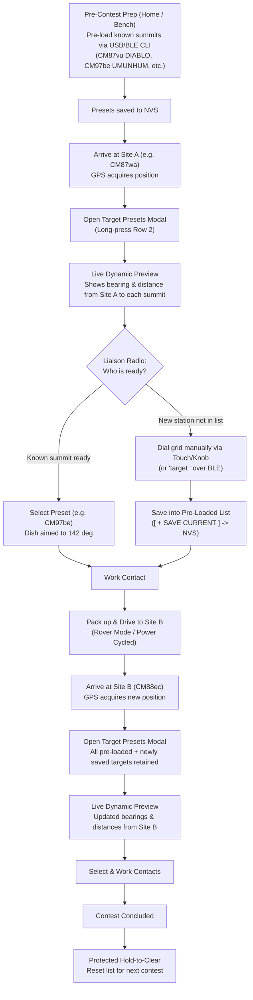
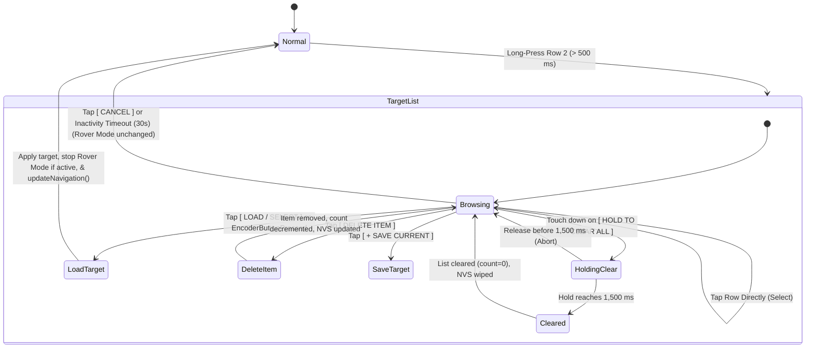

# Target Grid Presets & Mountain-Top History Manager — Design Specification

* **Feature:** Non-Volatile Target Maidenhead Grid History, Rover Preset Manager, & Live Azimuth/Distance Preview
* **Status:** Proposed (v0.4-dev)
* **Target Hardware:** ESP32-S3 (16 MB Flash, 8 MB OPI PSRAM), 480x480 Round Touch Display (ST7701 + CST8XX), Rotary Encoder, PCF8574 I2C Expander

---

## 1. Problem Statement & Motivation

In amateur radio VHF/UHF and microwave weak-signal operations (specifically the **ARRL 10 GHz and Up Contest**, **ARRL June/September VHF Contests**, and **Summits on the Air / SOTA**), rovers operate from portable field locations (hilltops, turnouts, and mountain passes), aiming high-gain dishes and yagis at distant mountain-top stations.

### Operational Context & The Rover Problem
1. **Fixed Targets vs. Moving Rover:** While the rover moves from one operating grid/summit to the next, the distant mountain-top stations (e.g., Mt. Diablo, Mt. Umunhum, Loma Prieta, Mt. Saint Helena) remain geographically fixed.
2. **Asynchronous Readiness:** Mountain-top stations are not ready in a predetermined or sequential order. Station readiness depends on weather, equipment setup, microwave band coordination over a 2-meter liaison frequency, and local operating queues:
   > *"Mt. Umunhum is on 10368.100 MHz now. Work him first. Mt. Diablo is still working someone else and will be ready in 15 minutes."*
3. **Setup Friction in the Field:** Under high sun glare, freezing wind, operations with gloves, manually dialing a 6-character Maidenhead locator (e.g., `C-M-8-7-v-u`) on a touchscreen for every target transition is slow, error-prone, and frustrating.
4. **Relocation Lifecycle:** When the rover completes contacts at Location A, they pack up the vehicle and drive 20+ km to Location B. When they arrive at Location B and are ready to switch from rover mode:
   - The distant mountain tops have not moved.
   - The operator needs instant recall of previously dialed summits without re-entering them.
   - The operator needs to see live azimuths (distances are nice to have) from the *new* location to each target before aiming the mast.
   - Once a contest weekend ends or the rover enters an entirely new operating division, the operator needs a clean, safe method to clear the preset list.

---

## 2. System Architecture & Rover Workflow

The Target Grid Preset & History Manager introduces an on-device preset cache backed by ESP32 Non-Volatile Storage (NVS) and a high-readability modal dialog designed specifically for 480x480 round displays.



---

## 3. Storage Architecture: ESP32 NVS (`Preferences.h`)

### Non-Volatile Data Scheme, Configurable Capacity, & Shared NVS Helper
The target list is stored in NVS using the same indexed-key architecture as `RoverLogManager` (`target_log` / `target_cfg` namespaces), managed through a lightweight shared helper (`src/system/nvs_store.h` providing `NvsConfig` and `NvsListStore<T>`) so new NVS-backed managers avoid duplicating `#if defined(ARDUINO)` / host-mock persistence boilerplate. (Existing `RoverLogManager` and `QsoLogManager` remain untouched for MVP.)

#### Capacity & Struct Footprint
* **Configurable Max Size:** Like Rover History (`DEFAULT_MAX_ROVER_STOPS = 100`, `10–500`), Target Presets supports a configurable capacity `maxTargets_` (**default `100`**, clamped **`10–500`**) persisted under `"target_cfg"` (`"max_targets"`), adjustable via `target max <n>`.
* **Indexed NVS Keys:** Storing entries as indexed keys (`t0`, `t1`, ...) with `count` avoids the ~4 KB ESP-IDF single-blob limit, scaling cleanly up to 500 presets with automatic orphan cleanup if capacity is reduced.
* **Struct Footprint (`TargetPreset`):** Each preset contains a 6-character Maidenhead locator, an optional 11-character human-readable label (spaces allowed, e.g. `"MT DIABLO"`, `"LOMA PRIETA"`), a usage counter for frequency-first sorting, and a timestamp:
  ```cpp
  #define DEFAULT_MAX_TARGET_PRESETS 100
  #define MIN_TARGET_PRESETS         10
  #define ABS_MAX_TARGET_PRESETS     500
  #define MAX_TARGET_LABEL_LEN       12

  #pragma pack(push, 1)
  struct TargetPreset {
    char     grid[7];                      // "CM87vu" (6 chars + null)
    char     label[MAX_TARGET_LABEL_LEN];  // "MT DIABLO" (up to 11 chars + null, spaces allowed)
    uint16_t useCount;                     // Incremented on [ LOAD / SELECT ] for frequency sorting
    uint32_t lastUsedTime;                 // Unix timestamp or sequence counter (tie-breaker)
  };
  #pragma pack(pop)
  ```
* **Sorting (MVP):** Presets are sorted by **usage frequency (`useCount` descending)**, with `lastUsedTime` descending as a tie-breaker so the most frequently worked summits always appear at the top.

### Flash Wear Mitigation & Write Gating
NOR flash wear leveling is handled automatically by ESP-IDF NVS. To further minimize flash writes and keep a pre-loaded contest roster clean:
* Presets are committed to NVS **only** on explicit modification:
  1. An explicit `[ + SAVE CURRENT ]` action in the Target Presets modal (or `target save [LABEL...]` via CLI).
  2. Loading a preset via `[ LOAD / SELECT ]` (updates `useCount` and `lastUsedTime`).
  3. A CLI provisioning command (`target add`, `target del`, `target clear`, `target max`) over USB Serial or BLE UART.
  4. An entry is deleted (`[ DELETE ITEM ]`) or the entire list is cleared (`[ HOLD TO CLEAR ALL ]`).
* Auto-locking the target editor after 5 seconds does **not** automatically bookmark transient/exploratory grids into the preset list.
* Entries are overwritten in place via `NvsListStore<TargetPreset>` without calling `clear()` mid-write, protecting against power loss.

---

## 4. UI Layout & Circular Display Specifications (480x480)

The target list interface uses a dedicated modal view (`UiMode::TargetList`), visually consistent with the Antenna Calibration and Rover History modals.

### Circular Geometry & Chord Constraints
On a 480x480 circular panel, the modal card is centered with an inset width of 380 px ($X \in [50, 430]$) and height of 350 px ($Y \in [65, 415]$), preventing bezel clipping at all four corners.

```text
               .---. (Y = 0)
            .-'     '-.
          .'   Row 1   '.     Y=35: Live Local Grid (mygrid) & UTC
         / +---------------+ \
        |  | TARGET PRESETS|  | Y=75: Modal Header with count (X/100)
        |  +---------------+  |
        |  |1.CM87vu DIABLO 048°|#| Y=125: Item 1 (Active) [Scroll Track]
        |  |2.CM97be UMUNHUM142°|#| Y=175: Item 2          [Thumb #    ]
        |  |3.CM88no ST HELN338°| | Y=225: Item 3          [Track      ]
        |  +---------------+  |
        |  |[LOAD] [DEL] [+SAVE]| Y=272: Load Selected / Delete Item / Save Current
        |  | [HOLD TO CLEAR ALL]| Y=324: 1.5s Hold-to-Clear Safety Bar (Wipe All)
         \ +---------------+ /  Y=376: [ CANCEL ] Button
          '.   Row 6   .'
            '-.     .-'
               '---' (Y = 480)
```

### Visual Row & Component Budget

| Component | Coordinates | Visual Styling | Function / Interaction |
| :--- | :--- | :--- | :--- |
| **Modal Background** | $X \in [45, 435]$, $Y \in [65, 415]$ | Dark Slate (`0x10A2`), 12px rounded corner | Modal background container |
| **Header Bar** | $X \in [60, 420]$, $Y \in [75, 105]$ | Yellow (`0xFFE0`), Font Size 2 | `"SAVED TARGET GRIDS (3/100)"` |
| **List Entry 1** | $X \in [60, 408]$, $Y \in [115, 160]$ | Cyan border if selected, Font Size 3 | Visible item 1 (Grid locator, label, live azimuth & distance) |
| **List Entry 2** | $X \in [60, 408]$, $Y \in [165, 210]$ | Gray border, Font Size 3 | Visible item 2 |
| **List Entry 3** | $X \in [60, 408]$, $Y \in [215, 260]$ | Gray border, Font Size 3 | Visible item 3 |
| **Scroll Indicator** | $X \in [414, 422]$, $Y \in [115, 260]$ | Gray track, White thumb bar | Proportional scroll position indicator (`0` to `count - 1`) |
| **[ LOAD / SELECT ]** | $X \in [55, 170]$, $Y \in [270, 314]$ | Emerald Green (`0x0540`), Font Size 2 | Activates preset as target, increments `useCount`, **stops Rover Mode** |
| **[ DELETE ITEM ]** | $X \in [180, 290]$, $Y \in [270, 314]$ | Crimson Red (`0x9800`), Font Size 2 | Removes only the selected preset item |
| **[ + SAVE CURRENT ]** | $X \in [300, 425]$, $Y \in [270, 314]$ | Cobalt Blue (`0x2945`), Font Size 2 | Bookmarks current active target into list |
| **[ HOLD TO CLEAR ALL ]** | $X \in [55, 425]$, $Y \in [324, 368]$ | Dark Red (`0x5000`), Yellow fill bar | 1.5-second hold wipes entire list from NVS |
| **[ CANCEL ]** | $X \in [150, 330]$, $Y \in [376, 408]$ | Dark Gray (`0x3186`), Font Size 2 | Dismisses modal without changing target or stopping Rover Mode |

### Main Screen Integration: Row 2 Target Label Subtitle
On the main compass screen (`UiMode::Normal`), `DisplayUi::renderTargetGrid()` currently leaves the caret row directly beneath the 6-character target grid (`REMSTARTY + CHAR_H(REMSIZE)`) blank whenever `isEditing == false`:

* **Bearing Mode (`OperationalMode::Bearing`, `isEditing == false`):** If the active target grid matches a saved preset with a non-empty `label` (or regional summit lookup), render the label centered/left-aligned in that empty caret-row space beneath Row 2.
* **Target Editing (`isEditing == true`):** Immediately clear the label area so the `^` under-caret and character selection occupy the full space as before.
* **Touch Hit Zones Unchanged:** All Row 2 touch hitboxes ("hot pixels" for tapping characters to enter edit mode or long-pressing Row 2) remain identical.
* **Rover Mode (`OperationalMode::Rover`):** Keep the Row 2 subtitle area empty/cleared.

---

## 5. Live Geodetic Preview Feature

A critical operational capability for rovers is that the preset manager does not merely show static 6-character strings (`CM87vu`).

Instead, as the modal renders each preset, it dynamically calculates:
1. **Target Azimuth:** Great-circle true bearing from live GPS position (`mygrid`) to the preset subsquare center.
2. **Line-of-Sight Distance:** Great-circle distance in kilometers.

```cpp
void drawPresetRow(int index, const TargetPreset& preset, const GeoPoint& currentPos, bool isSelected, int yPos) {
  GeoPoint tgtPt;
  gridToGeoPoint(preset.grid, tgtPt);

  double distMeters = 0.0, fwdAzimuth = 0.0;
  calculateWgs84(currentPos, tgtPt, distMeters, fwdAzimuth);

  int distKm = static_cast<int>(std::round(distMeters / 1000.0));
  
  // Format: "1. CM87vu DIABLO  048° 42k" (Font Size 2, 12px per char, 28 chars = 336px)
  char lineBuf[36];
  if (preset.label[0] != '\0') {
    snprintf(lineBuf, sizeof(lineBuf), "%d. %s %-8.8s %05.1f\xf7 %3dk", 
             index + 1, preset.grid, preset.label, fwdAzimuth, distKm);
  } else {
    snprintf(lineBuf, sizeof(lineBuf), "%d. %s          %05.1f\xf7 %3dk", 
             index + 1, preset.grid, fwdAzimuth, distKm);
  }
  
  // Highlight active row with contrasting bounding box
  if (isSelected) {
    gfx->fillRoundRect(60, yPos, 348, 44, 6, 0x03E0); // Forest green highlight
    gfx->setTextColor(WHITE, 0x03E0);
  } else {
    gfx->fillRoundRect(60, yPos, 348, 44, 6, 0x18E3); // Subdued slate
    gfx->setTextColor(0xDEFB, 0x18E3);
  }
  
  gfx->setTextSize(2);
  gfx->setCursor(68, yPos + 14);
  gfx->print(lineBuf);
}
```

This gives the rover instant situational awareness: when arriving at a new summit, the operator can see the bearings, distances, and summit names to all worked mountains simultaneously on one screen.

---

### How Summit / Target Names are Assigned

Because typing text with gloves on a small round screen can be tedious, names are entered through three complementary mechanisms:

#### 1. USB Serial & BLE UART CLI Provisioning & Batch File Streaming (Primary Pre-Contest Method)
Before heading into the field, operators can connect the compass to a laptop or phone via USB-C serial (`/dev/ttyACM0` at `115200` baud) or BLE UART and configure their weekend target list in seconds. These subcommands extend the existing `target <grid>` command in `SerialCli::handleTargetCommand()` (which continues to set the active target grid directly when given a Maidenhead locator or NATO phonetics):

##### Interactive Serial Commands
```text
=== Target Preset Serial Commands ===
target <GRID>               - Set active target grid directly (existing voice/CLI command)
target add <GRID> [LABEL]   - Add or update a target preset (spaces allowed, e.g. "target add CM97bb LOMA PRIETA")
target save [LABEL]         - Save the current active target grid into presets (optional label, spaces allowed)
target del <INDEX|GRID>     - Remove a specific target by 1-based index or grid
target list                 - Print all saved targets with index, grid, label, use count, and NVS slot
target max [N]              - Show or set max preset capacity (10-500, default 100)
target clear                - Wipe all target presets
```

##### Batch Provisioning via Script / Config File Streaming
Rather than requiring complex file transfer protocols (like XMODEM/YMODEM) or flashing raw filesystem partition images (LittleFS/SPIFFS), the serial interface acts as a **stream loader**:

1. **Create a Contest Config File (`contest_targets.txt`):**
   ```text
   # ----------------------------------------------------
   # ARRL 10 GHz Contest - NorCal Rover Summit Roster
   # ----------------------------------------------------
   target clear
   target add CM87vu DIABLO
   target add CM97be UMUNHUM
   target add CM97bb LOMA_P
   target add CM88no ST_HELN
   target add CM87uv TAMALPAIS
   target add DM04ms FRAZIER
   target add DM13dr SADDLEBK
   target list
   ```

2. **Pushing the File to the ESP32:**
   * **Via Minicom:** Press `Ctrl+A`, then `S` (*Send file*), select `ascii`, and choose `contest_targets.txt`.
   * **Via SecureCRT:** Go to **Transfer → Send ASCII...** and select `contest_targets.txt` (or simply copy the text and right-click paste into the terminal window).
   * **Via Linux Shell (1-line pipe):**
     ```bash
     stty -F /dev/ttyACM0 115200 raw -echo
     cat contest_targets.txt > /dev/ttyACM0
     ```
   * **Via Python Script:**
     ```python
     import serial, time
     with serial.Serial("/dev/ttyACM0", 115200, timeout=1) as ser:
         with open("contest_targets.txt") as f:
             for line in f:
                 if line.strip() and not line.startswith("#"):
                     ser.write((line.strip() + "\r\n").encode())
                     time.sleep(0.05)
     ```

3. **Device Execution & Confirmation:**
   As lines stream across USB CDC, `processSerialInput()` parses each command, validates the Maidenhead format, and writes the `TargetPresetList` struct into NVS flash with atomic wear leveling. The device confirms:
   ```text
   [TARGET] Cleared all presets.
   [TARGET] Added #1: CM87vu (DIABLO)
   [TARGET] Added #2: CM97be (UMUNHUM)
   [TARGET] Added #3: CM97bb (LOMA_P)
   [TARGET] Added #4: CM88no (ST_HELN)
   [TARGET] Added #5: CM87uv (TAMALPAIS)
   [TARGET] Added #6: DM04ms (FRAZIER)
   [TARGET] Added #7: DM13dr (SADDLEBK)
   === Saved Target Presets (7/20) ===
     #1: CM87vu - DIABLO
     #2: CM97be - UMUNHUM
     #3: CM97bb - LOMA_P
     #4: CM88no - ST_HELN
     #5: CM87uv - TAMALPAIS
     #6: DM04ms - FRAZIER
     #7: DM13dr - SADDLEBK
   ===================================
   ```
   All targets are now permanently committed to flash. The operator can unplug the USB cable, drive to any operating site, and find all summits waiting in the on-screen preset picker.

##### Why Serial Streaming is Chosen Over Flash Filesystem Images (LittleFS)
* **Zero Partitioning Overhead:** No need to carve out a 1.5 MB flash partition or reflash partition tables.
* **Direct NVS Integration:** Reuses the existing robust ESP-IDF `Preferences` wear-leveling log structure.
* **Human-Editable in Any Editor:** Files can be edited in Notepad, Vim, or exported from contest logging spreadsheets without build toolchains (`mklittlefs` / `esptool`).
* **Interactive Verification:** Immediate CLI feedback confirms whether each grid was valid or full before packing for the field.

#### 2. Pre-Loaded Regional Summit Table (Zero-Effort Field Auto-Detection)
In major contest regions (e.g., Northern California, Southern California, Pacific Northwest), rovers repeatedly work the same classic microwave peaks. A small lookup table in firmware flash (`PROGMEM`) automatically maps known 6-character subsquares to default summit names:
```cpp
struct KnownSummit {
  const char* grid;
  const char* name;
};

const KnownSummit REGIONAL_SUMMITS[] PROGMEM = {
  {"CM87vu", "DIABLO"},
  {"CM97be", "UMUNHUM"},
  {"CM97bb", "LOMA P"},
  {"CM88no", "ST HELN"},
  {"CM87uv", "TAMALPAIS"},
  {"DM04ms", "FRAZIER"},
  {"DM13dr", "SADDLEBK"}
};
```
When an operator dials in a grid on the touchscreen (e.g. `CM87vu`) and taps **`[ + SAVE CURRENT ]`**, the firmware automatically looks up the grid. If it matches a known regional summit and no custom label exists, it automatically assigns `"DIABLO"`!

#### 3. Touch Screen Fallback
If a grid is dialed on-screen that does not exist in the regional lookup table, the label field remains blank (`""`), and the UI displays the 6-character Maidenhead locator prominently:
```text
4. CM98aa          124.5°  64k
```

---

## 6. Input Arbitration & Dual Controls (Touch + Rotary Knob)

Both capacitive touch and the rotary encoder are fully supported to accommodate operators wearing gloves or working in direct sunlight:



### 1. Opening the Modal
* **Touch:** Long-press anywhere on the Target Grid (Row 2, $Y \in [70, 235]$) for $\ge 500\text{ ms}$. (A short tap $< 500\text{ ms}$ retains existing character edit behavior, and pressing the rotary encoder switch in `UiMode::Normal` retains its existing edit-mode toggle).
* **Rover Mode Behavior:** Opening the modal, scrolling, saving, deleting, or dismissing via **`[ CANCEL ]`** (or the 30-second timeout) **does NOT stop Rover Mode**.

### 2. Navigating Presets
* **Rotary Encoder:** Turning the knob increments/decrements the selected index ($0$ to $\text{count} - 1$) with responsive visual highlight scrolling.
* **Direct Touch:** Tapping any visible row immediately sets it as the selected index.

### 3. Loading a Target (and Stopping Rover Mode)
* Tapping **`[ LOAD / SELECT ]`** (or pressing the encoder switch while `UiMode::TargetList` is active):
  1. Increments `preset.useCount`, updates `preset.lastUsedTime`, and re-sorts/saves to NVS.
  2. Loads `preset.grid` into `GridEditor` (`setGrid(...)`) and disarms character editing.
  3. **If `operationalMode_ == OperationalMode::Rover`, calls `stopRoverMode(nowMs)`** (which logs the transit stop via `onTargetEdited(nowMs)` and transitions to `OperationalMode::Bearing`).
  4. Recalculates bearings and distances via `updateNavigation()` and exits modal back to `UiMode::Normal`.

### 4. Deleting an Individual Item (Accidental Entry Removal)
If an operator accidentally bookmarks a typo (e.g., `CM87aa` instead of `CM87wa`) or no longer needs a specific summit in their roster:
* Highlight the target using the rotary knob or direct row tap.
* Tap the red **`[ DELETE ITEM ]`** button.
* **Action:**
  1. Removes that specific entry at `selectedPresetIndex_`.
  2. Clamps `selectedPresetIndex_` within $[0, \text{count} - 1]$.
  3. Commits the updated list to NVS immediately via `NvsListStore`.
  4. Redraws the list in place without closing the modal.

### 5. Adding / Bookmarking Current Target
* Tapping `[ + SAVE CURRENT ]`:
  1. Validates that `gridEditor_.getGrid()` is a complete 6-character Maidenhead locator.
  2. Checks for duplicates: if already present, updates `lastUsedTime` (and preserves existing label/useCount).
  3. If new and list is at `maxTargets_`, evicts the least-used / oldest entry.
  4. Commits to NVS and redraws modal with updated count.

### 6. Safe Reset / Hold-to-Clear All Architecture (Full List Wipe)
When starting a new contest weekend or roving into a completely different division:
* The **`[ HOLD TO CLEAR ALL ]`** button wipes the entire roster.
* **Accidental Tap Protection:** Requires a continuous **1,500 ms long-press** with an animated yellow progress bar filling from left to right across the button.
* If the finger drifts off or is released before 1,500 ms, the wipe is aborted with no changes.
* Once the 1,500 ms hold completes:
  1. Clears all items (`count = 0`) and commits to NVS.
  2. The display redraws showing `"SAVED TARGET GRIDS (0/100)"` (using configured `maxTargets_`) with an `"Empty List"` placeholder.

---

## 7. Firmware Data Structures & Modular Architecture

### New Modules & Enum Extensions
* **`UiMode::TargetList`** added to `enum class UiMode` in `src/system/app_controller.h` (alongside `Normal`, `Calibrating`, `RoverHistory`, and `QsoCard`).
* **`NvsConfig` & `NvsListStore<T>`** (`src/system/nvs_store.h`):
  * Shared header-only abstraction for scalar NVS config keys and indexed NVS item lists (`count` + `t0`, `t1`, ... with orphan cleanup and `#if !defined(ARDUINO)` host test mock storage).
* **`TargetPresetManager`** (`src/system/target_preset_manager.h/.cpp`):
  * Uses `NvsConfig` and `NvsListStore<TargetPreset>` for persistence, configurable `maxTargets_` (`10–500`, default `100`), and frequency-first sorting (`useCount` descending, `lastUsedTime` tie-breaker).
  * API: `begin()`, `addOrUpdatePreset(const char* grid, const char* label = nullptr)`, `recordUse(size_t index, uint32_t nowSec)`, `removePreset(size_t index)`, `removePresetByGrid(const char* grid)`, `clearAll()`, `setMaxTargets(size_t max)`, `getPresets()`, `getCount()`.
* **`TargetListModal`** (`src/ui/target_list_modal.h/.cpp`):
  * Owns modal rendering (`drawModal()`, `drawPresetRow()`, `drawClearButton()`, `drawCancelButton()`, etc.) and host-testable string formatters (`formatPresetRow()`, `formatHeader()`).
* **`InputManager` & `AppController`** (`src/ui/input_manager.h/.cpp`, `src/system/app_controller.h/.cpp`, `src/ui/display_ui.h/.cpp`):
  * `InputManager` emits `LongPressTargetGridTriggered`, `TargetRowTouched`, and modal button/hold events (`HoldClearButtonProgress`, `ClearButtonCommitted`), keeping all existing Row 2 character touch hitboxes unchanged.
  * `DisplayUi::renderTargetGrid(grid, cursorCol, isEditing, label)` renders the optional `label` in the empty caret row (`REMSTARTY + CHAR_H(REMSIZE)`) only when `isEditing == false` and not in `OperationalMode::Rover`; entering edit mode clears the label so the `^` caret has the full space.
  * `AppController` coordinates modal state (`selectedPresetIndex_`, `presetScrollOffset_`, `targetModalOpenedMillis_`), 30s inactivity timeout, Rover Mode exit only on `[ LOAD / SELECT ]`, and `SerialCli` callbacks.

---

## 8. Verification & Test Plan

### Automated Host Unit Tests (`tests/test_calculations.cpp` via `tests/run_tests.sh`)
1. **Deduplication & Labels with Spaces:** Adding `CM87vu` twice updates without duplicating; `target add CM97bb LOMA PRIETA` preserves spaces up to `MAX_TARGET_LABEL_LEN - 1`.
2. **Frequency-First Sorting:** Loading a preset increments `useCount` and moves higher-frequency targets to the top (with `lastUsedTime` tie-breaker).
3. **Configurable Capacity & Eviction:** Clamps `maxTargets_` to `10–500` (default `100`), persists via `NvsConfig`, and evicts least-used/oldest entry when full.
4. **Individual Item Deletion & Shift:** Deleting an entry removes it cleanly, shifts subsequent items, and updates NVS.
5. **Format & Bounds Checking:** Rejection of non-Maidenhead or malformed strings.
6. **Hold-to-Clear Timing Logic:** Asserts that hold durations $< 1,500\text{ ms}$ reject clearing, while $\ge 1,500\text{ ms}$ commit an empty list.
7. **Rover Mode Stop Semantics:** Asserts that opening the modal, scrolling, saving, deleting, or tapping `[ CANCEL ]` / timing out leaves `OperationalMode::Rover` active, whereas `[ LOAD / SELECT ]` stops Rover Mode and logs the stop.
8. **CLI Integration (`SerialCli`):** Tests `target add`, `target save`, `target del`, `target list`, `target max`, `target clear`, and ensures `target <grid>` continues to set the active target directly.

### On-Device Hardware & Visual Self-Test
* Extend `SelfTest` (`src/system/self_test.cpp`) to include preset manager invariant checks and optional visual modal verification.

---

## 9. Future Extensibility

* **Configurable Sort Modes (CLI):** Add `target sort <freq|bearing|grid|name>` persisted in NVS to switch between usage frequency, clockwise bearing from current heading, alphabetical grid, and alphabetical label. *(An on-screen sort-mode UI control is considered even further out and intentionally omitted to keep the 480×480 modal uncluttered.)*
* **Shared NVS Store Adoption:** Migrate `RoverLogManager` and `QsoLogManager` onto `src/system/nvs_store.h` to eliminate existing NVS boilerplate duplication.
* **Elevation Tilt Calculation:** Storing target elevation (meters ASL) to calculate dish vertical tilt angle in addition to true azimuth.
* **WebBluetooth / Mobile Companion:** Import and export preset rosters directly from contest logging software via BLE.

