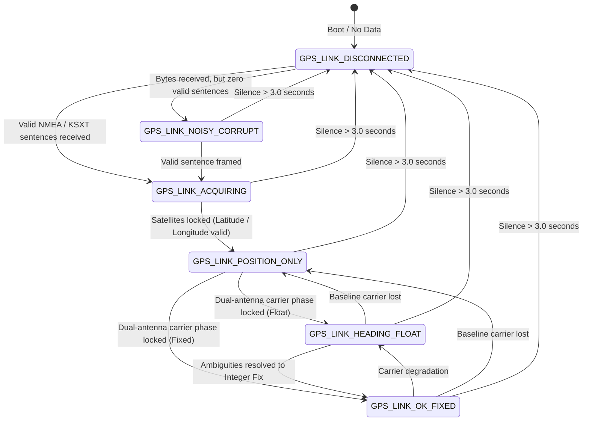

# Visual Display Self-Test & GNSS Link Diagnostic State Machine — Design Specification

* **Feature:** On-Device Display Self-Test Sequence & GNSS Stream Health Diagnostics
* **Status:** Implemented (v0.2-dev / PR #5)
* **Target Hardware:** ESP32-S3 (16 MB Flash, 8 MB OPI PSRAM), 480x480 Round Touch Display (ST7701 + CST8XX), Unicore UM982 GNSS Receiver over UART

---

## 1. Problem Statement & Motivation

Field deployments for microwave amateur radio contests (such as the ARRL 10 GHz & Up Contest) typically take place in remote, high-elevation summit locations under bright outdoor conditions. Operating setups are subject to physical vibration during transport, cable flex, and battery power variations.

Operators need rapid, high-confidence verification of two critical subsystems before and during operation:
1. **Display & Touch Functionality:** Verification that all display rows, color channels (Pure White, Bright Yellow, Bright Red, Cyan, Green), text sizes, touch zones, and layout elements are rendering correctly without hardware pixel defects or controller hangs.
2. **GNSS Stream & Physical Link Health:** Real-time visibility into whether the external dual-antenna receiver (mounted up on the antenna mast) is sending valid data, receiving power, locked onto satellites, or experiencing cable faults.

---

## 2. On-Device Visual Self-Test Architecture

The visual self-test provides an automated, non-destructive sequence that runs directly on the device hardware, exercising all screen elements and verifying internal calculations.

### Invocation Triggers
* **Touchscreen Trigger:** Tapping the bottom firmware version footer on Row 6 ($Y \ge 435\text{ px}$, $100 \le X \le 380\text{ px}$).
* **Serial Command Trigger:** Sending `test` via USB Serial Monitor (115200 baud).

```text
+-------------------------------------------------------------------+
| Row 1: Local Grid + Time                                          |
| Row 2: Target Maidenhead Grid Editor                              |
| Row 3: Antenna Heading + Calibration Pill + Target Bearing        |
| Row 4: Reverse Bearing + Distance                                 |
| Row 5: ARRL Contest Distance                                      |
| Row 6: [ v0.3-dev ] <--- Tap anywhere in footer to trigger test   |
+-------------------------------------------------------------------+
```

### State Preservation & Restoration
Because the self-test temporarily overwrites display buffers and global positioning state, all live variables are saved to stack-allocated variables on entry and fully restored upon completion:

```cpp
void runVisualSelfTest() {
  // Snapshot active operating state
  char saved_remote[7];
  char saved_mygrid[9];
  memcpy(saved_remote, remote, sizeof(saved_remote));
  memcpy(saved_mygrid, mygrid, sizeof(saved_mygrid));
  float saved_mylat = mylatitude, saved_mylon = mylongitude;
  bool saved_hasHeading = hasHeading;
  bool saved_rovdist = rovdist;
  bool saved_isEditing = isEditing;
  BearingQuality saved_quality = currentBearingQuality;
  unsigned long saved_lastHeading = lastHeadingUpdate;
  float saved_calibrationOffset = calibrationOffset;
  UiMode saved_uiMode = currentUiMode;

  // Execute test stages ...

  // Restore live operating state
  memcpy(remote, saved_remote, sizeof(remote));
  memcpy(mygrid, saved_mygrid, sizeof(mygrid));
  mylatitude = saved_mylat;
  mylongitude = saved_mylon;
  hasHeading = saved_hasHeading;
  currentBearingQuality = saved_quality;
  lastHeadingUpdate = saved_lastHeading;
  rovdist = saved_rovdist;
  isEditing = saved_isEditing;
  calibrationOffset = saved_calibrationOffset;
  currentUiMode = saved_uiMode;
  redrawMainScreen();
}
```

### Self-Test Execution Stages

| Stage | Name | Description | UI Display Elements |
| :--- | :--- | :--- | :--- |
| **Stage 1** | **Same Grid (ARRL 1.0 km)** | Injects identical local and remote grids (`CM87wa`). Verifies the ARRL contest minimum distance floor. | Footer: `TEST 1: SAME GRID` (Cyan)<br>Distance: `1.0 k` |
| **Stage 2** | **Mid Distance (< 1,000 km)** | Injects grid `DN13ab` (~$600\text{ km}$). Tests 3-digit distance formatting. | Footer: `TEST 2: DIST < 1000K` (Cyan) |
| **Stage 3** | **Long Distance (> 1,000 km)** | Injects grid `EL29ja` (~$2,500\text{ km}$). Tests 4-digit distance formatting. | Footer: `TEST 3: DIST > 1000K` (Cyan) |
| **Stage 4** | **Extreme Distance & Ghost Recovery** | Injects grid `ZA00AA` (> 10,000 km) then drops back to `CM87wa` (1.0 km) to verify ghost digit erasure. | Footer: `TEST 4: GHOST RECOVERY` (Cyan) |
| **Stage 5** | **Heading Quality Color States** | Cycles the main antenna heading through all visual quality states: Fixed (White), Float (Yellow), and Lost (Red). | Footer: `TEST 5: BEARING WHITE` / `YELLOW` / `RED` |
| **Stage 6** | **Live GNSS Stream Diagnostic** | Pumps Serial2 in background and evaluates the live hardware GNSS stream health. | Footer: `TEST 6: GPS STREAM` (Cyan)<br>Status Card: Fixed (Green), Float/Acquiring (Yellow), or No Data (Red) |
| **Stage 7** | **Antenna Calibration Status & Modal** | Tests uncalibrated/calibrated pill display (+4.2 deg) and demonstrates calibration modal snap button. | Footer: `TEST 7: CAL PILL OFF` / `CAL PILL +4.2` / `CAL MODAL` |
| **Stage 8** | **Rover 4-State Qualification Card** | Cycles Row 5 white card through all 4 Rover states: Transit (<16 km, Red), Qualified ($\ge$16 km, Green), Revisit ($\ge$16 km, Blue), and GPS Lost (Amber status, preserving distance color). | Footer: `TEST 8: ROVER TRANSIT` / `QUALIFIED` / `REVISIT` / `GPS LOST`<br>Row 5: 16-char status card |
| **Stage 9** | **Rover History & 1-Touch Undo Modal** | Opens contest history modal with mock stops and demonstrates long-press discard progress bar. | Footer: `TEST 9: ROVER MODAL` (Yellow)<br>Modal: History dialog & Discard progress |

---

### Non-Blocking GPS Pipeline During Self-Test

To ensure the hardware GNSS receiver stream diagnostic (Stage 6) accurately reflects live receiver status, the self-test sequence avoids blocking `delay()` calls. Instead, a cooperative polling loop (`selfTestDelay()`) periodically services `gpsManager.update(millis())`. 

While `AppController::isSelfTesting()` is active, incoming GPS callbacks update internal stream metrics (`totalBytesReceived_`, `lastByteMillis_`, and NMEA packet counters) while suppressing UI redraws, preventing the 3.0-second silence timeout from triggering a false disconnection warning.

---

---

## 3. GNSS Link Diagnostic State Machine

To prevent operators from guessing whether a lack of heading is caused by a broken cable, a powered-down receiver, or poor satellite geometry, the firmware implements a deterministic link evaluation engine (`evaluateGpsStream`).



### Verdict Definitions (`enum GpsLinkVerdict`)

```cpp
enum GpsLinkVerdict {
  GPS_LINK_DISCONNECTED = 0,   // No bytes received (>3s) or total bytes == 0
  GPS_LINK_NOISY_CORRUPT = 1,  // Raw bytes received, but no valid NMEA/KSXT sentences
  GPS_LINK_ACQUIRING = 2,      // Valid sentences streaming, waiting for satellites
  GPS_LINK_POSITION_ONLY = 3,  // Position valid, waiting for dual-antenna heading
  GPS_LINK_HEADING_FLOAT = 4,  // Dual-antenna heading active in Float mode (Yellow)
  GPS_LINK_OK_FIXED = 5        // Dual-antenna heading active in Fixed mode (White)
};
```

### Evaluation Algorithm
The diagnostic function evaluates the link without side-effects, making it directly testable in unit test suites:

```cpp
GpsLinkVerdict evaluateGpsStream(
    unsigned long now,
    unsigned long totalBytes,
    unsigned long lastByteTime,
    unsigned int gllCount,
    unsigned int ksxtCount,
    unsigned int hdtCount,
    bool hasLoc,
    bool hasHdg,
    BearingQuality quality)
{
  if (totalBytes == 0 || (now - lastByteTime > 3000)) {
    return GPS_LINK_DISCONNECTED;
  }
  if (gllCount == 0 && ksxtCount == 0 && hdtCount == 0) {
    return GPS_LINK_NOISY_CORRUPT;
  }
  if (hasHdg) {
    if (quality == BEARING_FIXED) return GPS_LINK_OK_FIXED;
    if (quality == BEARING_FLOAT) return GPS_LINK_HEADING_FLOAT;
  }
  if (hasLoc) {
    return GPS_LINK_POSITION_ONLY;
  }
  return GPS_LINK_ACQUIRING;
}
```

---

## 4. Interactive Serial Diagnostics

When diagnosing field setup issues with a laptop or terminal over USB, the firmware provides structured reports:

* **Commands:** `status`, `gps`, or `help`.
* **Output Information:**
  * Physical serial link status, byte counter, and timestamp of last received byte.
  * Message stream counters for `$GNGLL`, `$KSXT`, and legacy `$GNHDT`/`$GNTHS`.
  * Fix status: Local Maidenhead grid, satellite time, antenna heading, and carrier quality.
  * Context-specific troubleshooting guidance (e.g., checking GX12 connectors, 5V/12V power rails, or 115200 baud mismatch).

